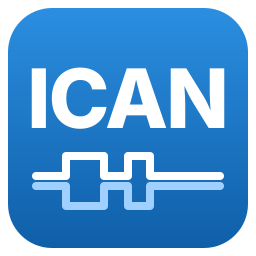
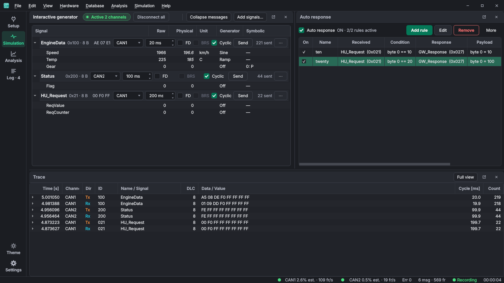
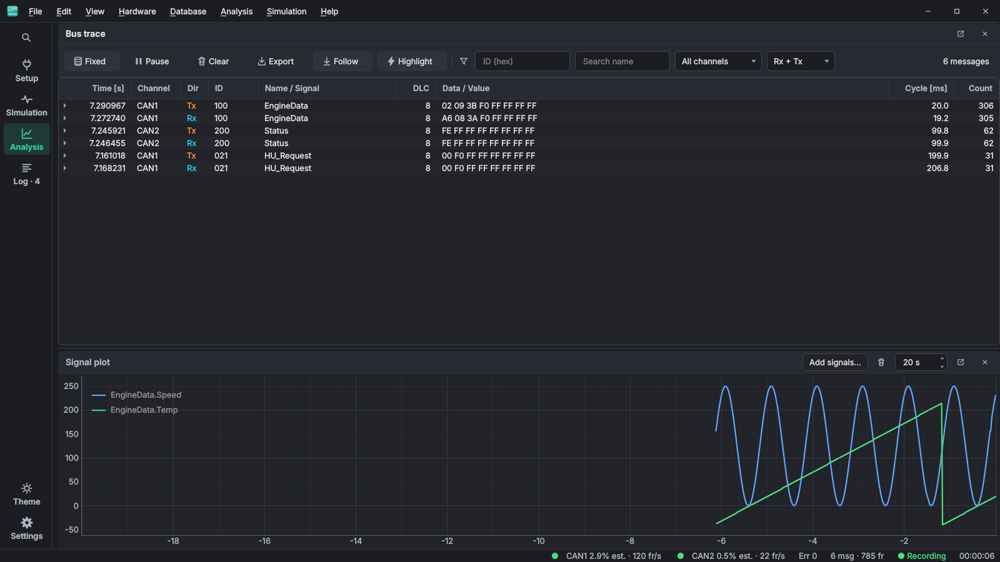
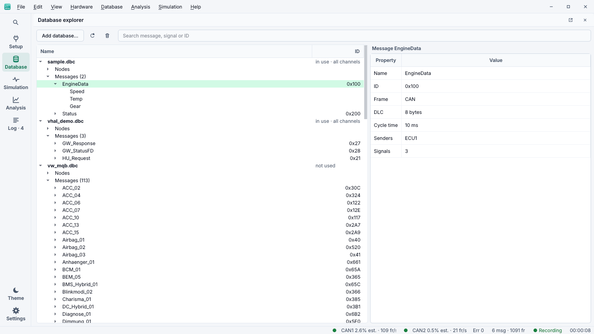

<div align="center">



# AutoSim Studio

**Simulate, observe and answer CAN / CAN FD traffic from your desk, without the car.**

A desktop tool for automotive engineers: load a DBC, connect a USB adapter (or none at all), and drive real ECUs or an
Android head unit with signals you control. Watch everything in a live trace and plots, and let rules answer requests
automatically.



</div>

---

## Why AutoSim Studio

Bench and head-unit work usually needs either a car, a rest-bus simulation in an expensive commercial tool, or a pile
of scripts. AutoSim Studio gives you the everyday part of that workflow in one free, focused application:

- **Start in seconds.** Built-in simulated nodes let you try everything with no hardware: pick `SIM1`, connect,
  send.
- **Use cheap hardware.** It works with ESP32-S3 + MCP2518FD boards (open firmware in this repository) and CANable 2.0
  USB adapters. Several adapters run side by side as CAN1, CAN2, and so on.
- **Simulate an Android head unit's car.** A small bridge daemon connects the Android VHAL's SocketCAN to AutoSim,
  so the head unit talks to your simulation as if it were the vehicle.
- **Feels familiar.** The workflow mirrors CANoe: databases, an interactive generator, a trace and a graphics
  window, organised on desktops.

## Features

| | |
|---|---|
| **Interactive generator** | Every message of a DBC as a table row: edit raw or physical values, symbolic value tables, cyclic or single-shot transmission, per-message channel and FD / BRS. Signal generators: sine, ramp, square, toggle. |
| **Auto response** | Rules such as *"when 0x21 carries 10, send 0x27 with 10"*: match raw bytes or DBC signals, respond with bytes or signal values, add delays and expressions, with a loop guard and hit counters. |
| **Bus trace** | A fixed view (one row per message, with decoded signals) or a chronological view. Filters, payload-change highlighting, Ctrl+C copy, export to CSV / ASC / BLF. Smooth at thousands of frames per second. |
| **Signal plot** | Live curves of any decoded signal, picked from a searchable dialog. |
| **Databases** | DBC, ARXML, KCD and SYM. A CANoe-style explorer (nodes > Tx messages > signals, properties). Each database can be assigned to all channels or to one channel, and switched on or off without removing it. |
| **Multi-channel CAN FD** | Classic CAN and CAN FD up to 8 Mbit/s data rate (hardware permitting), several channels at once, a per-channel status dot, and estimated bus load and frame rate. |
| **Workspace** | Desktops (Setup, Database, Simulation, Analysis), detachable windows for a second monitor, light and dark themes, a command palette (Ctrl+K), and saved layout, databases and projects. |

<table>
<tr>
<td></td>
<td></td>
</tr>
<tr>
<td align="center"><b>Analysis</b>: bus trace and live signal plot</td>
<td align="center"><b>Database</b>: CANoe-style explorer and properties</td>
</tr>
</table>

## Supported hardware

| Adapter | Connection | Notes |
|---|---|---|
| **Simulated node** (`SIM1`, `SIM2`, …) | built in | Loops frames back. Ideal for learning and demos. |
| **ESP32-S3 + MCP2518FD** | USB serial (921 600 Bd or native USB) | Open firmware and Arduino library in [`firmware/esp32_can_node`](firmware/esp32_can_node); detects the 20 / 40 MHz crystal automatically. |
| **CANable 2.0** (STM32G431, slcan) | USB CDC | Patched firmware with robust bit timing in [`firmware/canable2_stm32`](firmware/canable2_stm32). |
| **Android head unit** | TCP (`bridge://`) via adb or Ethernet | The `autosim-bridge` daemon bridges the VHAL's vcan to AutoSim. |

## Quick start

**Windows installer:** run `AutoSimStudio-Setup-<version>.exe` (see [Setup](docs/SETUP.md#1-install-the-app-windows)).

**From source** (Windows, Linux or macOS, with Python 3.11 managed by [uv](https://docs.astral.sh/uv/)):

```bash
git clone <this repository> && cd CAN_SIMULATOR
uv sync
uv run autosim
```

Then try it with no hardware:

1. **Setup** desktop (Ctrl+1): port `SIM1` → **Connect**.
2. **Database** desktop (Ctrl+2): **Add database…** → `tests/data/sample.dbc`.
3. **Simulation** desktop (Ctrl+3): **Add signals…** → tick `EngineData` → enable **Cyclic**. Set *Speed* to a
   *Sine* generator.
4. **Analysis** desktop (Ctrl+4): watch the trace, then **Add signals…** in the plot to see the sine.

## Documentation

| Document | What is inside |
|---|---|
| [Setup](docs/SETUP.md) | Install the app, the development environment, ESP32 / CANable / Android bridge |
| [User guide](docs/USER_GUIDE.md) | Desktops, windows and everyday workflows step by step |
| [System design](docs/design/SYSTEM_DESIGN.md) | Context, goals, requirements, key decisions |
| [High-level design](docs/design/HLD.md) | Architecture, components, data flow, threads |
| [Low-level design](docs/design/LLD.md) | Modules, classes, protocols, algorithms, sequences |
| [Deployment](docs/DEPLOYMENT.md) | Deployment diagrams, build and packaging |
| [Benchmark](docs/BENCHMARK.md) | Performance and limits: signals/s, 1 ms cycles, trace capacity, latency |
| [All documents](docs/README.md) | Index, including hardware and Android references |

## Project status

AutoSim Studio is under active development: about 300 automated tests that run headless (no display needed). The CAN
engine, the hardware back-ends and the UI are covered. Hardware-in-the-loop tests for CANable adapters are opt-in
(`AUTOSIM_HW=1`).

## Contributing

```bash
uv sync                    # dev dependencies included
uv run pytest              # full test suite (Qt runs offscreen in CI: QT_QPA_PLATFORM=offscreen)
uv run ruff check src      # lint
```

The [high-level](docs/design/HLD.md) and [low-level](docs/design/LLD.md) designs explain where things live. Section
*Extending* in the LLD shows how to add an adapter type, a generator or a window.
