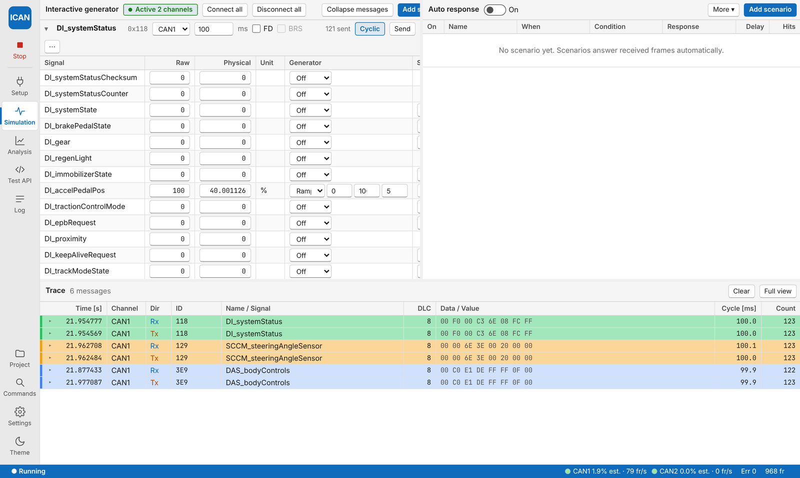
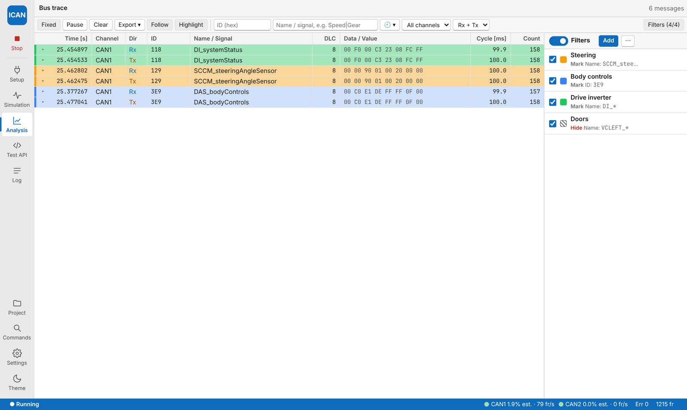
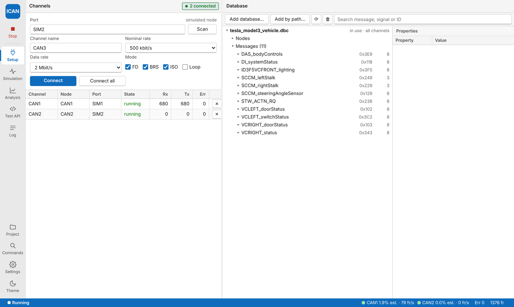
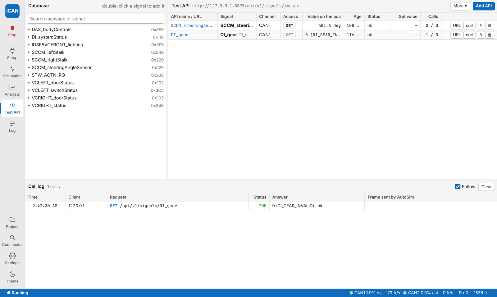
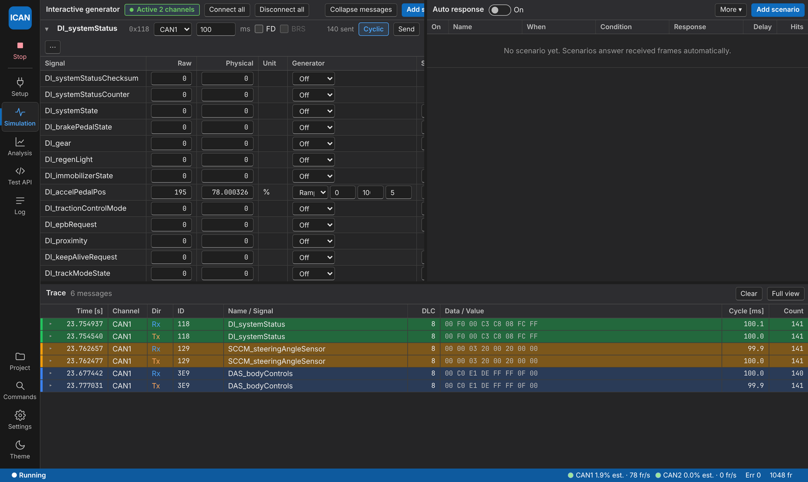

<div align="center">


# ICAN · AutoSim Studio

**Simulate, observe and answer CAN / CAN FD traffic from your desk, without the car.**

A desktop tool for automotive engineers:

- Load a DBC and connect a USB adapter, or none at all.
- Drive real ECUs or an Android head unit with signals you control.
- Watch everything in a live trace with colour filters, and let rules answer requests automatically.
- Test systems can read and write signals over HTTP.

[**Download for Windows**](https://github.com/Thuongst97/CAN_SIMULATOR/releases/latest) ·
[What's new](docs/RELEASE_NOTES.md) · [Performance](docs/PERFORMANCE.md)



</div>

---

## Why ICAN

Bench and head-unit work usually needs one of three things: a car, a rest-bus simulation in an expensive commercial
tool, or a pile of scripts. ICAN gives you the everyday part of that workflow in one free, focused application:

- **Start in seconds.** Built-in simulated nodes let you try everything with no hardware: pick `SIM1`, connect,
  press **Start** (`F9`).
- **Feels familiar.** The workflow mirrors CANoe, organised on desktops:
  - measurement Start / Stop;
  - databases;
  - an interactive generator;
  - auto response;
  - a trace.
- **Smooth with big databases and busy buses.** The window paints in its own process while the CAN engine runs in
  the background. The trace stays at 60 frames/s with a 1 500-message database and 10 000 frames/s, and a large DBC
  never freezes the window ([measured](docs/PERFORMANCE.md)).
- **Use the hardware you have.** It works with ESP32-S3 + MCP2518FD boards (open firmware in this repository),
  CANable 2.0 and PEAK PCAN USB adapters. Several adapters run side by side as CAN1, CAN2, and so on.
- **Simulate an Android head unit's car.** A small bridge daemon connects the Android VHAL's SocketCAN to ICAN, so
  the head unit talks to your simulation as if it were the vehicle.
- **Plug it into test automation.** The Test API publishes CAN signals as HTTP endpoints for pytest, Robot Framework,
  Jenkins and similar tools.

## Features

| | |
|---|---|
| **Measurement** | **Start / Stop** like CANoe (`F9`). When stopped, nothing is sent, answered or traced. Messages switched to Cyclic are *armed* and start with the measurement. Checks run before Start (no channel, channel errors). An adapter that fails while running is reported, or stops the measurement. |
| **Interactive generator** | Every message of a DBC as a table row: edit raw or physical values and symbolic value tables, send cyclically or once, choose the channel and FD / BRS per message. Signal generators: sine, ramp, square, toggle. |
| **Auto response** | Rules such as *"when 0x21 carries 10, send 0x27 with 10"*: match raw bytes or DBC signals, respond with bytes or signal values, add delays and expressions. A loop guard and hit counters are included. |
| **Bus trace** | A fixed view (one row per message, with decoded signals) or a chronological view. Name filter (`Speed\|Gear`, `ADRV_*`, `!CHECKSUM`) with the 5 recent filters. Payload-change highlighting. Export to CSV / ASC / BLF. |
| **Trace filters** | Like a logcat viewer: named filters by CAN ID or range (`100-1FF`) or by message / signal name. Each one **Marks** rows with a colour, **Shows only** the matching rows or **Hides** them, and has its own on / off switch. Right-click a row to add one. Export / import as JSON. |
| **Test API** | Publish a signal with a double-click. Test systems then `GET /api/v1/signals/<name>` its live value as JSON, or `PUT` a value to send a frame. A call log shows each request, its response and the frame sent. See the [guide](docs/TEST_API_GUIDE.md). |
| **Databases** | DBC, ARXML, KCD and SYM. A CANoe-style explorer: nodes > Tx messages > signals, with properties and DLC / FD. Each database can be assigned to all channels or to one, and switched on or off. Fast search, even with 24 000 signals. |
| **Multi-channel CAN FD** | Classic CAN and CAN FD up to 8 Mbit/s data rate (hardware permitting), several channels at once, a status per channel, and estimated bus load and frame rate. |
| **Projects and signal boards** | Save / open a **project** (databases, channels, rules, signals) or a **signal board** (the generator table and rules). The file format is the same as the 1.0 desktop app's. |
| **Workspace** | Desktops (Setup, Simulation, Analysis, Test API), a Windows engineering-tool look (Fluent) in light and dark, a **command palette** (`Ctrl+K`), **Settings** (`Ctrl+,`), native Open / Save dialogs, and the window position remembered between runs. |
| **Web mode** | The same simulator in any browser, also from other PCs (token protected), with an HTTP / WebSocket API for scripts and test benches. See [Web mode](docs/WEB_MODE.md). |

<table>
<tr>
<td></td>
<td></td>
</tr>
<tr>
<td align="center"><b>Analysis</b>: bus trace with Mark / Hide filters</td>
<td align="center"><b>Setup</b>: channels beside the CANoe-style database explorer</td>
</tr>
<tr>
<td></td>
<td></td>
</tr>
<tr>
<td align="center"><b>Test API</b>: signals published for test systems, with the call log</td>
<td align="center"><b>Simulation</b> in the dark theme</td>
</tr>
</table>

## Supported hardware

| Adapter | Connection | Notes |
|---|---|---|
| **Simulated node** (`SIM1`, `SIM2`, …) | built in | Loops frames back. Ideal for learning and demos. |
| **ESP32-S3 + MCP2518FD** | USB serial (921 600 Bd or native USB) | Open firmware and Arduino library in [`firmware/esp32_can_node`](firmware/esp32_can_node). It detects the 20 / 40 MHz crystal automatically. |
| **CANable 2.0** (STM32G431, slcan) | USB CDC | Patched firmware with robust bit timing in [`firmware/canable2_stm32`](firmware/canable2_stm32). |
| **PEAK PCAN** (PCAN-USB, PCAN-USB FD, PCAN-USB Pro FD, …) | PEAK driver (PCAN-Basic) | Classic CAN on every model, CAN FD on the FD models. Needs PEAK's free driver; the app links to it when it is missing. |
| **Android head unit** | TCP (`bridge://`) via adb or Ethernet | The `autosim-bridge` daemon bridges the VHAL's vcan to ICAN. |

## Quick start

**Windows:** download `AutoSim.Studio_<version>_x64-setup.exe` from
[Releases](https://github.com/Thuongst97/CAN_SIMULATOR/releases/latest) and run it.

- Windows 10 / 11, 64-bit; Python is included.
- If WebView2 is missing, the installer downloads it.
- The Test API listens on `http://127.0.0.1:8765` while the app runs.

Then try it with no hardware:

1. **Setup** desktop (`Ctrl+1`): port `SIM1` → **Connect**.
2. Same desktop, *Database*: **Add database…** → `tests/data/sample.dbc` (or your DBC).
3. **Simulation** desktop (`Ctrl+2`): **Add signals…** → tick `EngineData` → **Cyclic**. Set *Speed* to a *Sine*
   generator.
4. Press **Start** at the top of the left bar (`F9`). The trace fills, and *Speed* follows the sine (expand
   *EngineData* ▸).
5. **Analysis** desktop (`Ctrl+3`) → **Filters** → **Add**, or right-click a row to colour, show only or hide
   messages.

**From source** (Windows, Linux or macOS, with Python 3.11 managed by [uv](https://docs.astral.sh/uv/)):

```bash
git clone <this repository> && cd CAN_SIMULATOR
uv sync --extra web
uv run autosim                     # ICAN in an app window (Edge / Chrome), measurement stopped: press Start (F9)
uv run autosim-web                 # web mode for browsers and test benches (http://127.0.0.1:8765)
```

The desktop app (Tauri) needs Node 22 and Rust. Run it with the backend from source:

```bash
cd tauri && npm ci
AUTOSIM_BACKEND="uv run --extra web python -m autosim.web" npx tauri dev
```

The build steps (PyInstaller backend, then `npx tauri build`) are in [docs/TAURI.md](docs/TAURI.md). The previous
PySide6 desktop app (1.0) still runs with `uv run autosim-qt`; it is the only one with the signal plot.

## Documentation

| Document | What is inside |
|---|---|
| [Setup](docs/SETUP.md) | Install the app, the development environment, ESP32 / CANable / PCAN / Android bridge |
| [User guide](docs/USER_GUIDE.md) | Desktops, windows and everyday workflows step by step |
| [Desktop app (Tauri)](docs/TAURI.md) | How the app works, build, develop |
| [Web mode](docs/WEB_MODE.md) | The simulator in a browser, its HTTP / WebSocket API, settings, project / board files |
| [Test API guide](docs/TEST_API_GUIDE.md) | Read / write CAN signals from a test system: requests, JSON, errors |
| [Performance](docs/PERFORMANCE.md) | PySide6 vs. Tauri: database load, trace frame rate and latency, what was made faster |
| [Benchmark](docs/BENCHMARK.md) | Engine limits: signals/s, 1 ms cycles, trace capacity, latency |
| [System design](docs/design/SYSTEM_DESIGN.md) · [HLD](docs/design/HLD.md) · [LLD](docs/design/LLD.md) · [Web architecture](docs/design/WEB_ARCHITECTURE.md) | Context and decisions, architecture, modules and protocols |
| [Deployment](docs/DEPLOYMENT.md) | Deployment diagrams, build and packaging |
| [Release notes](docs/RELEASE_NOTES.md) | What is new in 1.2.1 ([1.2.0](docs/RELEASE_NOTES_1.2.0.md), [1.1](docs/RELEASE_NOTES_1.1.0.md), [1.0](docs/RELEASE_NOTES_1.0.0.md)) |
| [All documents](docs/README.md) | Index, including hardware and Android references |

## Project status

ICAN is under active development, with about 430 automated tests:

- **Python** (pytest), headless: no display is needed.
- **Browser end-to-end tests** (Playwright) for the web UI.
- **Coverage**: the CAN engine, the hardware back-ends, web mode, the Test API and the desktop features.
- **Hardware-in-the-loop** tests for CANable adapters are opt-in (`AUTOSIM_HW=1`).
- **CI** builds the Windows installer, checks that the app starts its backend and stops it on exit, and publishes
  the releases.

## Contributing

```bash
uv sync --extra web          # dev dependencies included
uv run pytest                # full test suite (Qt runs offscreen in CI: QT_QPA_PLATFORM=offscreen)
uv run ruff check src        # lint
```

The [high-level](docs/design/HLD.md) and [low-level](docs/design/LLD.md) designs explain where things live. Section
*Extending* in the LLD shows how to add an adapter type, a generator or a window. The performance tools are in
`tools/perf/` (see [Performance](docs/PERFORMANCE.md)).
