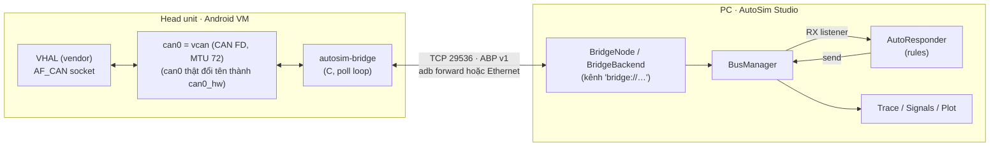

# Android VHAL bridge + Auto response

Đây là phần implement của **Proposal B (vcan + bridge)** trong [VIRTUAL_CAN_PROPOSAL.md](VIRTUAL_CAN_PROPOSAL.md).
Trước khi triển khai, khảo sát máy bằng [ANDROID_ENV_CHECKLIST.md](ANDROID_ENV_CHECKLIST.md) (`scripts\android_bridge.cmd check`).
Các layer CAN trong Android, điểm simulate và sơ đồ kết nối: [ANDROID_CAN_LAYERS.md](ANDROID_CAN_LAYERS.md)
(bản vẽ đầy đủ: [vhal_bridge_architecture.html](vhal_bridge_architecture.html), mở bằng trình duyệt).
VHAL trong Android VM vẫn mở `AF_CAN` socket như bình thường. Interface nó dùng được thay bằng một **vcan**,
và daemon `autosim-bridge` chuyển frame qua lại với AutoSim Studio. AutoSim trả lời theo các **rule auto
response** do người dùng cài sẵn trong giao diện.



| Thành phần | File |
|---|---|
| Daemon trong Android (C) | `bridge/autosim-bridge/autosim_bridge.c`, `abp.h` |
| Build Android / NDK / host | `Android.bp`, `build_ndk.sh`, `Makefile` |
| Init + SELinux (template để tích hợp vào image) | `autosim-bridge.rc`, `sepolicy/` |
| Tạo / khôi phục vcan trên HU | `bridge/autosim-bridge/autosim_vcan.sh` |
| Triển khai qua adb | `scripts/android_bridge.cmd` (Windows), `bridge/autosim-bridge/android_bridge.sh` (Linux/macOS) |
| Khảo sát môi trường Android | `bridge/autosim-bridge/android_env_check.sh` (lệnh `check` của script trên), [ANDROID_ENV_CHECKLIST.md](ANDROID_ENV_CHECKLIST.md) |
| Phía AutoSim: protocol, kênh, bridge Python mẫu | `src/autosim/hardware/bridge/` (`protocol.py`, `node.py`, `sim_bridge.py`) |
| Engine auto response (không phụ thuộc Qt) | `src/autosim/core/can_engine/auto_response.py` |
| Giao diện | `src/autosim/ui/panels/auto_response_panel.py` |
| Ví dụ | `examples/vhal_demo.dbc`, `examples/auto_response_raw.json`, `examples/auto_response_dbc.json` |

---

## 1. Chạy thử không cần head unit (5 phút)

```
uv run python -m autosim.hardware.bridge.sim_bridge --demo
```

Lệnh này chạy bridge viết bằng Python với một "VHAL giả": cứ mỗi giây nó gửi `0x21` với byte 0 lần lượt là
10, rồi 20, và in ra mọi frame mà AutoSim trả về. Tiếp theo, trong AutoSim:

1. **Channels** → Port `bridge://127.0.0.1:29536` → **Connect** (bảng kênh hiện `android:demo-vhal` · running).
2. Panel **Auto response** (tab cạnh *Signal plot*) → **More → Import rules…** → chọn `examples/auto_response_raw.json`.
3. Tick **Auto response**. Cửa sổ demo in ra:

```
VHAL  -> 0x021   10   [0a 00 00 00 00 00 00 00]
VHAL  <- 0x027  [0a 00 00 00 00 00 00 00]
VHAL  -> 0x021   20   [14 00 00 00 00 00 00 00]
VHAL  <- 0x027  [64 00 00 00 00 00 00 00]
```

Trên Linux có vcan thì có thể dùng kernel thật thay cho VHAL giả:
`sudo ip link add dev vcan0 type vcan && sudo ip link set vcan0 mtu 72 up`, chạy
`python -m autosim.hardware.bridge.sim_bridge -i vcan0`, rồi dùng `cansend vcan0 021#0A` và `candump vcan0` để đóng vai VHAL.

## 2. Trên head unit

Yêu cầu:
- Bản build **userdebug / eng** (cần `adb root`).
- Kernel của Android VM có `CONFIG_CAN_RAW` và `CONFIG_CAN_VCAN`. Kiểm tra bằng
  `adb shell "zcat /proc/config.gz | grep -E 'CAN_(RAW|VCAN)'"`. Nếu chưa có thì phải build `vcan.ko` khớp với
  kernel (GKI vendor module).

### 2.1 Build binary

| Cách | Lệnh | Kết quả |
|---|---|---|
| NDK (nhanh, không cần cây AOSP) | `scripts\android_bridge.cmd build` (Windows) hoặc `ANDROID_NDK_HOME=… bridge/autosim-bridge/build_ndk.sh` | `bridge/autosim-bridge/out/<abi>/autosim-bridge` (static) |
| Trong cây AOSP / vendor | copy thư mục `bridge/autosim-bridge` vào vendor tree, thêm `PRODUCT_PACKAGES_DEBUG += autosim-bridge autosim_vcan.sh` và `BOARD_VENDOR_SEPOLICY_DIRS += …/sepolicy` | `/vendor/bin/autosim-bridge` |

### 2.2 Triển khai qua adb (bench, không cần build lại image)

```
scripts\android_bridge.cmd deploy -RestartVhal
```

Lệnh này làm lần lượt các bước sau (có thể làm tay, xem bảng bên dưới):

| Bước | Lệnh tương đương |
|---|---|
| root | `adb root` |
| copy file | `adb push autosim-bridge autosim_vcan.sh /data/local/tmp/` |
| thay can0 bằng vcan | `adb shell sh /data/local/tmp/autosim_vcan.sh takeover can0`: `can0` thật đổi tên thành `can0_hw` (giữ down), rồi tạo vcan tên `can0` với MTU 72 (CAN FD) |
| VHAL mở lại interface | `-RestartVhal`: kill process VHAL để init khởi động lại; VHAL bind socket theo ifindex nên phải mở lại mới thấy vcan |
| chạy bridge | `adb shell "setsid nohup /data/local/tmp/autosim-bridge -i can0 -b 127.0.0.1 -p 29536 > /data/local/tmp/autosim-bridge.log 2>&1 &"` |
| nối tới PC | `adb forward tcp:29536 tcp:29536` |

Sau đó trong AutoSim: **Channels** → `bridge://127.0.0.1:29536` → **Connect**. AutoSim cũng tự chạy
`adb forward` nếu kết nối tới 127.0.0.1 bị từ chối.

Các biến thể:
- VHAL cấu hình được tên interface: `-Mode add -Interface vcan0` (chỉ tạo `vcan0`, không đụng `can0`).
- Kết nối qua Ethernet thay vì adb: `-Bind 0.0.0.0`, rồi ở AutoSim nhập `bridge://<IP của HU>:29536`.
- SELinux chặn socket (xem bằng `adb logcat | grep avc`): thêm `-Permissive` (chạy `setenforce 0` đến lần reboot sau).
- Trả HU về như cũ: `scripts\android_bridge.cmd restore -RestartVhal`. Xem trạng thái: `status`. Xem log: `log`.

### 2.3 Tích hợp vào image (boot-time)

`autosim-bridge.rc` dùng các property sau:
- `persist.vendor.autosim.enable=1`: ở `early-boot`, trước khi class `hal` (VHAL) chạy, init gọi
  `autosim_vcan.sh takeover can0` rồi start bridge.
- `persist.vendor.autosim.mode`, `persist.vendor.autosim.if`, `persist.vendor.autosim.bind`: chọn chế độ, tên
  interface và địa chỉ lắng nghe.

`sepolicy/` cho domain `autosim_bridge` quyền `can_socket` (kèm ioctl `SIOCGIFINDEX/MTU/FLAGS`) và quyền làm TCP server.
Đây là **template**: trên nhiều cây, `ip` (iproute2) chỉ có ở `/system` nên script vendor không gọi được. Khi đó hãy
tạo vcan ngay trong script setup CAN sẵn có của platform. Chỉ đưa các file này vào bản build debug.

## 3. Auto response trong AutoSim

Panel **Auto response** (Ctrl+K → "Auto response", hoặc tổ hợp phím **Ctrl+Shift+R** để bật/tắt):

- **Auto response** (checkbox): công tắc tổng. Các rule áp dụng cho frame **nhận** trên mọi kênh (bridge, CANable, SIM).
- **Add rule / Edit / Remove**, và **More → Duplicate, Reset hit counters, Import / Export rules**. Ô **On** của
  từng dòng bật/tắt riêng một rule. Cột **Hits** đếm số lần đã trả lời.
- Rule được lưu tự động, nên mở lại app vẫn còn, và cũng được lưu trong project file (*Save project*).

### Một rule gồm

**When received**
- *Channel*: chọn một kênh cụ thể hoặc *Any channel*.
- *Message*: chọn message trong DBC, hoặc gõ ID (`0x21`; với ID 29-bit thì tick *29-bit*).
- *Condition*:
  - *Any data*: mọi frame có ID này đều khớp.
  - *Signal value (DBC)*: so sánh giá trị vật lý của signal (`==`, `!=`, `<`, `<=`, `>`, `>=`).
  - *Raw bytes*: đọc số nguyên tại một byte offset, độ dài 1/2/3/4/8 byte, theo thứ tự Intel (LE) hoặc Motorola (BE).

**Then send**
- *Channel*: *Same channel as received* (mặc định) hoặc một kênh khác.
- *Message* hoặc ID, cùng các cờ FD và BRS.
- *Payload*:
  - *Signal values (DBC)*: điền giá trị cho từng signal; ô để trống thì lấy giá trị initial. Bit không dùng được pad
    bằng 1, giống mọi message DBC khác mà AutoSim gửi.
  - *Raw bytes*: chọn độ dài, chuỗi hex làm nền, và một *Value* ghi vào vị trí byte / size / order đã chọn.
- *Value* nhận một con số (`10`, `0x64`) hoặc biểu thức theo **`rx`**, tức giá trị mà condition vừa đọc được
  (`rx`, `rx * 10`, `rx + 1`).
- *Delay*: tính bằng ms; 0 nghĩa là gửi ngay.

Dòng *Preview* ở cuối dialog cho thấy chính xác frame sẽ được gửi, hoặc báo lỗi nếu rule chưa hợp lệ.

Ví dụ anh đưa (`examples/auto_response_*.json`):

| Rule | When received | Then send |
|---|---|---|
| 1 | 0x21, byte 0 == 10 (hoặc `ReqValue == 10`) | 0x27, byte 0 = 10 (hoặc `RespValue = 10`) |
| 2 | 0x21, byte 0 == 20 (hoặc `ReqValue == 20`) | 0x27, byte 0 = 100 (hoặc `RespValue = 100`) |

Nếu một frame khớp nhiều rule thì **mọi** rule khớp đều được gửi. Có một cơ chế bảo vệ chống vòng lặp: rule nào gửi
quá 1000 lần trong 1 giây sẽ tự tắt và ghi lý do vào log. Trường hợp điển hình là rule trả lời chính frame của nó
trên một kênh loopback.

## 4. Protocol ABP v1 (TCP)

Mỗi packet có dạng `0xAB | type | u16 length (LE) | payload`. Nội dung từng loại packet:

| Type | Hướng | Payload |
|---|---|---|
| `0x01` HELLO | bridge → PC khi vừa kết nối; PC trả lời lại | u16 version, u16 caps (bit0 = FD), tên interface, tên phần mềm |
| `0x02` FRAME | hai chiều | u32 id, u8 flags (EXT, FD, BRS, ESI, RTR), u8 len, u16 reserved, u64 timestamp µs, data |
| `0x03` PING / `0x04` PONG | hai chiều | echo |
| `0x05` STATUS | bridge → PC, mỗi giây | rx, tx, tx_errors, dropped, can_up |
| `0x06` ERROR | bridge → PC | u16 code (1 write, 2 interface down, 3 frame sai, 4 protocol), text |

Bridge xử lý các tình huống sau:
- **Nhiều client**: tối đa 4. Mọi client nhận mọi frame từ CAN, và frame từ client nào cũng được ghi ra CAN.
- **Client chậm**: bridge có buffer gửi riêng cho từng client; nếu đầy thì frame bị bỏ và đếm vào `dropped`,
  không bao giờ block phía CAN.
- **CAN socket đầy** (EAGAIN / ENOBUFS): frame được xếp vào hàng đợi TX 4096 frame và gửi tiếp theo đúng thứ tự.
- **Interface mất hoặc chưa có**: thử lại mỗi giây và gửi ERROR cho client.
- **Client im lặng quá 10 giây**: bị ngắt.

Phía AutoSim xử lý như sau:
- Gửi PING mỗi giây.
- Nếu 5 giây không có dữ liệu thì coi link chết (half-open).
- Tự reconnect mỗi giây khi bridge hoặc adb khởi động lại; kênh chuyển ERROR rồi tự về RUNNING.

## 5. Test

| Test | Nội dung |
|---|---|
| `tests/test_auto_response.py` | condition, payload, biểu thức, delay, kênh, ID 29-bit, loop guard, lưu project, end-to-end qua `CanEngine` |
| `tests/test_bridge.py` | codec, BridgeNode ↔ bridge Python, burst 2000 frame giữ thứ tự, reconnect, link half-open, FD trên interface classic, nhiều client, đường VHAL → auto response → VHAL |
| `tests/test_bridge_c.py` | **binary C** (bản `fake`: "interface" là unix socket SOCK_SEQPACKET mang đúng `struct can_frame` / `canfd_frame`) với AutoSim: hai chiều, 3000 frame mỗi chiều, interface xuất hiện / mất / quay lại, daemon restart, client gửi rác, giới hạn client; chạy được cả với `ABRIDGE_TEST_CFLAGS="-fsanitize=address,undefined"` |
| `tests/test_gui_auto_response.py` | dialog (DBC / raw / lỗi), bảng, công tắc, lưu QSettings và project, import / export, kênh bridge trong Channels, kịch bản của anh chạy qua GUI, loop guard |

**Chưa kiểm được trong môi trường phát triển (cần làm trên bench):**
- Chạy trên kernel Android thật với vcan; container ở đây không có `AF_CAN`. Phần syscall SocketCAN của bridge rất
  mỏng (`socket`, `ioctl`, `bind`, `read`, `write`); phần còn lại đã được test qua bản `fake`.
- Build bằng NDK hoặc Soong.
- Script PowerShell.
- File rc / sepolicy khi tích hợp vào image.
