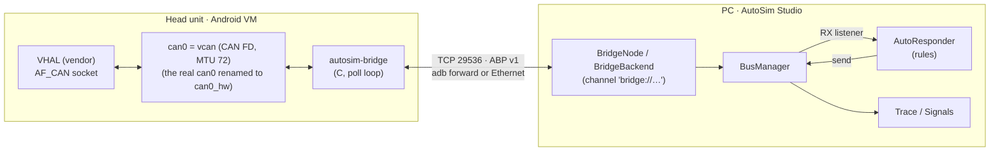

# Android VHAL bridge + auto response

This is the implementation of **Proposal B (vcan + bridge)** from [VIRTUAL_CAN_PROPOSAL.md](VIRTUAL_CAN_PROPOSAL.md).
Before deploying, survey the device with [ANDROID_ENV_CHECKLIST.md](ANDROID_ENV_CHECKLIST.md)
(`scripts\android_bridge.cmd check`). The CAN layers in Android, the simulation point and connection diagrams are
in [ANDROID_CAN_LAYERS.md](ANDROID_CAN_LAYERS.md) (full drawings: [vhal_bridge_architecture.html](vhal_bridge_architecture.html),
open it in a browser).

The VHAL in the Android VM keeps opening its `AF_CAN` socket as usual. The interface it uses is replaced by a
**vcan**, and the `autosim-bridge` daemon forwards frames to and from AutoSim Studio. AutoSim answers them with the
**auto response rules** the user sets up in the UI.



| Component | File |
|---|---|
| Daemon on Android (C) | `bridge/autosim-bridge/autosim_bridge.c`, `abp.h` |
| Android / NDK / host build | `Android.bp`, `build_ndk.sh`, `Makefile` |
| Init + SELinux (templates for image integration) | `autosim-bridge.rc`, `sepolicy/` |
| Create / restore the vcan on the head unit | `bridge/autosim-bridge/autosim_vcan.sh` |
| Deploy over adb | `scripts/android_bridge.cmd` (Windows), `bridge/autosim-bridge/android_bridge.sh` (Linux / macOS) |
| Android environment survey | `bridge/autosim-bridge/android_env_check.sh` (the `check` command of the scripts above), [ANDROID_ENV_CHECKLIST.md](ANDROID_ENV_CHECKLIST.md) |
| AutoSim side: protocol, channel, Python reference bridge | `src/autosim/hardware/bridge/` (`protocol.py`, `node.py`, `sim_bridge.py`) |
| Auto response engine (no Qt) | `src/autosim/core/can_engine/auto_response.py` |
| UI | `src/autosim/ui/panels/auto_response_panel.py` |
| Examples | `examples/vhal_demo.dbc`, `examples/auto_response_raw.json`, `examples/auto_response_dbc.json` |

---

## 1. Try it without a head unit (5 minutes)

```
uv run python -m autosim.hardware.bridge.sim_bridge --demo
```

This runs the Python bridge with a "fake VHAL": every second it sends `0x21` with byte 0 = 10, then 20, and prints
every frame AutoSim sends back. Then, in AutoSim:

1. **Setup** desktop → *Channels* → port **VIRTUAL CAN** (= `bridge://127.0.0.1:29536`) → **Connect** (the channel table shows
   `android:demo-vhal` · running).
2. **Simulation** desktop → *Auto response* → **More → Import rules…** → `examples/auto_response_raw.json`.
3. Tick **Auto response**. The demo window prints:

```
VHAL  -> 0x021   10   [0a 00 00 00 00 00 00 00]
VHAL  <- 0x027  [0a 00 00 00 00 00 00 00]
VHAL  -> 0x021   20   [14 00 00 00 00 00 00 00]
VHAL  <- 0x027  [64 00 00 00 00 00 00 00]
```

On Linux with vcan you can use the real kernel instead of the fake VHAL:
`sudo ip link add dev vcan0 type vcan && sudo ip link set vcan0 mtu 72 up`, run
`python -m autosim.hardware.bridge.sim_bridge -i vcan0`, then play the VHAL with `cansend vcan0 021#0A` and
`candump vcan0`.

## 2. On the head unit

Requirements:
- A **userdebug / eng** build (`adb root` is needed).
- The Android VM kernel has `CONFIG_CAN_RAW` and `CONFIG_CAN_VCAN`. Check with
  `adb shell "zcat /proc/config.gz | grep -E 'CAN_(RAW|VCAN)'"`. Without them, build a `vcan.ko` that matches the
  kernel (GKI vendor module).

### 2.1 Build the binary

| Way | Command | Result |
|---|---|---|
| NDK (fast, no AOSP tree) | `scripts\android_bridge.cmd build` (Windows) or `ANDROID_NDK_HOME=… bridge/autosim-bridge/build_ndk.sh` | `bridge/autosim-bridge/out/<abi>/autosim-bridge` (static) |
| In the AOSP / vendor tree | copy `bridge/autosim-bridge` into the vendor tree, add `PRODUCT_PACKAGES_DEBUG += autosim-bridge autosim_vcan.sh` and `BOARD_VENDOR_SEPOLICY_DIRS += …/sepolicy` | `/vendor/bin/autosim-bridge` |

### 2.2 Deploy over adb (bench, no image rebuild)

```
scripts\android_bridge.cmd deploy -RestartVhal
```

It performs these steps (they can be done by hand, see the table):

| Step | Equivalent command |
|---|---|
| root | `adb root` |
| copy files | `adb push autosim-bridge autosim_vcan.sh /data/local/tmp/` |
| replace can0 by a vcan | `adb shell sh /data/local/tmp/autosim_vcan.sh takeover can0`: the real `can0` is renamed `can0_hw` (kept down), then a vcan named `can0` is created with MTU 72 (CAN FD) |
| VHAL reopens the interface | `-RestartVhal`: kills the VHAL process so init restarts it; the VHAL binds its socket by ifindex, so it must reopen to see the vcan |
| run the bridge | `adb shell "setsid nohup /data/local/tmp/autosim-bridge -i can0 -b 127.0.0.1 -p 29536 > /data/local/tmp/autosim-bridge.log 2>&1 &"` |
| connect to the PC | `adb forward tcp:29536 tcp:29536` |

Then in AutoSim: **Setup → Channels** → **VIRTUAL CAN** → **Connect**. AutoSim also runs
`adb forward` itself when a connection to 127.0.0.1 is refused.

Variants:
- The VHAL's interface name is configurable: `-Mode add -Interface vcan0` (only creates `vcan0`, leaves `can0`
  alone).
- Ethernet instead of adb: `-Bind 0.0.0.0`, then enter `bridge://<head unit IP>:29536` in AutoSim.
- SELinux blocks the socket (see `adb logcat | grep avc`): add `-Permissive` (runs `setenforce 0` until the next
  reboot).
- Put the head unit back as it was: `scripts\android_bridge.cmd restore -RestartVhal`. State: `status`. Log: `log`.

### 2.3 Image integration (boot time)

`autosim-bridge.rc` uses these properties:
- `persist.vendor.autosim.enable=1`: at `early-boot`, before the `hal` class (VHAL) starts, init calls
  `autosim_vcan.sh takeover can0` and then starts the bridge.
- `persist.vendor.autosim.mode`, `persist.vendor.autosim.if`, `persist.vendor.autosim.bind`: mode, interface name
  and listen address.

`sepolicy/` gives the `autosim_bridge` domain `can_socket` permissions (with the `SIOCGIFINDEX/MTU/FLAGS` ioctls)
and the right to be a TCP server. These are **templates**: on many trees `ip` (iproute2) exists only in `/system`, so
a vendor script cannot call it. In that case create the vcan in the platform's existing CAN setup script. Put
these files in debug builds only.

## 3. Auto response in AutoSim

The **Auto response** window is on the **Simulation** desktop (also *Simulation → Auto response window*; **Ctrl+Shift+R**
switches all rules on / off):

- **Auto response** (check box): the master switch. Rules apply to frames **received** on any channel (bridge,
  ESP32, CANable, SIM).
- **Add scenario / Edit / Remove**, and **More → Duplicate rule, Reset hit counters, Import rules…, Export rules…**.
  The **On** box of a row switches one rule. **Hits** counts the answers sent.
- Rules are saved automatically (they are there after a restart) and in project files (*File → Save project*).

### A rule

**When received**
- *Channel*: one channel or *Any channel*.
- *Message*: pick a message from the databases, or type an ID (`0x21`; tick *29-bit* for extended IDs).
- *Condition*:
  - *Any data*: every frame with this ID matches.
  - *Signal value (DBC)*: compares the signal's physical value (`==`, `!=`, `<`, `<=`, `>`, `>=`).
  - *Raw bytes*: reads an integer at a byte offset, 1 / 2 / 3 / 4 / 8 bytes long, Intel (LE) or Motorola (BE)
    order.

**Then send**
- *Channel*: *Same channel as received* (default) or another channel.
- *Message* or ID, and the FD and BRS flags.
- *Payload*:
  - *Signal values (DBC)*: a value per signal; empty cells keep the initial value. Unused bits are padded with 1,
    like every DBC message AutoSim sends.
  - *Raw bytes*: a length, a hex base payload, and a *Value* written at the chosen byte / size / order.
- *Value* is a number (`10`, `0x64`) or an expression of **`rx`**, the value the condition just read
  (`rx`, `rx * 10`, `rx + 1`).
- *Delay*: in ms; 0 sends immediately.

The *Preview* line at the bottom of the dialog shows exactly the frame that will be sent, or the problem if the
rule is not valid yet.

Example (`examples/auto_response_*.json`):

| Rule | When received | Then send |
|---|---|---|
| 1 | 0x21, byte 0 == 10 (or `ReqValue == 10`) | 0x27, byte 0 = 10 (or `RespValue = 10`) |
| 2 | 0x21, byte 0 == 20 (or `ReqValue == 20`) | 0x27, byte 0 = 100 (or `RespValue = 100`) |

When a frame matches several rules, **every** matching rule is sent. A loop guard protects the bus: a rule that
sends more than 1 000 times in one second is switched off and the reason is logged. The typical case is a rule
answering its own frame on a loopback channel.

## 4. Protocol ABP v1 (TCP)

Every packet is `0xAB | type | u16 length (LE) | payload`:

| Type | Direction | Payload |
|---|---|---|
| `0x01` HELLO | bridge → PC on connect; the PC answers | u16 version, u16 caps (bit 0 = FD), interface name, software name |
| `0x02` FRAME | both | u32 id, u8 flags (EXT, FD, BRS, ESI, RTR), u8 len, u16 reserved, u64 timestamp µs, data |
| `0x03` PING / `0x04` PONG | both | echo |
| `0x05` STATUS | bridge → PC, every second | rx, tx, tx_errors, dropped, can_up |
| `0x06` ERROR | bridge → PC | u16 code (1 write, 2 interface down, 3 bad frame, 4 protocol), text |

The bridge handles:
- **Several clients**: up to 4. Every client receives every frame from CAN, and frames from any client are written
  to CAN.
- **Slow clients**: a send buffer per client; when it is full, frames are dropped and counted in `dropped`. The CAN
  side never blocks.
- **CAN socket full** (EAGAIN / ENOBUFS): frames wait in a TX queue of 4 096 frames and are sent in order.
- **Interface missing or gone**: retried every second, with ERROR sent to the clients.
- **Client silent for more than 10 seconds**: disconnected.

AutoSim:
- Sends PING every second.
- Treats 5 seconds without data as a dead (half-open) link.
- Reconnects every second when the bridge or adb restarts; the channel goes to ERROR and back to RUNNING by
  itself.

## 5. Tests

| Test | Covers |
|---|---|
| `tests/test_auto_response.py` | conditions, payloads, expressions, delay, channels, 29-bit IDs, loop guard, project files, end to end through `CanEngine` |
| `tests/test_bridge.py` | codec, BridgeNode ↔ Python bridge, a 2 000-frame burst keeps its order, reconnect, half-open link, FD on a classic interface, several clients, the VHAL → auto response → VHAL path |
| `tests/test_bridge_c.py` | the **C binary** (`fake` build: the "interface" is a unix `SOCK_SEQPACKET` socket carrying real `struct can_frame` / `canfd_frame`) with AutoSim: both directions, 3 000 frames each way, interface appearing / disappearing / returning, daemon restart, a client sending garbage, the client limit; also runs with `ABRIDGE_TEST_CFLAGS="-fsanitize=address,undefined"` |
| `tests/test_gui_auto_response.py` | rule dialog (DBC / raw / errors), table, switches, QSettings and project persistence, import / export, the bridge channel in Channels, the example scenario through the GUI, loop guard |

**Not verifiable in the development environment (to be done on a bench):**
- Running on a real Android kernel with vcan; the development container has no `AF_CAN`. The bridge's SocketCAN
  syscalls are a thin layer (`socket`, `ioctl`, `bind`, `read`, `write`); the rest is tested through the `fake`
  build.
- Building with the NDK or Soong.
- The PowerShell scripts.
- The rc / sepolicy files once integrated into an image.
