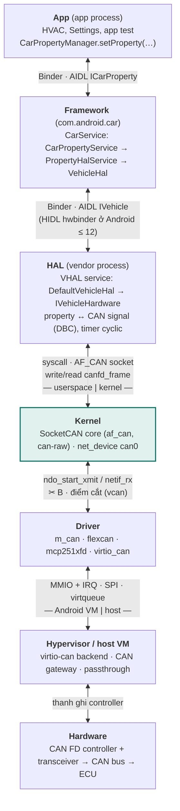
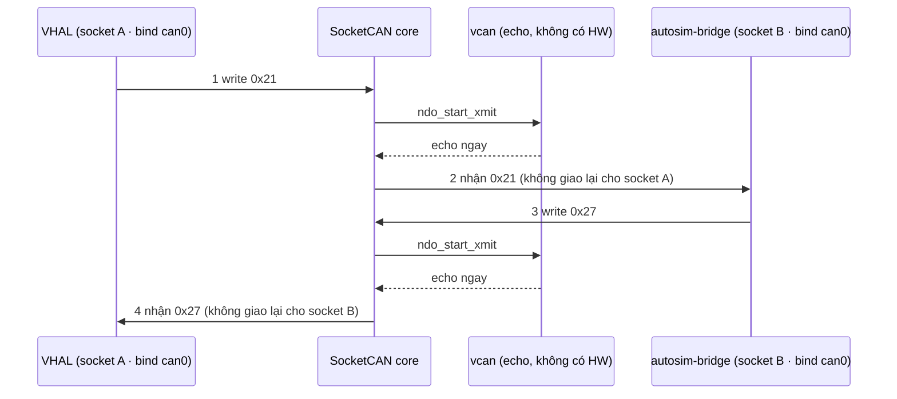
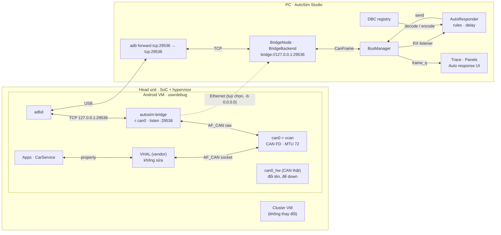
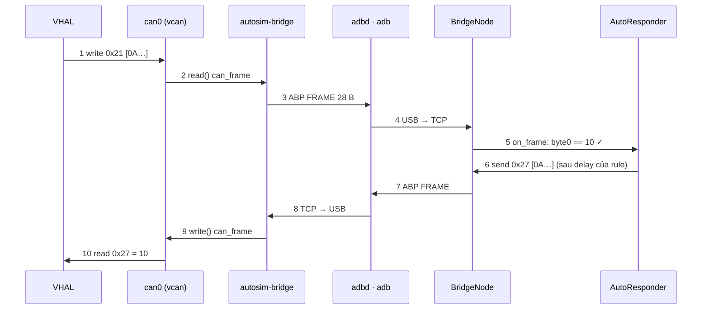
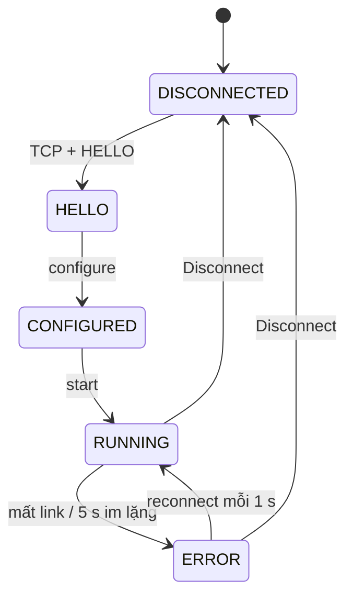

# Các layer CAN trong Android và điểm simulate

Tài liệu này đặt AutoSim VHAL Bridge ([ANDROID_BRIDGE.md](ANDROID_BRIDGE.md)) vào các layer CAN của Android, từ app
xuống tới phần cứng. Mỗi bước ghi rõ hai layer nói chuyện với nhau bằng cơ chế gì.

Bản vẽ đầy đủ (SVG, có cả theme sáng và tối) nằm trong [vhal_bridge_architecture.html](vhal_bridge_architecture.html);
mở file đó bằng trình duyệt. File gồm các hình:
- các layer CAN và điểm simulate;
- cơ chế vcan;
- toàn cảnh hệ thống;
- trước/sau takeover;
- một vòng request → response;
- gói ABP trên dây;
- trạng thái kênh bridge;
- bảng kết nối.

Các sơ đồ Mermaid dưới đây là bản rút gọn để đọc ngay trên GitHub hoặc VS Code.

Nội dung: [1 Các layer](#1-các-layer-can-trong-android) · [2 Điểm simulate](#2-điểm-simulate) ·
[3 Cơ chế vcan](#3-vì-sao-vcan-đủ-để-chen-vào) · [4 Toàn cảnh](#4-toàn-cảnh-hệ-thống) ·
[5 Request → response](#5-một-vòng-request--response) · [6 Gói ABP](#6-gói-tin-trên-dây-abp-v1) ·
[7 Trạng thái kênh](#7-trạng-thái-của-kênh-bridge) · [8 Bảng kết nối](#8-bảng-kết-nối)

---

## 1. Các layer CAN trong Android

| Layer | Thành phần | Nói chuyện với layer dưới bằng |
|---|---|---|
| App | `CarPropertyManager.setProperty(…)` | **Binder**, AIDL `ICarProperty` (app → process `com.android.car`) |
| Framework | CarService: CarPropertyService → PropertyHalService → VehicleHal; kiểm tra permission, map property ID / area | **Binder**, stable AIDL `IVehicle` (Android 13+; Android ≤ 12 dùng HIDL hwbinder `@2.0`) |
| HAL | VHAL service (vendor): DefaultVehicleHal → IVehicleHardware; map property ↔ CAN signal theo DBC / ARXML, timer gửi cyclic | **syscall**: `socket(AF_CAN, SOCK_RAW, CAN_RAW)`, `bind(ifindex)`, `write` / `read` `can_frame` / `canfd_frame` (ranh giới userspace và kernel) |
| Kernel | SocketCAN core (`af_can`, `can-raw`), net_device `can0` | `ndo_start_xmit` / `netif_rx` (API trong kernel giữa core và driver) |
| Driver | m_can, flexcan, mcp251xfd, virtio_can | MMIO + IRQ, SPI hoặc virtqueue, tuỳ platform (ranh giới Android VM và host) |
| Hypervisor / host | virtio-can backend, CAN gateway hoặc passthrough | thanh ghi controller |
| Hardware | CAN FD controller + transceiver → CAN bus → ECU | |

## 2. Điểm simulate

**Mình đứng ở điểm B: giữa SocketCAN core và driver.**
- Phía trên đường cắt chạy đúng code của sản phẩm: app, CarService, toàn bộ VHAL (kể cả phần map property sang CAN
  signal) và SocketCAN core.
- Phía dưới, driver và phần cứng được thay bằng vcan, `autosim-bridge` và AutoSim. Vì vậy AutoSim nhận đúng CAN frame
  mà VHAL gửi.
- Đây là layer thấp nhất mà mình vẫn chỉ cần sửa trong Android VM, không phải đụng tới hypervisor hay host.

| Điểm | Chen vào ở đâu | Code thật được test | AutoSim thấy gì | Phải sửa gì |
|---|---|---|---|---|
| Inject property | shell → CarService (`cmd car_service inject-vhal-event`) | app, một phần CarService | không có | không (lệnh adb) |
| A · backend VHAL | IVehicleHardware (GRPC VHAL / backend giả) | app, CarService, frontend VHAL | property | build VHAL khác; bỏ qua phần map signal của vendor |
| **B · vcan + bridge** (đang dùng) | giữa SocketCAN core và driver | app, CarService, toàn bộ VHAL, SocketCAN | CAN frame thật | vcan + bridge trong Android VM (userdebug) |
| D · virtio-can backend | hypervisor / host | như B, thêm driver virtio_can của guest | CAN frame thật | image của host / hypervisor |
| E · HIL | CAN bus vật lý (CANable) | toàn bộ, gồm cả controller | CAN frame thật | không, nhưng cần bench và CANable |

## 3. Vì sao vcan đủ để chen vào

vcan không có phần cứng: frame gửi xuống được trả ngay lên SocketCAN core, và core giao nó cho mọi socket khác đang
bind trên `can0`. Người ghi không nhận lại frame của chính mình (mặc định `CAN_RAW_RECV_OWN_MSGS` tắt). Nên VHAL chỉ
thấy frame do bridge ghi, và bridge chỉ thấy frame do VHAL ghi. Với VHAL, `can0` trông giống hệt một bus thật có ECU
trả lời.

## 4. Toàn cảnh hệ thống

Có hai vòng CAN nằm hoàn toàn trong kernel của Android VM: VHAL ↔ vcan và autosim-bridge ↔ vcan.

Mọi thứ đi ra khỏi head unit là TCP:
- Bridge lắng nghe trên `127.0.0.1:29536`, và `adb forward` nối cổng đó qua USB tới cùng số cổng trên PC.
- Nếu bridge chạy với `-b 0.0.0.0` thì AutoSim nối thẳng qua Ethernet.

CAN controller thật được đổi tên thành `can0_hw` và để down, nên frame của VHAL không ra bus thật.

**Trước / sau takeover** (`autosim_vcan.sh takeover can0`):

| | VHAL nói với | Đầu bên kia |
|---|---|---|
| Trước | `can0` = controller thật | CAN bus, ECU thật |
| Sau | `can0` = vcan (MTU 72) | `autosim-bridge` → AutoSim; controller thật thành `can0_hw`, down |

Sau takeover phải restart VHAL để nó mở lại `can0`, vì VHAL gắn socket theo ifindex lúc khởi động.
`autosim_vcan.sh restore` làm ngược lại: xoá vcan và trả tên `can0` cho controller thật.

## 5. Một vòng request → response

Rule ví dụ: nhận `0x21` có byte 0 = 10 thì gửi `0x27` có byte 0 = 10.

- Bước 5 chạy trên thread đọc của kênh. AutoResponder tra rule theo ID nên rất nhẹ.
- Frame trả lời được đưa sang thread `auto-response` để gửi sau khoảng delay của rule (0 ms là gửi ngay).
- Trên localhost, test đo cả vòng 1→10 dưới 20 ms (median). Đi qua adb bằng USB sẽ chậm thêm vài ms.

## 6. Gói tin trên dây (ABP v1)

Gói FRAME mang `0x21 [0A 00 00 00 00 00 00 00]`, tổng 28 byte:

| Byte | 0 | 1 | 2–3 | 4–7 | 8 | 9 | 10–11 | 12–19 | 20–27 |
|---|---|---|---|---|---|---|---|---|---|
| Field | magic | type | payload len | CAN id | flags | len | reserved | timestamp µs | data |
| Giá trị | `AB` | `02` (FRAME) | `18 00` (24) | `21 00 00 00` | `00` | `08` | `00 00` | u64 LE | `0A 00 00 00 00 00 00 00` |

Ngoài FRAME còn có các loại gói sau:
- **HELLO**: lúc kết nối; mang tên interface và cho biết có hỗ trợ CAN FD hay không.
- **PING / PONG**: keep-alive mỗi giây.
- **STATUS**: bộ đếm của bridge, gửi mỗi giây.
- **ERROR**: báo interface mất, ghi CAN lỗi, hoặc gói sai.

Chi tiết protocol: [ANDROID_BRIDGE.md § 4](ANDROID_BRIDGE.md#4-protocol-abp-v1-tcp).

## 7. Trạng thái của kênh bridge

Khi bridge hoặc adb khởi động lại, bảng Channels thấy kênh chuyển sang `error` rồi tự về `running`, không cần bấm
Connect lại. Trong lúc ERROR, gửi frame sẽ báo "link to the bridge lost - reconnecting".

## 8. Bảng kết nối

| Kết nối | Kiểu | Địa chỉ / cơ chế | Dữ liệu | Ai mở, khi mất thì sao |
|---|---|---|---|---|
| VHAL ↔ can0 | AF_CAN | raw socket, bind theo ifindex của `can0` | `can_frame` 16 B / `canfd_frame` 72 B | VHAL mở lúc khởi động; phải restart VHAL sau takeover |
| autosim-bridge ↔ can0 | AF_CAN | raw socket + `CAN_RAW_FD_FRAMES` | như trên | bridge mở; interface mất thì thử lại mỗi 1 s và báo ERROR |
| adbd ↔ autosim-bridge | TCP | `127.0.0.1:29536` trong Android | ABP v1 | bridge listen, tối đa 4 client; client im lặng 10 s bị ngắt |
| PC ↔ head unit | USB | `adb forward tcp:29536 tcp:29536` | luồng TCP đi xuyên qua | AutoSim tự chạy `adb forward` nếu kết nối 127.0.0.1 bị từ chối |
| PC ↔ head unit (tuỳ chọn) | TCP | Ethernet, bridge chạy `-b 0.0.0.0`; port `bridge://<IP>:29536` | ABP v1 | AutoSim connect; reconnect mỗi 1 s |
| BridgeNode → BusManager | in-process | callback trên thread `bridge-rx` | `CanFrame` | frame đi vào trace qua `frame_q` |
| BusManager → AutoResponder | in-process | RX listener, cùng thread đọc | chỉ frame RX | rule nào gửi quá 1000 lần/s thì tự tắt |
| AutoResponder → BusManager.send | in-process | thread `auto-response`, hàng đợi theo thời điểm gửi | frame trả lời | lỗi gửi được đếm ở cột Hits và ghi log |
