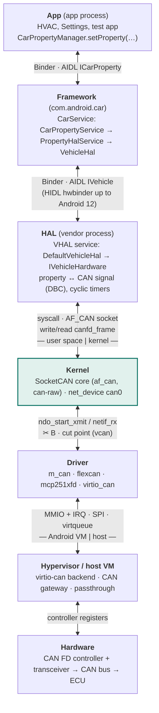
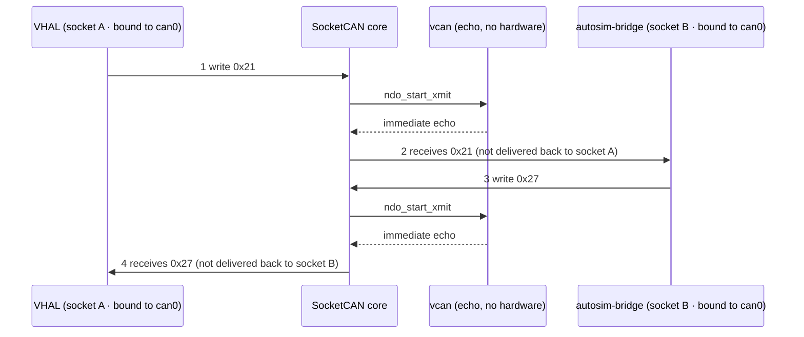
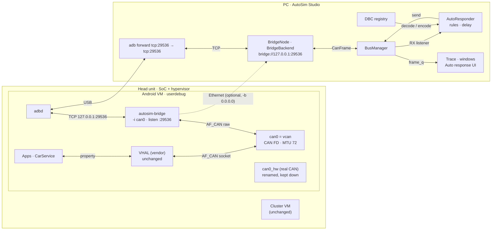
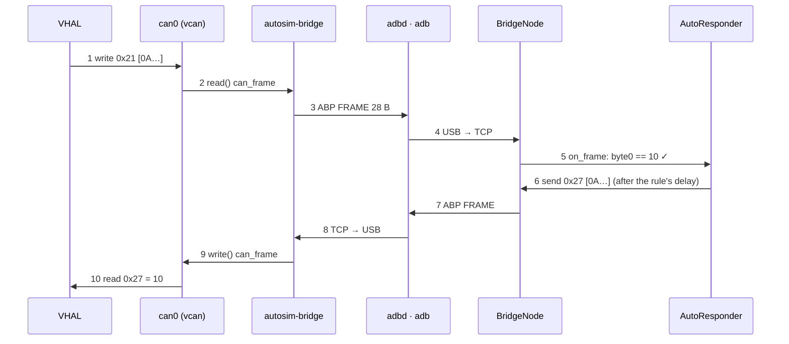
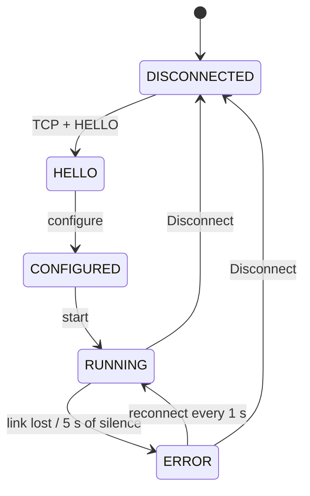

# CAN layers in Android and the simulation point

This document places the AutoSim VHAL bridge ([ANDROID_BRIDGE.md](ANDROID_BRIDGE.md)) in Android's CAN layers, from
the app down to the hardware. For every step it states how the two layers talk to each other.

The full drawings (SVG, light and dark) are in [vhal_bridge_architecture.html](vhal_bridge_architecture.html); open
that file in a browser. It contains:
- the CAN layers and the simulation point;
- the vcan mechanism;
- the system overview;
- before / after takeover;
- one request → response round trip;
- an ABP packet on the wire;
- the bridge channel states;
- the connection table.

The Mermaid diagrams below are condensed versions to read directly on GitHub or in VS Code.

Contents: [1 Layers](#1-can-layers-in-android) · [2 Simulation point](#2-simulation-point) ·
[3 vcan](#3-why-a-vcan-is-enough-to-step-in) · [4 Overview](#4-system-overview) ·
[5 Request → response](#5-one-request--response-round-trip) · [6 ABP packet](#6-a-packet-on-the-wire-abp-v1) ·
[7 Channel states](#7-states-of-the-bridge-channel) · [8 Connections](#8-connection-table)

---

## 1. CAN layers in Android

| Layer | Components | Talks to the layer below through |
|---|---|---|
| App | `CarPropertyManager.setProperty(…)` | **Binder**, AIDL `ICarProperty` (app → `com.android.car` process) |
| Framework | CarService: CarPropertyService → PropertyHalService → VehicleHal; permission checks, property ID / area mapping | **Binder**, stable AIDL `IVehicle` (Android 13+; up to Android 12, HIDL hwbinder `@2.0`) |
| HAL | VHAL service (vendor): DefaultVehicleHal → IVehicleHardware; maps properties ↔ CAN signals from DBC / ARXML; cyclic send timers | **syscalls**: `socket(AF_CAN, SOCK_RAW, CAN_RAW)`, `bind(ifindex)`, `write` / `read` of `can_frame` / `canfd_frame` (the user-space / kernel boundary) |
| Kernel | SocketCAN core (`af_can`, `can-raw`), net_device `can0` | `ndo_start_xmit` / `netif_rx` (the in-kernel API between core and driver) |
| Driver | m_can, flexcan, mcp251xfd, virtio_can | MMIO + IRQ, SPI or virtqueue depending on the platform (the Android VM / host boundary) |
| Hypervisor / host | virtio-can backend, CAN gateway or passthrough | controller registers |
| Hardware | CAN FD controller + transceiver → CAN bus → ECU | |

## 2. Simulation point

**AutoSim steps in at point B: between the SocketCAN core and the driver.**
- Above the cut runs the product's real code: apps, CarService, the whole VHAL (including its property-to-signal
  mapping) and the SocketCAN core.
- Below it, the driver and the hardware are replaced by a vcan, `autosim-bridge` and AutoSim. AutoSim therefore
  receives exactly the CAN frames the VHAL sends.
- It is the lowest layer that can still be changed inside the Android VM alone, without touching the hypervisor or
  the host.

| Point | Where it steps in | Real code under test | What AutoSim sees | What must change |
|---|---|---|---|---|
| Property injection | shell → CarService (`cmd car_service inject-vhal-event`) | apps, part of CarService | nothing | nothing (an adb command) |
| A · VHAL backend | IVehicleHardware (GRPC VHAL / fake backend) | apps, CarService, VHAL frontend | properties | a different VHAL build; the vendor's signal mapping is bypassed |
| **B · vcan + bridge** (used) | between the SocketCAN core and the driver | apps, CarService, the whole VHAL, SocketCAN | real CAN frames | vcan + bridge in the Android VM (userdebug) |
| D · virtio-can backend | hypervisor / host | as B, plus the guest's virtio_can driver | real CAN frames | the host / hypervisor image |
| E · HIL | the physical CAN bus (CANable, ESP32 node) | everything, including the controller | real CAN frames | nothing, but needs a bench and an adapter |

## 3. Why a vcan is enough to step in

A vcan has no hardware: a frame written to it comes straight back to the SocketCAN core, which delivers it to every
other socket bound to `can0`. A writer does not receive its own frames (`CAN_RAW_RECV_OWN_MSGS` is off by default).
So the VHAL sees only the frames written by the bridge, and the bridge sees only the frames written by the VHAL. To
the VHAL, `can0` looks exactly like a real bus with ECUs answering.

## 4. System overview

Two CAN loops stay entirely inside the Android VM's kernel: VHAL ↔ vcan and autosim-bridge ↔ vcan.

Everything that leaves the head unit is TCP:
- The bridge listens on `127.0.0.1:29536`, and `adb forward` connects that port over USB to the same port on the PC.
- If the bridge runs with `-b 0.0.0.0`, AutoSim connects directly over Ethernet.

The real CAN controller is renamed `can0_hw` and kept down, so the VHAL's frames do not reach the real bus.

**Before / after takeover** (`autosim_vcan.sh takeover can0`):

| | The VHAL talks to | Other end |
|---|---|---|
| Before | `can0` = the real controller | the CAN bus, real ECUs |
| After | `can0` = vcan (MTU 72) | `autosim-bridge` → AutoSim; the real controller is `can0_hw`, down |

After takeover the VHAL must be restarted so that it reopens `can0`: it binds its socket by ifindex at start-up.
`autosim_vcan.sh restore` does the reverse: deletes the vcan and gives the name `can0` back to the real controller.

## 5. One request → response round trip

Example rule: when `0x21` arrives with byte 0 = 10, send `0x27` with byte 0 = 10.

- Step 5 runs on the channel's reader thread. The AutoResponder looks rules up by ID, so it is cheap.
- The response is handed to the `auto-response` thread, which sends it after the rule's delay (0 ms: immediately).
- On localhost the tests measure the whole round trip 1→10 under 20 ms (median). Through adb over USB it takes a few
  ms more.

## 6. A packet on the wire (ABP v1)

A FRAME packet carrying `0x21 [0A 00 00 00 00 00 00 00]`, 28 bytes in total:

| Byte | 0 | 1 | 2–3 | 4–7 | 8 | 9 | 10–11 | 12–19 | 20–27 |
|---|---|---|---|---|---|---|---|---|---|
| Field | magic | type | payload len | CAN id | flags | len | reserved | timestamp µs | data |
| Value | `AB` | `02` (FRAME) | `18 00` (24) | `21 00 00 00` | `00` | `08` | `00 00` | u64 LE | `0A 00 00 00 00 00 00 00` |

Besides FRAME:
- **HELLO**: on connect; carries the interface name and whether CAN FD is supported.
- **PING / PONG**: keep-alive every second.
- **STATUS**: the bridge's counters, every second.
- **ERROR**: interface lost, CAN write failure, or a bad packet.

Protocol details: [ANDROID_BRIDGE.md § 4](ANDROID_BRIDGE.md#4-protocol-abp-v1-tcp).

## 7. States of the bridge channel

When the bridge or adb restarts, the Channels table shows the channel going to `error` and back to `running` by
itself, with no need to press Connect again. While in ERROR, sending a frame reports "link to the bridge lost -
reconnecting".

## 8. Connection table

| Connection | Kind | Address / mechanism | Data | Who opens it, what happens when it is lost |
|---|---|---|---|---|
| VHAL ↔ can0 | AF_CAN | raw socket bound to the ifindex of `can0` | `can_frame` 16 B / `canfd_frame` 72 B | the VHAL at start-up; the VHAL must be restarted after takeover |
| autosim-bridge ↔ can0 | AF_CAN | raw socket + `CAN_RAW_FD_FRAMES` | as above | the bridge; when the interface goes away it retries every 1 s and reports ERROR |
| adbd ↔ autosim-bridge | TCP | `127.0.0.1:29536` inside Android | ABP v1 | the bridge listens, up to 4 clients; a client silent for 10 s is disconnected |
| PC ↔ head unit | USB | `adb forward tcp:29536 tcp:29536` | the TCP stream, tunnelled | AutoSim runs `adb forward` itself when a connection to 127.0.0.1 is refused |
| PC ↔ head unit (optional) | TCP | Ethernet, bridge started with `-b 0.0.0.0`; port `bridge://<IP>:29536` | ABP v1 | AutoSim connects; reconnects every 1 s |
| BridgeNode → BusManager | in process | callback on the `bridge-rx` thread | `CanFrame` | frames reach the trace through `frame_q` |
| BusManager → AutoResponder | in process | RX listener, on the same reader thread | RX frames only | a rule sending more than 1 000 times/s switches itself off |
| AutoResponder → BusManager.send | in process | `auto-response` thread, queue ordered by send time | response frames | send errors are counted in the Hits column and logged |
