# AutoSim Studio – architecture and how it works

AutoSim Studio is a Windows desktop tool that **simulates CAN / CAN FD nodes and analyses the bus**: it loads a DBC
database, transmits messages with signal values you set (or that generators drive), receives every frame on the bus,
decodes it and shows it in a trace and a plot. Real buses are reached through **CANable 2.0** USB-CAN FD adapters;
built-in **simulated nodes** (SIM1, SIM2) allow working without hardware.

Contents: [1 System context](#1-system-context) · [2 System design](#2-system-design) ·
[3 Component diagram](#3-component-diagram) · [4 Communication diagram](#4-communication-diagram) ·
[5 Sequence diagrams](#5-sequence-diagrams) · [6 How it works](#6-how-it-works) ·
[7 Build, test, deploy](#7-build-test-and-deploy) · [8 Extending](#8-extending-the-tool)

Diagrams are [Mermaid](https://mermaid.js.org/) – GitHub and VS Code render them.

---

## 1. System context

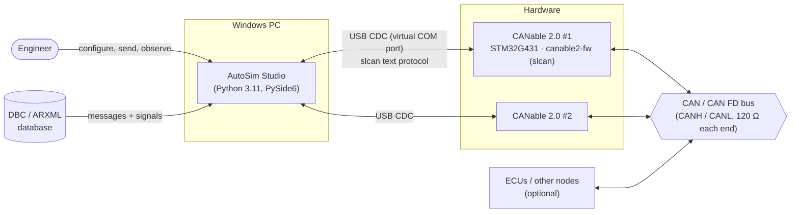

| External element | Role |
|---|---|
| Engineer | loads databases, opens channels, sets signal values, starts cyclic transmission, reads trace / plot |
| DBC / ARXML file | defines frames (ID, length, FD) and signals (bit layout, factor, offset, range, unit, value tables) |
| CANable 2.0 | USB-CAN FD adapter; its open-source firmware (`firmware/canable2_stm32/`) speaks **slcan** over a virtual COM port |
| CAN bus | 500 k / 2 M (or other) CAN FD bus; two CANables on one bus can talk to each other (loop test) |

---

## 2. System design

### 2.1 Layers

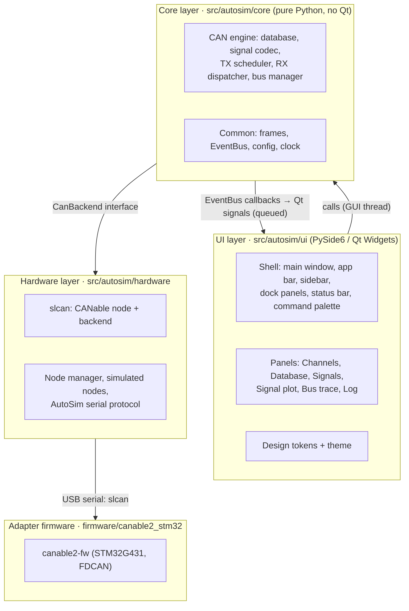

**Design rules**

* **The core never imports Qt.** Engines run on their own threads and publish results on a thread-safe `EventBus`;
  the UI's `QtBridge` turns each topic into a Qt signal, which Qt delivers *queued* on the GUI thread. The engine can
  therefore be tested (and scripted) without a GUI.
* **One interface per adapter type.** Everything that carries frames implements `CanBackend`
  (`open(cfg) / send(frame) / close() / set_rx_callback(cb)`); the bus manager does not know whether a channel is a
  CANable, a simulated node or a python-can interface.
* **One channel per adapter**, any number of channels in parallel (CAN1, CAN2, …), each on its own threads.
* **The GUI never blocks on hardware:** sends are a short serial write; receives arrive through a queue and are
  pushed to the GUI in batches (~30 per second).

### 2.2 Thread model

| Thread | Owner | Work |
|---|---|---|
| GUI (main) | Qt | widgets, models, timers (trace highlight 120 ms, signal panel 150 ms, plot 50 ms, status 1 s) |
| `can-tx` | `TxScheduler` | heap of due transmissions; sleeps, then spins the last ~2 ms for precise cycle times; encodes and sends |
| `can-rx` | `RxDispatcher` | takes frames from `BusManager.frame_q`, decodes / annotates them, publishes `TraceRow` batches every 33 ms |
| `slcan-rx-<ch>` | `SlcanNode` (one per CANable) | reads the COM port, splits slcan lines, delivers frames and the error register |
| `slcan-status-<ch>` | `SlcanNode` | every second: polls the error register (`E`), publishes node status |
| `sim-node`, `sim-node-status` | `SimNode` (per simulated channel) | firmware-like simulated node behind an in-memory pipe |
| `<name>-<ch>` | `SerialNode` | reader / writer of the AutoSim serial protocol (simulated nodes) |

Shared state is protected by locks (`TxScheduler._cv`, `MessageState._lock`, `RxDispatcher._lock`,
`DatabaseRegistry._lock`); the frame queue (`queue.Queue`, 200 000 entries) decouples the adapters from decoding.

### 2.3 Data model

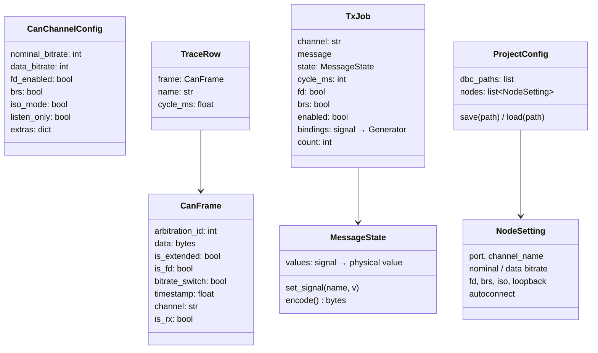

---

## 3. Component diagram

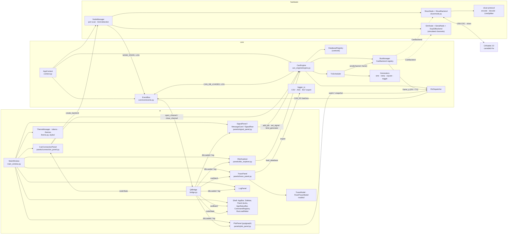

| Component | Responsibility | Key code |
|---|---|---|
| `AppContext` | creates and owns the event bus, CAN engine, node manager, project config | `context.py` |
| `CanEngine` | facade for the UI: load databases, open / close channels, create TX jobs, set signals, bind generators | `core/can_engine/engine.py` |
| `DatabaseRegistry` | loads DBC / ARXML / KCD / SYM with cantools, id → message lookup per channel, decode | `database.py` |
| `MessageState` | current physical signal values of one TX message; clamps to the DBC range; encodes the payload | `signal_codec.py` |
| `TxScheduler` | cyclic and one-shot transmission, generator evaluation, precise timing | `tx_scheduler.py` |
| `BusManager` | channel name → backend; routes `send`; puts every RX **and** TX frame into `frame_q` | `bus_manager.py` |
| `RxDispatcher` | decodes / annotates frames (name, cycle time), feeds plot buffers, publishes trace batches | `rx_dispatcher.py` |
| `EventBus` / `QtBridge` | thread-safe pub/sub; topics `CAN_RX`, `NODE_STATE`, `CAN_DB_LOADED`, `LOG` → Qt signals | `events.py`, `ui/bridge.py` |
| `NodeManager` | lists COM ports, recognises CANables by USB ID, builds the right node + backend, publishes node state | `hardware/esp32_gateway/manager.py` |
| `SlcanNode` / `SlcanBackend` | slcan session with one CANable: version, configuration, open, frames, error register | `hardware/slcan/` |
| Simulated nodes | `SimNode` behind an in-memory pipe, spoken to by `SerialNode` with the AutoSim protocol | `hardware/esp32_gateway/` |
| Panels | Channels, Database, Signals, Plot, Trace, Log – see section 6 | `ui/panels/` |
| Shell | app bar, sidebar, docks with versioned layout, status bar, bus-load estimate, commands / shortcuts | `ui/shell/` |
| Theme | design tokens (dark / light), stylesheet, fonts (Segoe UI), icons | `ui/theme.py`, `ui/styles/` |

---

## 4. Communication diagram

How the objects collaborate when CAN1 transmits a message cyclically and CAN2 (on the same bus) receives it.
Numbers give the order; `a/b` are concurrent branches.

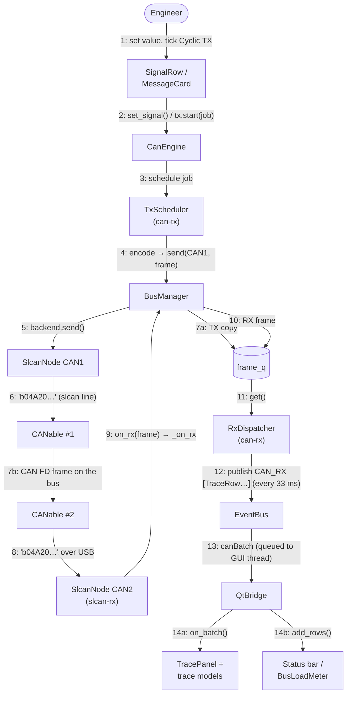

---

## 5. Sequence diagrams

### 5.1 Application start-up

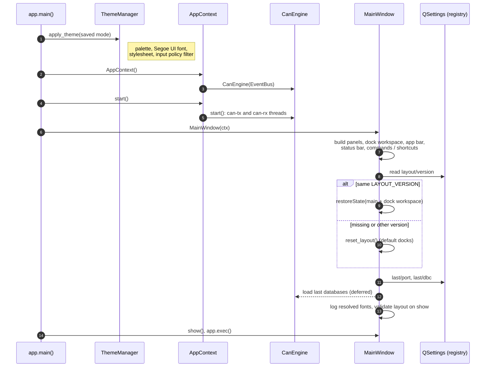

### 5.2 Connecting a CANable

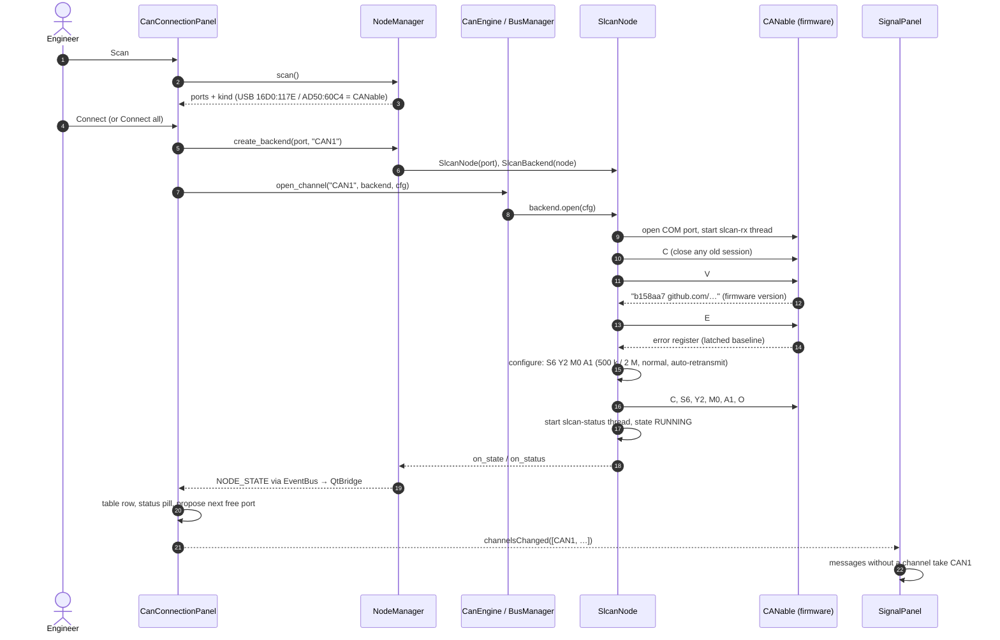

### 5.3 Cyclic transmission and reception (two adapters on one bus)

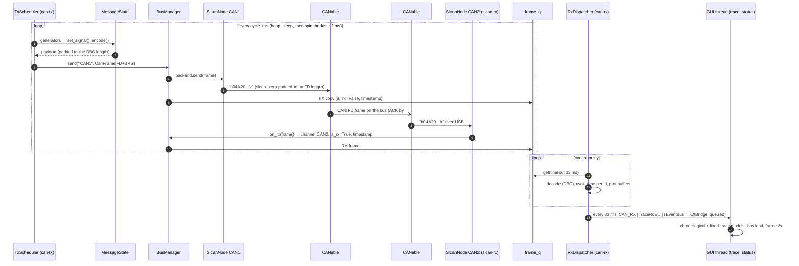

### 5.4 Editing a signal and using a generator

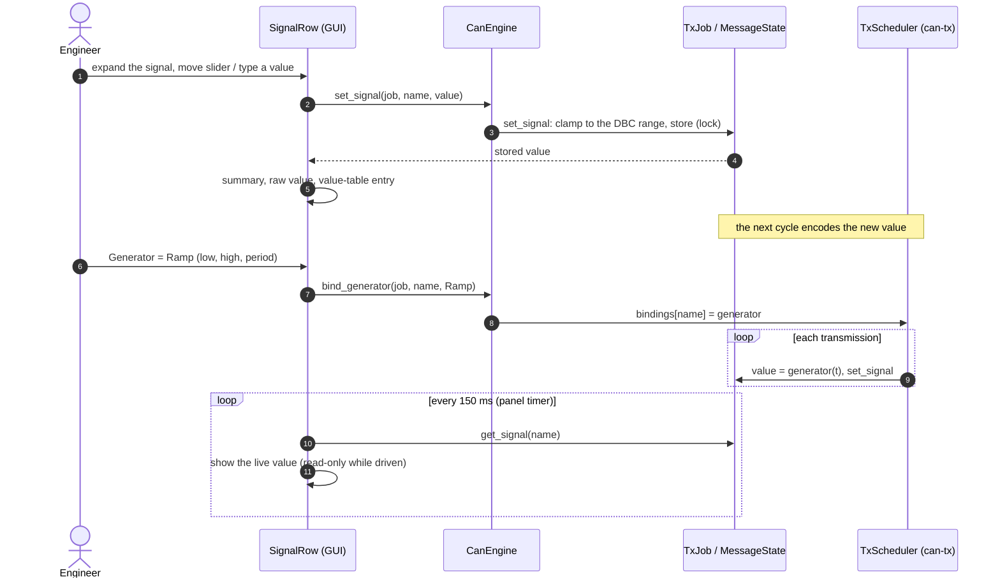

### 5.5 Adapter error monitoring

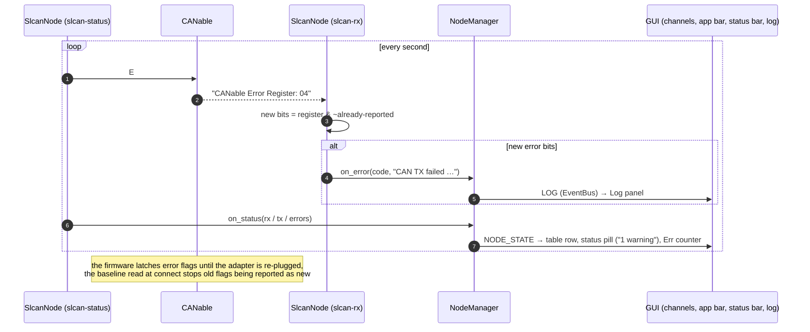

---

## 6. How it works

### 6.1 Databases and decoding

* `DatabaseRegistry.load()` reads DBC / ARXML / KCD / SYM with **cantools** (non-strict). Real-world DBCs that declare
  ids above 0x7FF without the extended flag are repaired on the fly (treated as 29-bit ids; impossible ids skipped) and
  reported in the Log.
* Databases can be global (`*`) or bound to a channel; `message_by_id(channel, id)` looks in the channel's databases
  first. `decode(frame)` pads short payloads and returns physical values (factor / offset applied).
* The Database panel shows node → message → signal; double-click (or *Add to signals*) creates a TX message.

### 6.2 Transmission

* A **TX job** = message + `MessageState` (current physical values, initialised from the DBC) + cycle time + FD / BRS
  flags + generator bindings. Each section in the Signals panel owns one job; the same message can be sent on several
  channels (one section per channel).
* `MessageState.set_signal()` clamps to the DBC range and stores under a lock; `encode()` packs all signals
  (cantools, padding) – so the GUI and the TX thread never see a half-updated payload.
* `TxScheduler` keeps a heap of `(due time, job)`. Its thread sleeps until ~2 ms before the due time and then spins,
  giving sub-millisecond cycle timing without busy-waiting the whole time; when it falls behind it re-bases instead of
  bursting. Generators (sine, ramp, square, toggle) are evaluated just before encoding. *Send once* calls the same
  path immediately.
* A send error stops that job and is logged; closing a channel stops its jobs.

### 6.3 Reception, decoding and the trace

* Adapters deliver frames on their reader threads into `BusManager._on_rx`, which stamps channel / direction / time
  and puts them into `frame_q`; transmitted frames are put there too, so the trace shows both directions.
* `RxDispatcher` empties the queue on its own thread: cycle time per (channel, id, direction), decoding, samples for
  watched plot signals – and publishes **batches every 33 ms** (≈30 Hz), so thousands of frames per second cost the
  GUI ~30 updates per second.
* The **Bus trace** has two models fed by the same batches:
  * *Fixed* (default): one row per (channel, direction, id), updated in place, with expandable signal rows decoded
    lazily when painted;
  * *Chronological*: a ring buffer of every frame (also the source of CSV / ASC / BLF export).
  Filters (id, name, channel, direction) and a fading highlight for updated rows run on the GUI thread.
* The **plot** asks `RxDispatcher.snapshot()` for watched signals every 50 ms and redraws the time window.

### 6.4 CANable adapters (slcan)

* Recognised by USB ID (`16D0:117E` current firmware, `AD50:60C4` older builds). One `SlcanNode` per adapter.
* Session: `C` (close), `V` (version), `E` (baseline error register), then on start `C`, `S0–S9` (nominal rate),
  `Y2`/`Y5` (data rate 2 / 5 Mbit/s), `M0` (normal), `A1` (auto retransmit), `O` (open).
* Frames: `t/T` classic, `d/D` FD without BRS, `b/B` FD with BRS; the length nibble is the CAN FD DLC code, payloads
  are zero-padded to the next valid FD length (12, 16, 20, 24, 32, 48, 64).
* The firmware sends no command acknowledgements; the error register (`E`) is polled every second and decoded
  (TX failed, RX FIFO overflow, TX buffer full, USB buffers full …). Flags are latched by the firmware until re-plug,
  so only *new* bits are reported.
* *Loop* mode is emulated on the PC (the firmware has no loopback): frames are echoed to the app, nothing goes on the
  bus.
* Firmware details, update and recovery: [CANABLE_FIRMWARE.md](CANABLE_FIRMWARE.md).

### 6.5 Simulated nodes

`SIM1` / `SIM2` create a `SimNode` behind an in-memory pipe and a `SerialNode` speaking the AutoSim binary protocol
(COBS framing, CRC-16; [ESP32_PROTOCOL.md](ESP32_PROTOCOL.md)). The simulated node loops transmitted frames back, so
the whole app can be used and tested without hardware.

### 6.6 Multiple channels

Each open adapter is a channel (CAN1, CAN2, …) with its own backend and threads; all of them feed the one frame
queue. *Connect all* opens every free CANable with the form's bit rates; a port can be open only once. Messages added
before a channel existed pick up the first free channel as soon as one is connected.

### 6.7 User interface

* **Shell:** app bar (status pill, Connect / Disconnect all, command palette, View menu, theme), collapsible sidebar
  (Channels, Database), dock panels (Signals, Signal plot, Bus trace, Log) whose layout is saved with a version
  number, status bar (estimated bus load and frames/s per channel, error counter, trace size, recording, elapsed).
* **Signals panel:** messages and signal rows collapse (collapsed by default) so many fit in view; details hold the
  slider, value input (unit inline), raw value, value table and generator. The mouse wheel never changes values.
* **Bus load** is estimated from each frame's length, format and the channel's bit rates (ISO CAN FD frame layout,
  ~10 % stuff bits) – labelled "est.".
* **Theme:** design tokens for a graphite dark and a light theme (WCAG AA contrast, tested); one font (Segoe UI) at
  13 / 14 / 18 px. A theme switch takes ~0.1 s (stylesheet cleared and re-applied, repaints frozen).
* **Keyboard:** `Ctrl+K` palette, `Space` pause trace (never while typing), `Ctrl+F/L/E` trace search / clear /
  export, `Ctrl+B` sidebar, `Ctrl+J` log, `Ctrl+O` load DBC, `Ctrl+S` save project.

### 6.8 Persistence

| What | Where |
|---|---|
| Theme, window / dock layout (versioned), sidebar sections, last port, last databases | `QSettings` → registry `HKCU\Software\AutoSim\AutoSimStudio` |
| Project: databases + open channels with bit rates (reconnected on open) | JSON file chosen by the user (`ProjectConfig`) |
| Trace export | CSV / Vector ASC / Vector BLF (python-can writers) |

### 6.9 Performance (measured, two CANables, 32-byte FD frames)

| Load | Fixed trace | Chronological trace |
|---|---|---|
| 400 frames/s (1 message per channel, 10 ms) | ~27 repaints/s, input delay < 1 ms | ~27 repaints/s, ~8 ms |
| 4 000 frames/s (10 messages per channel) | ~9 repaints/s, ~100 ms | ~23 repaints/s, ~27 ms |

Hardware throughput: a 1 000-frame burst of 16-byte FD frames at 500 k / 5 M arrives complete and in order
(~2 800 frames/s). Probe: `tools/ui/perf_trace.py`.

---

## 7. Build, test and deploy

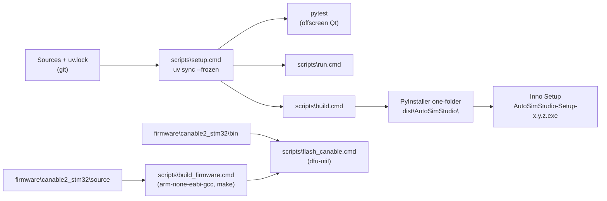

* **Dependencies:** `uv` with `uv.lock` (exact versions); Python 3.11 from `.python-version`.
* **Tests** (`tests/`, ~200): engine and codec, slcan protocol against a software model of the CANable firmware
  (`tests/fake_canable.py`), GUI tests (pytest-qt, offscreen), WCAG contrast, shell / shortcuts / layout, and
  **hardware tests** with real CANables (`AUTOSIM_HW=1`: both directions, bit-rate matrix, all FD lengths, bursts,
  real production DBCs bit-exact, the full GUI with two adapters).
* **Installer:** PyInstaller one-folder app + Inno Setup; app icon from `src/autosim/ui/assets/app_icon.svg`.
* **Moving to another machine:** clone and run `scripts\setup.cmd` – [MIGRATION.md](MIGRATION.md).

---

## 8. Extending the tool

* **Another adapter type:** implement a node with `connect / configure / start / send_frame / close` and the
  `on_rx / on_state / on_status / on_error` callbacks, wrap it in a `CanBackend`, recognise it in
  `NodeManager.kind_of()` / `create_backend()` (e.g. by USB ID in `hardware/slcan/__init__.py`). The engine and UI
  need no change.
* **Another panel:** create the widget, add it as a dock in `MainWindow._build_can_tab()` (`ws.add_panel(...)`),
  subscribe to `QtBridge` signals, and bump `LAYOUT_VERSION` so saved layouts are rebuilt.
* **Another generator:** add a class with `value(t)` in `core/can_engine/generators.py` and register it in
  `make_generator()` / `PARAM_LABELS`; it appears in the Signals panel's generator list after adding it to `GEN_ITEMS`.
* **New event topic:** add the name in `core/common/events.py`, publish it from the engine, add a signal in
  `QtBridge`.
