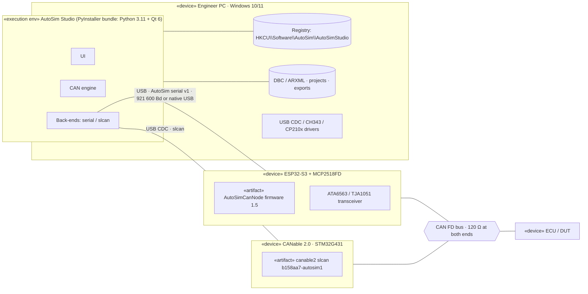
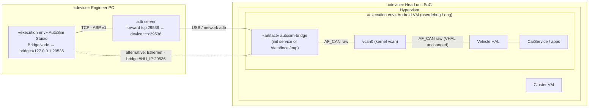
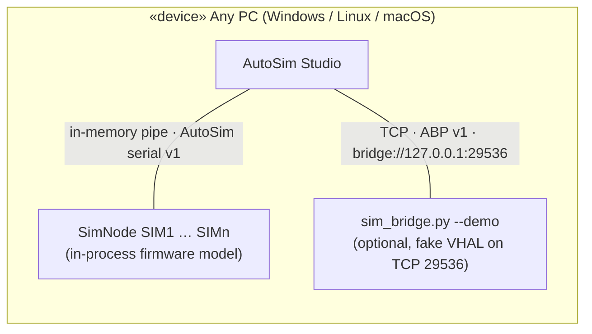

# AutoSim Studio – Deployment

| | |
|---|---|
| **Scope** | Where each part of AutoSim runs, how it is built, packaged and installed |
| **Related** | [Setup](SETUP.md) (step by step) · [HLD](design/HLD.md) · [System design](design/SYSTEM_DESIGN.md) |

## 1. Deployment units

| Unit | Runs on | Built from | Artifact |
|---|---|---|---|
| **AutoSim Studio** (desktop app) | Windows 10 / 11 PC (Linux / macOS from source) | `src/autosim` | `AutoSimStudio-Setup-<version>.exe` (Inno Setup) or `uv run autosim-qt` |
| **ESP32 CAN FD node firmware** | ESP32-S3 (also ESP32, ESP32-C3) + MCP2518FD module | `firmware/esp32_can_node` | PlatformIO image or the Arduino library `AutoSimCanNode-<version>.zip` |
| **CANable 2.0 firmware** | STM32G431 on the CANable 2.0 | `firmware/canable2_stm32` | `canable2-b158aa7-autosim1.bin` (recommended) or the upstream `canable2-b158aa7.bin` |
| **autosim-bridge** | Android head unit (VM or device), as root / system service | `bridge/autosim-bridge` | `autosim-bridge` binary per ABI, `autosim-bridge.rc`, SELinux policy |
| **Reference bridge** (optional) | Any Linux with SocketCAN, or a PC with no CAN at all (`--demo`) | `src/autosim/hardware/bridge/sim_bridge.py` | Python module |

## 2. Deployment diagrams

### 2.1 Bench with USB adapters

### 2.2 Android head unit

The VHAL keeps opening its usual interface name. `autosim_vcan.sh` either renames the real interface and creates
a `vcan` with the original name (*replace* mode), or adds `vcan0` (*add* mode). `restore` undoes it. See
[ANDROID_BRIDGE](ANDROID_BRIDGE.md) and [ANDROID_ENV_CHECKLIST](ANDROID_ENV_CHECKLIST.md).

### 2.3 No hardware (demo, training, CI)

## 3. Build and packaging

### 3.1 Desktop application

| Step | Command | Output |
|---|---|---|
| Environment | `uv sync` (Python 3.11 from `.python-version`, exact versions from `uv.lock`) | `.venv/` |
| Tests | `uv run pytest` (`QT_QPA_PLATFORM=offscreen` for headless runs) | report |
| Run from source | `uv run autosim` (ICAN, new UI) · `uv run autosim-qt` (PySide6 app) | – |
| App bundle | `.\scripts\build.ps1 -SkipInstaller` (PyInstaller, `packaging/autosim.spec`, one-folder) | `dist\AutoSimStudio\` |
| Installer | `.\scripts\build.ps1` (adds Inno Setup 6, `packaging/installer.iss`) | `dist\installer\AutoSimStudio-Setup-<version>.exe` |

- The version comes from `pyproject.toml`.
- The installer installs into `C:\Program Files\AutoSim Studio` (`{autopf}`, administrator rights) and creates Start
  menu entry (desktop icon optional). It bundles Python, Qt and every dependency, so the target PC needs nothing else.
- Prerequisites on the build machine: `scripts\setup.cmd -Installer` (uv, Python, Inno Setup, PyInstaller group).

### 3.2 ESP32 node firmware

| Option | How | Notes |
|---|---|---|
| Arduino IDE | Install `firmware/esp32_can_node/release/AutoSimCanNode-1.5.0.zip` (*Add .ZIP Library*), open the example, board *ESP32S3 Dev Module*, upload | The MCP2518FD driver is bundled. Choose *USB CDC On Boot* to match the USB port you use. |
| PlatformIO | `cd firmware/esp32_can_node && pio run -e esp32s3_uart -t upload` (environments: `esp32s3_uart`, `esp32s3`, `esp32dev`, `esp32c3`) | `-D` flags override pins, crystal, LED, baud |
| Unit tests | `pio test -e native` | Protocol and node logic on the PC |

Wiring and troubleshooting: [ESP32_MCP2518FD_WIRING](ESP32_MCP2518FD_WIRING.md).

### 3.3 CANable 2.0 firmware

| Step | Command |
|---|---|
| Toolchain | `scripts\setup.cmd -Firmware` (dfu-util, Arm GNU toolchain, make) |
| Build (optional) | `scripts\build_firmware.cmd [-Version b158aa7-autosim1]` |
| Flash | Hold BOOT, plug in, then `scripts\flash_canable.cmd -Bin firmware\canable2_stm32\bin\canable2-b158aa7-autosim1.bin` (the current firmware is backed up first) |
| Check | `uv run python tools/canable_info.py` |

Details and why the patched timing matters: [CANABLE_FIRMWARE](CANABLE_FIRMWARE.md).

### 3.4 Android bridge

| Mode | Steps |
|---|---|
| Bench (no image rebuild) | `scripts\android_bridge.cmd build` (NDK, `ANDROID_NDK_HOME`) → `scripts\android_bridge.cmd deploy [-RestartVhal] [-Mode add -Interface vcan0]`: pushes to `/data/local/tmp`, creates the vcan, starts the bridge, runs `adb forward` |
| System image | Add `bridge/autosim-bridge` to the product (`Android.bp`), install `autosim-bridge.rc` and the `sepolicy/` rules; the service starts at boot |
| Check the device | `scripts\android_bridge.cmd check` → `android_env_report_<time>.txt` |
| Undo | `scripts\android_bridge.cmd restore` |

## 4. Configuration

| Setting | Where | Default |
|---|---|---|
| Serial baud for UART-connected ESP32 nodes | `AUTOSIM_BAUD` (app) and `AUTOSIM_UART_BAUD` / `cfg.uartBaud` (firmware) | 921 600 |
| Use the OS title bar instead of the themed one | `AUTOSIM_NATIVE_TITLEBAR=1` | custom title bar |
| Hardware-in-the-loop tests | `AUTOSIM_HW=1` | off |
| Android bridge port | `bridge://HOST:PORT` in the Channels window; `-p` option of the daemon | 29536 |
| User settings (theme, layout, databases, rules) | Registry `HKCU\Software\AutoSim\AutoSimStudio` (INI under `~/.config` on Linux) | – |

## 5. Upgrades and compatibility

- **App**: install the new setup over the old one; settings stay in the registry. A saved window layout from another
  layout version is replaced by the default layout once (the Log shows a note).
- **ESP32 firmware**: the app checks the protocol version in HELLO (v1); firmware 1.4+ measures the crystal, 1.5+
  limits retransmissions and polls the MCP2518FD.
- **CANable**: any slcan firmware works; the AutoSim build is recommended next to crystal-clocked nodes.
- **Bridge**: ABP v1. The HELLO exchange carries the version; a mismatch makes the connection fail with a message
  naming both versions.
