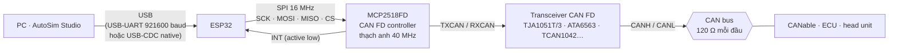
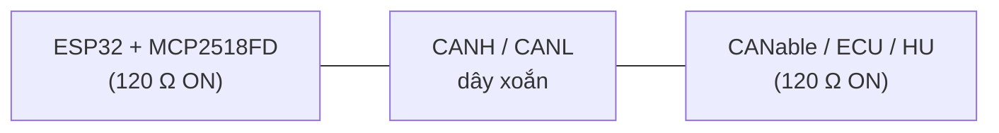

# ESP32 + MCP2518FD: đấu nối và chạy với AutoSim

Một board ESP32 nối với module CAN FD MCP2518FD trở thành **một kênh CAN / CAN FD** của AutoSim Studio. Board
dùng firmware [`firmware/esp32_can_node`](../firmware/esp32_can_node/README.md) và protocol
[ESP32_PROTOCOL.md](ESP32_PROTOCOL.md). Mỗi board cắm vào một cổng USB và hiện thành một kênh riêng (CAN1, CAN2, …).



---

## 1. Chọn module

| Cần có | Lý do |
|---|---|
| **Chip MCP2518FD** (hoặc MCP2517FD) với thạch anh **40 MHz** hoặc 20 MHz | Firmware hỗ trợ 40 MHz (mặc định) và 20 MHz (`-DOSC_FREQ=20`). Có thạch anh 40 MHz thì đạt được 8 Mbit/s data |
| **Transceiver hỗ trợ CAN FD**: TJA1051T/3, TJA1042, TJA1462, ATA6563, TCAN1042/1044, MCP2562FD | Transceiver CAN classic (TJA1050, MCP2551, SN65HVD230 đời cũ) chỉ đảm bảo tới 1 Mbit/s: phase data 2–8 Mbit/s sẽ bị lỗi bit |
| **Logic 3,3 V** | ESP32 **không chịu được 5 V** trên chân GPIO (xem mục 3) |
| Jumper hoặc điện trở **120 Ω** | Cho node nằm ở đầu bus |

Các module bán sẵn thường có: MCP2518FD, thạch anh 40 MHz, transceiver, header `VCC GND SCK SI SO CS INT`, terminal
`CANH CANL` và jumper 120 Ω. Trước khi cấp điện, đọc schematic của module để biết `VCC` nuôi những gì (mục 3).

## 2. Bảng đấu nối

| Tín hiệu | Chân module MCP2518FD | ESP32 DevKit (classic) | ESP32-S3-DevKitC-1 | ESP32-C3-DevKitM-1 |
|---|---|---|---|---|
| SPI clock | `SCK` | **GPIO 18** | GPIO 12 | GPIO 4 |
| ESP32 → MCP (MOSI) | `SI` / `SDI` | **GPIO 23** | GPIO 11 | GPIO 6 |
| MCP → ESP32 (MISO) | `SO` / `SDO` | **GPIO 19** | GPIO 13 | GPIO 5 |
| Chip select | `CS` / `nCS` | **GPIO 5** | GPIO 10 | GPIO 7 |
| Ngắt (active low) | `INT` / `nINT` | **GPIO 4** | GPIO 4 | GPIO 3 |
| Nguồn logic | `VCC` / `VDD` (3,3 V) | **3V3** | 3V3 | 3V3 |
| Mass | `GND` | **GND** | GND | GND |
| Không dùng | `INT0`, `INT1`, `CLKO`, `nSTBY` | — | — | — |

- Chân mặc định nằm trong `firmware/esp32_can_node/src/board_config.h`. Có thể đổi khi build, ví dụ
  `build_flags = -DCS_PIN=15 -DINT_PIN=27`. Chân INT phải là GPIO có ngắt; mọi GPIO của ESP32 đều có.
- Nếu module đưa chân **`STBY`** của transceiver ra header thì nối xuống **GND**. Để hở hoặc kéo lên thì
  transceiver ở chế độ standby và không gửi được gì.
- LED báo RX: GPIO 2 (classic), LED RGB GPIO 48 (S3) hoặc GPIO 8 (C3). Firmware không cho build nếu chân LED trùng
  chân SPI.

```
 ESP32 DevKit (classic)                    Module MCP2518FD
 ┌──────────────┐                           ┌──────────────────────────┐
 │          3V3 ├───────────────────────────┤ VCC (3,3 V)              │
 │          GND ├───────────────────────────┤ GND                      │
 │      GPIO 18 ├──── SCK ─────────────────►│ SCK                      │
 │      GPIO 23 ├──── MOSI ────────────────►│ SI                       │
 │      GPIO 19 │◄─── MISO ─────────────────┤ SO                       │
 │       GPIO 5 ├──── CS ──────────────────►│ CS                       │
 │       GPIO 4 │◄─── INT ──────────────────┤ INT                      │
 └──────┬───────┘                           │          CANH ●──────────┼──► bus CANH
        │ USB → PC (AutoSim)                │          CANL ●──────────┼──► bus CANL
                                            │   [J 120 Ω] (node đầu bus)│
                                            └──────────────────────────┘
```

## 3. Điện áp: phần quan trọng nhất

ESP32 chạy 3,3 V và **không** chịu được 5 V. MCP2518FD xuất mức logic bằng đúng điện áp nuôi nó (`VDD`). Nếu
module nuôi MCP2518FD bằng 5 V thì chân `SO` (MISO) và `INT` sẽ đưa 5 V vào ESP32 và làm hỏng chip.

| Module của anh | Cách nối |
|---|---|
| Một chân `VCC` nuôi cả MCP2518FD lẫn transceiver có chân `VIO` (TJA1051T/3, TJA1042T/3, ATA6563, TCAN1042V…) | Cấp **3V3** vào `VCC`, xong |
| Có **hai chân**: `VCC` = 5 V cho transceiver và `VIO` / `3V3` cho logic | 5 V từ chân `5V`/`VIN` của DevKit vào `VCC`, **3V3 vào `VIO`** |
| Transceiver bắt buộc 5 V, không có `VIO` (ví dụ TJA1050, MCP2551) và MCP2518FD chạy 5 V | **Không nối thẳng.** Cần level shifter cho `SO` và `INT`. Tốt nhất là đổi module, vì các transceiver này cũng không đảm bảo CAN FD |

Đo bằng đồng hồ trước khi cắm ESP32: giữa `SO` và `GND` (đo khi module đã cấp nguồn) phải là ≤ 3,3 V.

## 4. Bus CAN



- **Hai điện trở 120 Ω**, mỗi đầu bus một cái; các node ở giữa không bật. Tắt nguồn và đo giữa CANH và CANL phải
  được khoảng **60 Ω**. Đo ra 120 Ω là thiếu một đầu; đo ra 40 Ω là thừa một điện trở.
- **Nối chung GND** giữa các node khi chúng không cùng nguồn (ví dụ ESP32 cấp từ PC còn ECU cấp nguồn riêng).
- Dùng dây xoắn đôi. Ở 5–8 Mbit/s, bus bàn thử nên ngắn (dưới 1–2 m) và nhánh rẽ (stub) càng ngắn càng tốt.
- Dây SPI giữa ESP32 và module để **ngắn (< 10 cm)**. SPI chạy 16 MHz với thạch anh 40 MHz; dây dài hoặc lỏng sẽ
  gây lỗi `SPI read-back error`.
- Mọi node trên bus phải dùng **cùng nominal rate, data rate, chế độ ISO/non-ISO** và sample point gần nhau.

## 5. Build, nạp firmware, kết nối với AutoSim

**Dùng Arduino IDE** (ESP32-S3): mở `firmware/esp32_can_node/arduino/AutoSimCanNode/AutoSimCanNode.ino`, làm theo
[README của sketch](../firmware/esp32_can_node/arduino/AutoSimCanNode/README.md). Trong README có cách cài board
package, thư viện ACAN2517FD, menu Tools cho từng cổng USB của S3, và file `autosim_config.h` để đổi chân.

**Dùng PlatformIO:**

```bash
cd firmware/esp32_can_node
pio run -e esp32dev -t upload                    # ESP32 classic (cổng USB-UART)
pio run -e esp32s3_uart -t upload --upload-port COM4   # S3, cổng "UART"
pio run -e esp32s3 -t upload                     # S3, cổng "USB" (native)
pio run -e esp32c3 -t upload                     # C3 (native USB)
pio test -e native                               # 29 unit test, không cần phần cứng
```

Không có PlatformIO thì chạy được không cần cài: `uvx --from platformio pio …`. Nếu không nạp được: giữ **BOOT**,
nhấn **RESET**, thả BOOT rồi nạp lại; nạp xong nhấn RESET một lần.

Kiểm tra firmware đã chạy chưa: `uv run python firmware/esp32_can_node/tools/probe_port.py COM4`.

Trong AutoSim:
1. **Channels → Scan**, chọn cổng COM của ESP32. Dòng gợi ý dưới ô Port là "serial · ESP32 + MCP2518FD firmware?".
2. Chọn bit rate. Data rate phải là **bội số nguyên 1–10** của nominal: 500k/2M, 500k/5M, 1M/8M được; 500k/8M không
   được, firmware sẽ báo lý do. Tick FD / BRS / ISO đúng như các node khác trên bus.
3. **Connect**. Bảng kênh hiện tên board `ESP32-xxxxxx` và trạng thái `running`.

**Thử không cần bus**: tick **Loop** trước khi Connect. MCP2518FD chạy internal loopback và nhận lại chính frame
của mình. Nên làm bước này đầu tiên để xác nhận SPI và firmware chạy đúng trước khi đụng tới bus.

## 6. Bit timing, TDC và lỗi bit

Firmware dùng sample point mà AutoSim gửi trong CONFIG (mặc định **80 % nominal, 75 % data**). Nó giữ số time quanta
mà driver ACAN2517FD chọn và đặt **SJW = PS2**. Với data rate trên 1 Mbit/s, firmware bật **Transmitter Delay
Compensation (TDC) tự động**, với offset tính theo sample point data.

TDC là thứ quyết định CAN FD ở 2–8 Mbit/s có gửi được hay không. Khi node đang gửi, nó đọc lại bit của chính mình
qua transceiver. Độ trễ vòng của transceiver khoảng 100–250 ns, trong khi một bit ở 5 Mbit/s chỉ dài 200 ns. Không
có TDC, controller so sánh bit trước khi bit kịp quay về, nên tự báo **lỗi BIT0/BIT1 trong phase data** và frame bị
huỷ, dù các node khác vẫn nhận bình thường.

Khi có lỗi bus, firmware đọc thanh ghi **BDIAG1** của MCP2518FD. Mỗi loại lỗi được báo **một lần** cho mỗi phiên
kết nối, xuất hiện trong Log của AutoSim, ví dụ `[CAN1] node error 9: bus error: no ACK, data BIT1`.

| Lỗi trong log | Nguyên nhân thường gặp |
|---|---|
| `no ACK` | Không có node nào khác trên bus, node kia sai bit rate, hoặc thiếu termination |
| `nominal BIT0/BIT1`, `nominal FORM/STUFF/CRC` | Sai nominal bit rate, đấu ngược CANH/CANL, nhiễu, thiếu GND chung |
| `data BIT0/BIT1` | Lỗi khi đang gửi phase data: transceiver không hỗ trợ CAN FD, bus quá dài hoặc phản xạ, data rate quá cao so với dây |
| `data CRC/STUFF/FORM` | Sai data rate, sample point data lệch nhiều so với node khác, ISO vs non-ISO không khớp |
| `TX in bus-off` | Node đã bus-off; STATUS cũng báo bus-off. Disconnect rồi Connect lại |

### Về lỗi bit khi gửi bằng CANable 2.0
Firmware `canable2-fw` hiện có (`firmware/canable2_stm32/source/src/can.c`) cấu hình FDCAN của STM32G431 như sau:
- **không bật TDC**, vì không có lệnh nào gọi `HAL_FDCAN_ConfigTxDelayCompensation` hoặc `HAL_FDCAN_EnableTxDelayCompensation`;
- sample point **88 %** cho cả nominal lẫn data (17 tq, TSEG1 = 14, TSEG2 = 2);
- **SJW = 1 tq**;
- data rate chỉ có hai mức cố định 2 hoặc 5 Mbit/s.

Vì thiếu TDC, khi gửi FD có BRS ở 5 Mbit/s (và ở 2 Mbit/s nếu transceiver chậm), CANable sẽ báo lỗi bit trong phase
data. Đây là lý do nên dùng ESP32 + MCP2518FD (có TDC) để gửi CAN FD tốc độ cao. Một cách khác là sửa `can.c` để bật
TDC, đặt sample point data khoảng 75–80 % và tăng SJW, rồi nạp lại CANable.

## 7. Checklist khi không chạy

| Triệu chứng | Kiểm tra |
|---|---|
| `HELLO: no answer` | Chưa nạp firmware, hoặc nạp bản cho cổng khác (S3/C3 có hai cổng USB), cáp chỉ sạc, board đang ở download mode (nhấn RESET). Chạy `probe_port.py` |
| `no answer from MCP2518FD (check SPI wiring, CS, 3V3, crystal)` | Nguồn 3V3 và GND, CS, thạch anh; module 20 MHz thì build với `-DOSC_FREQ=20` |
| `SPI read-back error` | MOSI/MISO bị đảo, dây SPI dài hoặc lỏng |
| `mode switch timed out` | Transceiver chưa có nguồn hoặc `STBY` đang kéo lên |
| Loop chạy được nhưng lên bus thì `no ACK` | Không có node khác, sai bit rate, thiếu 120 Ω, CANH/CANL đảo |
| STATUS báo `dropped` tăng | Link serial chậm hơn bus: UART 921600 chỉ tải được khoảng 1000 frame FD 64 byte mỗi giây. Dùng ESP32-S3/C3 với USB native |

## 8. Phần đã kiểm và chưa kiểm

**Đã kiểm, không cần phần cứng:**
- Build sạch, không warning cho `esp32dev`, `esp32s3_uart`, `esp32s3`, `esp32c3` (PlatformIO `espressif32 @ 8.0.0`,
  Arduino core 3.3, ACAN2517FD 2.1.16).
- 29 unit test của protocol và logic node (`pio test -e native`), gồm chia sample point và tên lỗi BDIAG1.
- `tests/test_firmware.py`: build logic firmware thật thành chương trình chạy trên PC (`tools/fw_sim.cpp`) và cho
  `SerialNode` của AutoSim nói chuyện với nó, gồm cả đường báo lỗi bus.

**Chưa kiểm:** chạy trên ESP32 và MCP2518FD thật. Cần kiểm trên bench: bit timing thực tế trên dây, TDC ở 5 và
8 Mbit/s, ngắt INT, throughput. Nên thử theo thứ tự: Loop → hai node ESP32 với nhau → ESP32 với CANable hoặc ECU.
