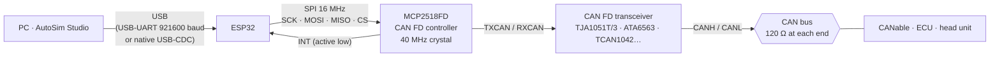

# ESP32 + MCP2518FD: wiring and use with AutoSim

An ESP32 board connected to an MCP2518FD CAN FD module becomes **one CAN / CAN FD channel** of AutoSim Studio. The
board runs the firmware [`firmware/esp32_can_node`](../firmware/esp32_can_node/README.md) and speaks the protocol in
[ESP32_PROTOCOL.md](ESP32_PROTOCOL.md). Each board plugs into its own USB port and shows up as its own channel
(CAN1, CAN2, …).



---

## 1. Choosing a module

| Needed | Why |
|---|---|
| **MCP2518FD chip** (or MCP2517FD) with a **40 MHz** or 20 MHz crystal | Firmware ≥ 1.4 **measures** the crystal frequency at every Connect (`cfg.oscMHz = 0`, the default). To fix it, set `cfg.oscMHz = 20` or `40` (PlatformIO: `-DOSC_FREQ=20`). A 40 MHz crystal reaches 8 Mbit/s data; use 20 MHz only up to 2 Mbit/s data (5M leaves 4 tq per bit, 8M is not possible) |
| **CAN FD transceiver**: TJA1051T/3, TJA1042, TJA1462, ATA6563, TCAN1042/1044, MCP2562FD | Classic CAN transceivers (TJA1050, MCP2551, older SN65HVD230) are only specified up to 1 Mbit/s: a 2–8 Mbit/s data phase will give bit errors |
| **3.3 V logic** | The ESP32 **does not tolerate 5 V** on its GPIOs (see section 3) |
| **120 Ω** jumper or resistor | For a node at the end of the bus |

Off-the-shelf modules usually have:
- an MCP2518FD with a 40 MHz **or 20 MHz** crystal (read the crystal's marking: `H20.00` = 20 MHz, `40.000` = 40 MHz);
- a transceiver, for example ATA6563 (VCC 5 V, VIO 3.3 V, pin 8 is STBY);
- a header `VCC GND SCK SI SO CS INT`, a `CANH CANL` terminal and a 120 Ω jumper.

Before powering it, read the module's schematic to know what `VCC` supplies (section 3).

## 2. Wiring table

| Signal | MCP2518FD module pin | ESP32 DevKit (classic) | ESP32-S3-DevKitC-1 | ESP32-C3-DevKitM-1 |
|---|---|---|---|---|
| SPI clock | `SCK` | **GPIO 18** | GPIO 12 | GPIO 4 |
| ESP32 → MCP (MOSI) | `SI` / `SDI` | **GPIO 23** | GPIO 11 | GPIO 6 |
| MCP → ESP32 (MISO) | `SO` / `SDO` | **GPIO 19** | GPIO 13 | GPIO 5 |
| Chip select | `CS` / `nCS` | **GPIO 5** | GPIO 10 | GPIO 7 |
| Interrupt (active low) | `INT` / `nINT` | **GPIO 4** | GPIO 4 | GPIO 3 |
| Logic supply | `VCC` / `VDD` (3.3 V) | **3V3** | 3V3 | 3V3 |
| Ground | `GND` | **GND** | GND | GND |
| Not used | `INT0`, `INT1`, `CLKO`, `nSTBY` | — | — | — |

- The default pins come from the library's `autosim::defaultBoardConfig()`, chosen by chip.
  - Arduino IDE: change them in `setup()`, e.g. `cfg.cs = 15; cfg.intPin = 27;`.
  - PlatformIO: use `build_flags = -DCS_PIN=15 -DINT_PIN=27`.
  - The INT pin must be a GPIO with interrupts; every ESP32 GPIO has them.
- If the module brings the transceiver's **`STBY`** pin out to the header, connect it to **GND**. Left open or pulled
  up, the transceiver stays in standby and cannot send anything.
- Activity LED: GPIO 2 (classic), RGB LED on GPIO 48 (S3) or GPIO 8 (C3). RGB LED colours: blue = frame received,
  green = frame sent, red = could not send (bus-off / no ACK). The firmware refuses to build if the LED pin is one of
  the SPI pins.

```
 ESP32 DevKit (classic)                    MCP2518FD module
 ┌──────────────┐                           ┌──────────────────────────┐
 │          3V3 ├───────────────────────────┤ VCC (3.3 V)              │
 │          GND ├───────────────────────────┤ GND                      │
 │      GPIO 18 ├──── SCK ─────────────────►│ SCK                      │
 │      GPIO 23 ├──── MOSI ────────────────►│ SI                       │
 │      GPIO 19 │◄─── MISO ─────────────────┤ SO                       │
 │       GPIO 5 ├──── CS ──────────────────►│ CS                       │
 │       GPIO 4 │◄─── INT ──────────────────┤ INT                      │
 └──────┬───────┘                           │          CANH ●──────────┼──► bus CANH
        │ USB → PC (AutoSim)                │          CANL ●──────────┼──► bus CANL
                                            │  [J 120 Ω] (end-of-bus)  │
                                            └──────────────────────────┘
```

## 3. Voltages: the most important part

The ESP32 runs at 3.3 V and does **not** tolerate 5 V. The MCP2518FD drives its logic outputs at its own supply
voltage (`VDD`). If the module supplies the MCP2518FD with 5 V, the `SO` (MISO) and `INT` pins put 5 V into the
ESP32 and damage it.

| Your module | How to connect it |
|---|---|
| One `VCC` pin supplies both the MCP2518FD and a transceiver with a `VIO` pin (TJA1051T/3, TJA1042T/3, ATA6563, TCAN1042V…) | **3V3** into `VCC`, done |
| **Two pins**: `VCC` = 5 V for the transceiver and `VIO` / `3V3` for the logic | 5 V from the DevKit's `5V` / `VIN` pin into `VCC`, **3V3 into `VIO`** |
| The transceiver needs 5 V and has no `VIO` (e.g. TJA1050, MCP2551), and the MCP2518FD runs at 5 V | **Do not connect directly.** `SO` and `INT` need a level shifter. Better: change the module, since these transceivers do not guarantee CAN FD either |

Measure with a multimeter before plugging in the ESP32: with the module powered, `SO` to `GND` must be ≤ 3.3 V.

## 4. The CAN bus


- **Two 120 Ω resistors**, one at each end of the bus; the nodes in between have theirs off. With power off, CANH to
  CANL must measure about **60 Ω**. 120 Ω means one end is missing; 40 Ω means one resistor too many.
- **Connect the grounds** of the nodes when they do not share a supply (e.g. an ESP32 powered from the PC and an ECU
  with its own supply).
- Use twisted pair. At 5–8 Mbit/s keep a bench bus short (under 1–2 m) and the stubs as short as possible.
- Keep the SPI wires between the ESP32 and the module **short (< 10 cm)**. SPI runs at 16 MHz with a 40 MHz crystal;
  long or loose wires cause `SPI read-back error`.
- Every node on the bus must use **the same nominal rate, data rate, ISO / non-ISO mode** and close sample points.

## 5. Build, flash, connect to AutoSim

**With the Arduino IDE** (ESP32-S3): the firmware is the **Arduino library `AutoSimCanNode`**.
1. Get the ZIP file `firmware/esp32_can_node/release/AutoSimCanNode-<version>.zip` (on GitHub: open the file and
   click **Download raw file**).
2. Install it with *Sketch → Include Library → Add .ZIP Library*.
3. Open *File → Examples → AutoSimCanNode*.

Pins and crystal are set in the example's `setup()`. Details:
[the library's README](../firmware/esp32_can_node/lib/AutoSimCanNode/README.md).

**With PlatformIO:**

```bash
cd firmware/esp32_can_node
pio run -e esp32dev -t upload                    # ESP32 classic (USB-UART port)
pio run -e esp32s3_uart -t upload --upload-port COM4   # S3, "UART" port
pio run -e esp32s3 -t upload                     # S3, "USB" port (native)
pio run -e esp32c3 -t upload                     # C3 (native USB)
pio test -e native                               # 29 unit tests, no hardware needed
```

Without PlatformIO installed: `uvx --from platformio pio …`. If flashing fails: hold **BOOT**, press **RESET**,
release BOOT and flash again; after flashing press RESET once.

To check that the firmware runs: `uv run python firmware/esp32_can_node/tools/probe_port.py COM4`.

In AutoSim:
1. **Channels → Scan**, choose the ESP32's COM port. The hint under the Port box reads
   "serial · ESP32 + MCP2518FD firmware?".
2. Choose the bit rates. The data rate must be an **integer multiple (1–10)** of the nominal rate: 500k/2M, 500k/5M
   and 1M/8M work; 500k/8M does not, and the firmware says why. Set FD / BRS / ISO like the other nodes on the bus.
3. **Connect**. The channel table shows the board name `ESP32-xxxxxx` and the state `running`.

**Test without a bus**: tick **Loop** before Connect. The MCP2518FD runs in internal loopback and receives its own
frames. Do this first, to confirm SPI and the firmware work before touching the bus.

## 6. Bit timing, TDC and bit errors

The firmware uses the sample points AutoSim sends in CONFIG (default **80 % nominal, 75 % data**). It keeps the
number of time quanta the ACAN2517FD driver chooses and sets **SJW = PS2**. Above 1 Mbit/s data rate the firmware
enables **automatic Transmitter Delay Compensation (TDC)**, with the offset computed from the data sample point.

TDC decides whether CAN FD at 2–8 Mbit/s can be sent at all:
- While a node sends, it reads its own bits back through the transceiver.
- The transceiver's loop delay is about 100–250 ns, while a bit at 5 Mbit/s lasts only 200 ns.
- Without TDC the controller compares a bit before it has come back. It reports **BIT0 / BIT1 errors in the data
  phase** and aborts the frame, even though the other nodes receive it fine.

On bus errors the firmware reads the MCP2518FD's **BDIAG1** register. Each kind of error is reported **once** per
connection, in AutoSim's Log, e.g. `[CAN1] node error 9: bus error: no ACK, data BIT1`.

| Error in the log | Usual cause |
|---|---|
| `no ACK` | No other node on the bus, the other node uses another bit rate, or termination is missing |
| `nominal BIT0/BIT1`, `nominal FORM/STUFF/CRC` | Wrong nominal bit rate, CANH / CANL swapped, noise, no common ground. Also **firmware ≤ 1.3 with a 20 MHz crystal module** (`H20.00`) without `cfg.oscMHz = 20`: the node runs at exactly half the bit rate, and the other side reads STUFF / FORM / CRC errors. Flash firmware ≥ 1.4 (measures the crystal). AutoSim's Log adds the hint `bit rate mismatch?` to these errors |
| `nominal BIT0` on the very first frame, then `TX in bus-off`; the other node reports `no ACK` | The transceiver does not drive the bus: its **5 V** supply is missing, or it is in **standby**. Firmware ≥ 1.3 drives STBY through the MCP2518FD's INT0 / GPIO0 pin (XSTBY, `cfg.xstby`, on by default), for modules that wire STBY to that pin |
| `data BIT0/BIT1` | Errors while sending the data phase: the transceiver does not support CAN FD, the bus is too long or reflects, or the data rate is too high for the wiring |
| `data CRC/STUFF/FORM` | Wrong data rate, data sample point far from the other nodes', ISO vs non-ISO mismatch |
| `TX in bus-off` | The node is bus-off; STATUS reports bus-off too. Disconnect and Connect again |
| Only **one frame** is sent after Connect, then nothing is sent or received | Firmware ≤ 1.4. Two causes: (1) a frame the bus rejects (`no ACK`, `data BIT1`…) was retransmitted forever, blocking every later frame in the TX FIFO (which holds one frame); (2) the INT pin does not reach the ESP32, so the driver neither loads the next frame nor reads received ones. Firmware ≥ 1.5 retransmits at most 3 times and reads the MCP2518FD's state over SPI every 1 ms without waiting for INT. If INT does not work, the Log reports `INT never fired on GPIO n` |
| `data BIT1` / `data BIT0` when sending FD with BRS | The other node flags an error in the data phase: the two channels use different data rates (CANable only has 2M or 5M), the transceiver does not support FD, or the bus is long / missing 120 Ω. Try 500k/2M, or FD without BRS. A loose wire gives the same symptom |

### Bit errors when sending with a CANable 2.0

The upstream `canable2-fw` firmware (`firmware/canable2_stm32/source/src/can.c`) configures the STM32G431's FDCAN as
follows:
- **no TDC**: nothing calls `HAL_FDCAN_ConfigTxDelayCompensation` or `HAL_FDCAN_EnableTxDelayCompensation`;
- an **88 %** sample point for both nominal and data (17 tq, TSEG1 = 14, TSEG2 = 2);
- **SJW = 1 tq**;
- only two fixed data rates, 2 or 5 Mbit/s.

Without TDC, sending FD with BRS at 5 Mbit/s (and at 2 Mbit/s with a slow transceiver) gives bit errors in the data
phase. To send high-speed CAN FD, prefer the ESP32 + MCP2518FD (which has TDC), or flash the CANable with AutoSim's
bit-timing build, see [CANABLE_FIRMWARE.md](CANABLE_FIRMWARE.md).

## 7. Checklist when it does not work

| Symptom | Check |
|---|---|
| `HELLO: no answer` | Firmware not flashed, or flashed for the other port (S3 / C3 have two USB ports), a charge-only cable, or the board is in download mode (press RESET). Run `probe_port.py` |
| `no answer from MCP2518FD (check SPI wiring, CS, 3V3, crystal)` | 3V3 and GND, CS, the crystal (the firmware measures it over SPI at Connect: no reading means SPI or the crystal is faulty) |
| `MCP2518FD clock measured … kHz, not 20/40 MHz` | A crystal other than 20 / 40 MHz, or unreliable SPI. Set `cfg.oscMHz` by hand if you are sure of the frequency |
| `SPI read-back error` | MOSI / MISO swapped, SPI wires long or loose |
| `mode switch timed out` | The transceiver has no supply, or `STBY` is pulled up |
| Loop works but on the bus `no ACK` | No other node, wrong bit rate, 120 Ω missing, CANH / CANL swapped |
| STATUS reports `dropped` increasing | The serial link is slower than the bus: UART at 921600 carries only about 1000 64-byte FD frames per second. Use an ESP32-S3 / C3 with native USB |

## 8. What has and has not been tested

**Tested without hardware:**
- Clean builds without warnings for `esp32dev`, `esp32s3_uart`, `esp32s3`, `esp32c3` (PlatformIO
  `espressif32 @ 8.0.0`, Arduino core 3.3, ACAN2517FD 2.1.16 bundled in the library).
- 29 unit tests of the protocol and the node logic (`pio test -e native`), including the sample-point split and the
  BDIAG1 error names.
- `tests/test_firmware.py`: builds the real firmware logic into a PC program (`tools/fw_sim.cpp`) and has AutoSim's
  `SerialNode` talk to it, including the bus-error path.

**Tested on hardware by users:** ESP32-S3 + MCP2518FD (20 MHz crystal) exchanging CAN FD with a CANable 2.0, after
firmware 1.5.

**Still to check on a bench:** TDC at 5 and 8 Mbit/s, throughput limits. Recommended order: Loop → two ESP32 nodes
together → ESP32 with a CANable or an ECU.
