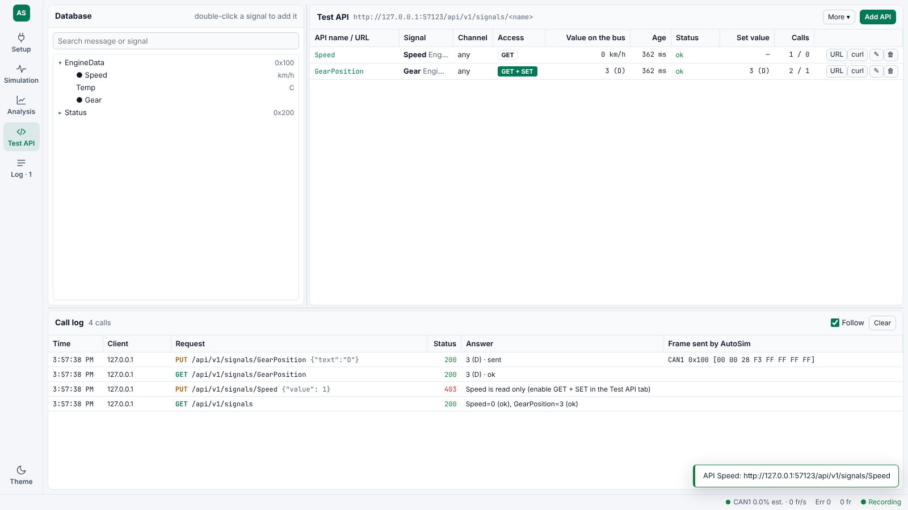

# Test API guide - read and write CAN signals from a test system

AutoSim web mode can publish CAN signals as HTTP endpoints. A test system (pytest, Robot Framework, Jenkins,
LabVIEW, Postman, a shell script …) then:

- **reads** the current value of a signal on the bus with `GET`
- **writes** a signal with `PUT`: AutoSim sends one CAN frame with that value right away

This guide walks through one example end to end: **reading the vehicle speed** (signal `Speed` of message
`EngineData`, unit km/h), then **setting the gear** (signal `Gear`, value table P / R / N / D).



---

## 1. Start AutoSim web mode

| Installed (Windows) | From source |
|---|---|
| Start menu → **AutoSim Studio Web** (this PC only) | `uv run --extra web autosim-web` |
| Start menu → **AutoSim Studio Web (network access)** (other PCs too) | `uv run --extra web autosim-web --host 0.0.0.0` |

The console window prints the address, by default **`http://127.0.0.1:8765`**. In the browser:

1. **Setup → Database**: add the DBC / ARXML file of the vehicle.
2. **Setup → Channels**: open the channel connected to the bus (e.g. `CAN1`).

> Network access: the printed address ends with `?token=…`. Every API call from another PC must send this token
> in the header `X-AutoSim-Token: <token>` (see [section 7](#7-token-network-access)).

## 2. Publish the signal

Open the **Test API** tab (`Ctrl+4`):

- In the database tree on the left, open `EngineData` and **double-click `Speed`**.
- A row `Speed` appears on the right. Its URL is

  ```
  http://127.0.0.1:8765/api/v1/signals/Speed
  ```

Defaults of a new API: name = signal name, **read only** (GET), any channel, *stale after* 1000 ms, value to send =
the DBC initial value. Click ✎ (or double-click the row) to change them, e.g. to rename it `VehicleSpeed`, pick a
channel, or allow PUT (*GET + SET*).

The **URL** and **curl** buttons copy the address or a ready-to-run command.

## 3. Read the current value (GET)

**Request**

```
GET http://127.0.0.1:8765/api/v1/signals/Speed
```

```bash
curl http://127.0.0.1:8765/api/v1/signals/Speed
```

**Response** (HTTP 200, JSON)

```json
{
  "name": "Speed",
  "signal": "Speed",
  "message": "EngineData",
  "id": "0x100",
  "channel": "CAN1",
  "value": 88.5,
  "raw": 885,
  "text": null,
  "unit": "km/h",
  "timestamp": 152.734911,
  "age_ms": 9.6,
  "direction": "rx",
  "status": "ok",
  "default": 0,
  "set_value": 0,
  "access": "get"
}
```

**What each field means**

| Field | Meaning |
|---|---|
| `name` | API name (the last part of the URL) |
| `signal`, `message`, `id` | the CAN signal, its message and the message ID (hex) |
| `channel` | channel of the frame the value comes from (`CAN1` …) |
| **`value`** | **physical value** (factor and offset applied), e.g. `88.5` km/h - this is the number to check |
| `raw` | raw integer in the frame (`885` = 88.5 / factor 0.1); `null` for float signals |
| `text` | name from the DBC value table when the value has one (e.g. `"D"`), else `null` |
| `unit` | unit from the DBC |
| `timestamp` | time of that frame in seconds (AutoSim clock) |
| **`age_ms`** | how long ago that frame was seen, in ms |
| `direction` | `"rx"` received from the bus, `"tx"` sent by AutoSim |
| **`status`** | **whether `value` can be trusted** (below) |
| `default` | DBC initial value of the signal |
| `set_value` | value a PUT would send (APIs with GET + SET) |
| `access` | `"get"` (read only) or `"getset"` |

**`status` values**

| `status` | `value` | Meaning |
|---|---|---|
| `ok` | number | a frame arrived within *stale after* ms (default 1000) |
| `stale` | number (old) | the last frame is older than *stale after*: the sender stopped or the bus is down |
| `no_data` | `null` | this message was never seen on the bus since AutoSim started |
| `inactive` | `null` | multiplexed signal not present in the last frame |
| `undecodable` | `null` | the frame does not match the DBC layout |
| `error` | `null` | the message / signal is no longer in the databases in use (see `error`) |

### How to read the result

1. HTTP status must be **200** (otherwise read `error`, see [section 6](#6-errors)).
2. **`status` must be `"ok"`** - otherwise `value` is old (`stale`) or missing (`null`).
3. Use **`value`** (physical, with `unit`). For enumerations compare **`text`** (`"D"`) or `value` (`3`).

```python
import requests

r = requests.get("http://127.0.0.1:8765/api/v1/signals/Speed", timeout=2)
r.raise_for_status()                                  # HTTP error -> exception
speed = r.json()
assert speed["status"] == "ok", f"no fresh value: {speed['status']}"
print(f"Speed = {speed['value']} {speed['unit']} ({speed['age_ms']} ms ago)")
```

PowerShell:

```powershell
$s = Invoke-RestMethod http://127.0.0.1:8765/api/v1/signals/Speed
if ($s.status -ne "ok") { throw "no fresh value: $($s.status)" }
"Speed = $($s.value) $($s.unit)"
```

### Several signals in one call

```
GET http://127.0.0.1:8765/api/v1/signals?names=Speed,Gear
GET http://127.0.0.1:8765/api/v1/signals                     (every published API)
```

```json
{"signals": {
  "Speed": {"value": 88.5, "unit": "km/h", "status": "ok", "age_ms": 9.6, …},
  "Gear":  {"value": 3, "text": "D", "status": "ok", "age_ms": 9.6, …}
}}
```

## 4. Write a value (PUT)

Edit the API (✎) and choose **GET + SET**. Then a `PUT` makes AutoSim send **one frame** of the message now, on the
API's channel (or on the channel the database is used on).

```
PUT http://127.0.0.1:8765/api/v1/signals/Gear
Content-Type: application/json

{"text": "D"}
```

The body takes one of:

| Body | Meaning |
|---|---|
| `{"value": 3}` | physical value (factor / offset applied by AutoSim) |
| `{"text": "D"}` | name from the DBC value table (case does not matter) |
| `{"raw": 3}` | raw integer as in the frame (`"0x03"` works too) |

```bash
curl -X PUT -H "Content-Type: application/json" -d '{"text": "D"}' http://127.0.0.1:8765/api/v1/signals/Gear
```

**Response** (HTTP 200)

```json
{"name": "Gear", "signal": "Gear", "message": "EngineData", "id": "0x100", "channel": "CAN1",
 "value": 3, "raw": 3, "text": "D", "unit": "", "status": "sent", "access": "getset",
 "sent": {"channel": "CAN1", "id": "0x100", "data": "00 00 28 F3 FF FF FF FF", "fd": false}}
```

`status: "sent"` and `sent.data` show the frame AutoSim put on the bus. The other signals of that frame carry their
DBC initial value, or the value of their own API if they have one. A later `GET` returns the value seen on the bus.

The Test API works **on its own**: it does not use the Interactive generator (Simulation tab), and nothing is sent
cyclically - one PUT, one frame.

## 5. Typical test step: set, then wait for the answer

```python
import time
import requests

B = "http://127.0.0.1:8765/api/v1/signals"

def get(name):
    r = requests.get(f"{B}/{name}", timeout=2)
    r.raise_for_status()
    return r.json()

def wait_for(name, check, timeout=3.0):
    """Poll until check(answer) is true; returns the answer or raises."""
    end = time.monotonic() + timeout
    while True:
        a = get(name)
        if a["status"] == "ok" and check(a):
            return a
        if time.monotonic() > end:
            raise AssertionError(f"{name}: {a}")
        time.sleep(0.05)

requests.put(f"{B}/GearRequest", json={"text": "D"}, timeout=2).raise_for_status()   # ask the ECU for D
wait_for("Gear", lambda a: a["text"] == "D")                                        # ECU reports D
wait_for("Speed", lambda a: a["value"] < 5)                                         # still standing
```

## 6. Errors

An error answers `{"error": "text"}` with an HTTP status:

| HTTP | When | Example `error` |
|---|---|---|
| 400 | bad body | `Gear: 9 is outside 0 … 7`, `Gear: no value named 'X' (value table: P, R, N, D)`, `Body is not JSON` |
| 401 | token missing / wrong | `Not authorised: …` |
| 403 | PUT on a read-only API | `Speed is read only (enable GET + SET in the Test API tab)` |
| 404 | unknown API name | `No API named Sped` |
| 409 | channel not open / adapter refused | `Channel CAN1 is not open - connect it in Setup > Channels` |

Every call - also the failed ones - is in the **Call log** at the bottom of the Test API tab: time, client address,
request and body, HTTP status, answer, and the frame AutoSim sent.

**Click a call** to open it: the whole request (method, URL, client, time to the millisecond, headers, body), the
whole JSON response with the HTTP status and the time AutoSim took, and for a PUT the frame it sent (channel, ID,
DLC, data). *Copy as curl* gives a command that repeats the call; *Copy response* copies the JSON. Opening a call
switches *Follow* off, so new calls do not scroll it away. The token is never shown in the log.

## 7. Token (network access)

When AutoSim web is started for other PCs (`--host 0.0.0.0`, or the *network access* shortcut), the console prints
an address with `?token=…`. Send that token with every API call:

```bash
curl -H "X-AutoSim-Token: Qx3…" http://192.168.1.20:8765/api/v1/signals/Speed
```

```python
requests.get(url, headers={"X-AutoSim-Token": "Qx3…"})
```

Use the IP address of the AutoSim PC instead of `127.0.0.1`, and allow the port (8765) in the Windows firewall.
Start with `--token <your token>` to keep the same token across restarts.

## 8. Checklist when a value looks wrong

| Symptom | Check |
|---|---|
| `status: "no_data"` | the channel is open (Setup → Channels), the ECU sends the message, the right DBC is in use |
| `status: "stale"` | the sender stopped; the bus or the adapter is disconnected; increase *stale after* for slow messages (e.g. cycle 1 s) |
| value differs from CANoe | the API's channel (✎) is the bus you mean; the DBC version matches the ECU |
| PUT gives 409 | the channel is open; pick the channel in the API (✎) if the database is used on several |
| `°C` shows as `°C` | fixed: DBC files in UTF-8 and cp1252 are both read correctly |

## 9. Keep and share the list of APIs

- The published APIs are saved automatically (in `--data-dir`, default `~/.autosim-web`) and come back after a
  restart.
- **More → Export APIs (JSON)** writes the list to a file; **More → Import APIs (JSON)** loads it on another PC.

Reference of every call: [WEB_MODE.md › Test API for test systems](WEB_MODE.md#test-api-for-test-systems).
