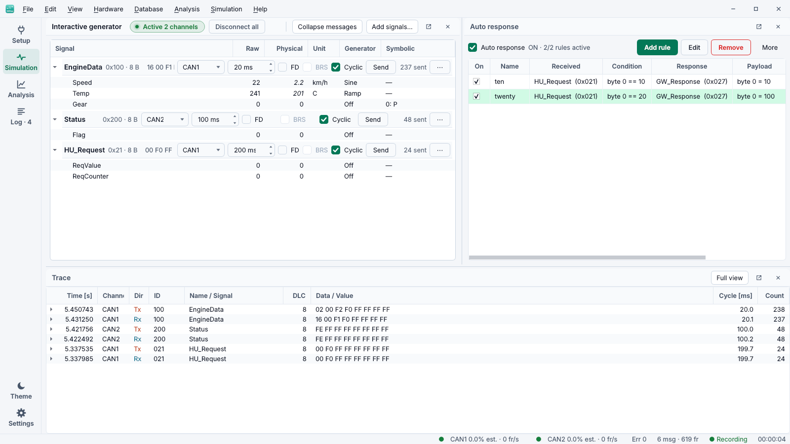
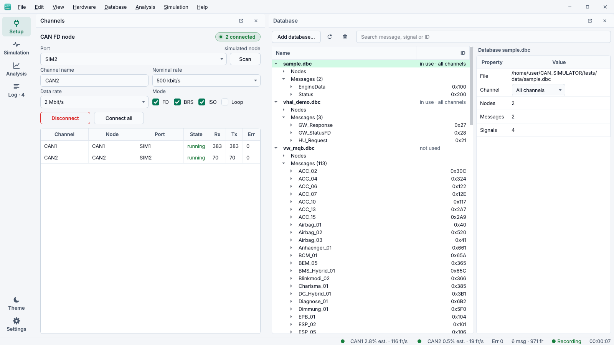
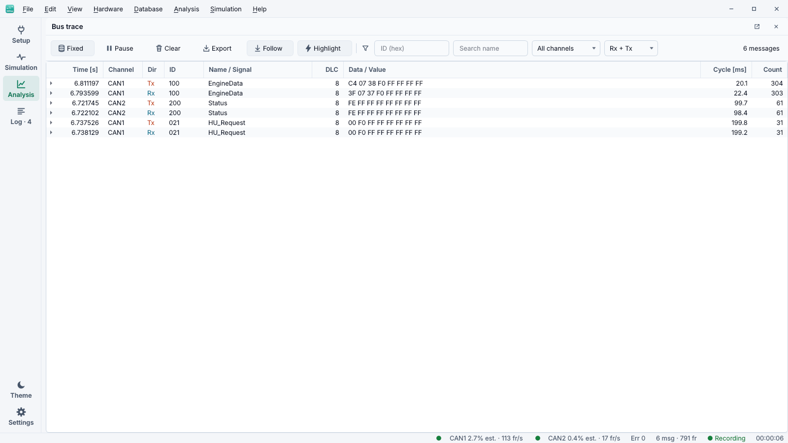

# AutoSim Studio – User Guide

How to use AutoSim Studio day to day. To install, see [Setup](SETUP.md).

1. [The window](#1-the-window)
2. [Setup: channels and databases](#2-setup-channels-and-databases)
3. [Simulation: interactive generator](#3-simulation-interactive-generator)
4. [Simulation: auto response](#4-simulation-auto-response)
5. [Analysis: bus trace](#5-analysis-bus-trace)
6. [Working with windows](#6-working-with-windows)
7. [Projects and settings](#7-projects-and-settings)
8. [Keyboard shortcuts](#8-keyboard-shortcuts)

## 1. The window

| Area | What it is |
|---|---|
| **Title bar** | App icon, the menus **File · Edit · View · Hardware · Database · Analysis · Simulation · Help**, and the window buttons. Drag the empty part to move the window (snap works); double-click to maximise. |
| **Rail** (left) | The desktops **Setup**, **Simulation**, **Analysis**; **Log** (shows the number of new lines, e.g. `Log · 2`); **Theme**; **Settings** |
| **Desktop** | The windows of the selected desktop |
| **Log** | Opens on demand (rail → Log, `Ctrl+J`), right of the rail, with **Clear** |
| **Status bar** | One entry per channel: **● state dot** (green running, amber connecting, red error), estimated bus load and frames/s; error count; trace size; Recording / Paused; elapsed time |

Every feature menu starts with the entry that opens its window, for example *Hardware → Channels window* or
*Analysis → Trace window*.

## 2. Setup: channels and databases

### 2.1 Open a channel

1. **Scan** lists the adapters: ESP32 nodes, CANable adapters (recognised by USB ID and preselected), PEAK PCAN
   channels (`PCAN_USBBUS1`, …, when PEAK's driver is installed; *Help → Download PEAK driver (PCAN)…* links to it), the
   simulated nodes `SIM1`, `SIM2`, and **VIRTUAL CAN**, the Android head unit through `autosim-bridge` (`bridge://127.0.0.1:29536`; type `bridge://<IP>:29536` for Ethernet).
2. Choose the **port**, a **channel name** (CAN1, CAN2, …), the **nominal rate**, the **data rate** and the mode:

| Field | Meaning |
|---|---|
| Nominal rate | Arbitration-phase bit rate: 125 k, 250 k, 500 k or 1 M |
| Data rate | CAN FD data-phase rate. CANable: 2 or 5 Mbit/s only. PCAN FD: 1, 2, 4, 5 or 8 Mbit/s (PCAN-USB: classic CAN only). ESP32 and simulated nodes: an integer multiple (1–10×) of the nominal rate. |
| FD / BRS / ISO | CAN FD on; bit-rate switching; ISO CRC (untick for non-ISO / Bosch; not on CANable or PCAN) |
| Loop | Internal loopback: the node receives its own frames, no bus needed |

3. **Connect**. The table shows each channel with its node name, port, state and Rx / Tx / error counters.
   Double-click a node name to rename the board (stored in the board; ESP32 only).
4. **Connect all** opens every free real adapter with the form's settings; **Disconnect all** closes all (it asks
   first when cyclic transmission is running). Both are also in the *Hardware* menu and in the Interactive
   generator's header.

To change the bit rates of an open channel: Disconnect, adjust, Connect.

### 2.2 Database window

The right part of the Setup desktop (60 % of the width; drag the gap to change it). It lists every database of the
configuration, used or not, as a tree.

- **Add database…** (or drop `.dbc` / `.arxml` / `.kcd` / `.sym` files on the window). Added files are used on
  all channels.
- The tree shows each file → **Nodes** → node → **Tx messages** → message → signals, and file → **Messages** →
  message → signals. Next to each file: *in use · all channels*, *in use · CAN1* or *not used*.
- **Properties** (right) describes the selected item: a message's ID, frame type, DLC, cycle time, senders and
  comment; a signal's start bit, length, byte order, sign, factor, offset, range, unit, initial value and value
  table; a database's file and counts, and its **Channel** choice:
  - *All channels*: used on every channel (decoding, simulation, rules);
  - one open channel: used on that channel only (e.g. powertrain DBC on CAN1, body DBC on CAN2);
  - *Not used*: unloaded from the engine, kept in the list.

- **Search** matches message names, signal names and hex IDs (`0x100`, `100`).
- Double-click a message (or right-click → *Add to Signals*) to open it in the Interactive generator.
- Right-click a file: *Use on* → *All channels* / a channel, *Do not use*, *Reload* (after editing the file; if the
  new version does not parse, the old one stays), *Copy path*, *Remove*. **Delete** removes the selected file. If
  messages of the file are being simulated, AutoSim asks first.

## 3. Simulation: interactive generator

### 3.1 Add messages and signals

**Add signals…** (header of the window, *Simulation* menu, `Ctrl+Shift+A`) opens the selection dialog:

- A tree of the databases in use → messages → signals, with check boxes.
- Type to search by message name, signal name or hex ID.
- Ticking a signal selects its message. Messages already in the generator are shown ticked and greyed.
- **Add** puts the messages in the generator, on the first open channel (or the channel their database is
  assigned to).

### 3.2 Edit and send

Each message is a row with its controls, and its signals are rows below it:

| Control | Use |
|---|---|
| Channel | Channel that sends this message |
| Cycle | Cycle time in ms |
| FD / BRS | Send as a CAN FD frame / with bit-rate switching |
| **Cyclic** | Start / stop periodic transmission |
| **Send** | Send once now |
| `…` | *Send on another channel*, *Remove message* |

Signal columns: **Raw** (integer on the wire) · **Physical** (scaled value) · **Unit** · **Generator** ·
**Symbolic** (value table). Click a cell, press `F2` / `Enter`, or start typing to edit. Raw and physical values
stay in sync and are limited to the signal's range.

**Generators** drive a signal automatically: *Sine*, *Ramp*, *Square*, *Toggle*. Choosing one opens its parameters
(amplitude, frequency, limits, …); right-click → *Generator parameters…* changes them, and *Stop generator* ends it.

The header shows the simulator status: **Inactive**, **Active n channels**, **Connecting** or **Error**. Hover it
to see each channel, its port and its state. **Collapse messages** folds every message to one line.

### 3.3 Copy

`Ctrl+C` copies the current cell (e.g. a signal name or value). Right-click a row: *Copy name*, *Copy <column>*,
*Copy row*.

## 4. Simulation: auto response

Rules answer received frames automatically. A typical use is an Android head unit asking for a value.

**Add rule** opens the editor:

| Part | Options |
|---|---|
| **When** | Message received (ID, or a message picked from the databases), on a channel or any channel |
| **Condition** | Any payload; a DBC signal compared with a value (`==`, `!=`, `<`, …); or a raw integer read from the payload (offset, size, byte order) |
| **Send** | Response ID, channel (default: where the trigger came in), FD / BRS, delay in ms |
| **Payload** | Raw bytes (hex) with an optional value written at an offset; or DBC signal values. Values are numbers or expressions of `rx`, the value that matched (e.g. `rx*10+1`). |

Example: *when 0x21 byte 0 == 10 → send 0x27 with byte 0 = 10* and *when 0x21 byte 0 == 20 → send 0x27 with byte
0 = 100*.

- The **Auto response** check box turns all rules on or off (`Ctrl+Shift+R`); each rule has its own **On** box.
- **Hits** counts how often a rule fired. An invalid rule is shown in red with the reason (hover).
- **More**: *Duplicate rule*, *Reset hit counters*, *Import rules…* / *Export rules…* (JSON).
- A rule that fires more than 1 000 times per second is switched off automatically (loop guard), with a Log line.
- Rules are saved between runs and in project files.

## 5. Analysis: bus trace

### 5.1 Bus trace

| Toolbar | Use |
|---|---|
| **Fixed** | One row per message (per channel and direction), updated in place, expandable (▸) to the decoded signals. Untick for the chronological view (one row per frame). |
| **Pause** (`Space`) / **Clear** (`Ctrl+L`) / **Export** (`Ctrl+E`) | Export writes every frame to CSV, Vector ASC or BLF |
| **Follow** | Keep the newest frame in view (chronological view) |
| **Highlight** | Rows flash briefly when their **payload changes** (a cyclic message repeating the same data stays calm) |
| Filters | ID (hex, several separated by commas), name search (`Ctrl+F`), channel, Rx / Tx |

Columns: Time, Channel, Dir (Rx cyan / Tx orange), ID, Name / Signal, DLC (`FD` for CAN FD), Data / Value,
Cycle [ms], Count. Drag a header edge to resize any column; `Ctrl+C` copies a cell or the selected rows.

The **Simulation** desktop has a compact **Trace** of the same data under the generator; **Full view** opens this
Bus trace.

## 6. Working with windows

- **Desktops**: `Ctrl+1` Setup · `Ctrl+2` Simulation · `Ctrl+3` Analysis.
- **Detach** a window with **⧉** in its header (or *View → Detach window*). It becomes a normal window you can move
  to a second monitor, and it stays visible whatever desktop is selected. Closing it docks it back.
- **Close / reopen**: **×** closes a window; reopen it from its menu or *View*. *View → Reset layout* restores
  the default arrangement.
- **Resize** windows by dragging the gaps between them. The layout of every desktop is remembered.
- **Theme**: rail → **Theme**, or *View → Theme* (Dark, Light, Follow system).

## 7. Projects and settings

- **File → Save project…** (`Ctrl+S`) writes channels, databases and rules to a JSON file; **Open project…**
  restores them (missing databases are listed in the Log).
- Remembered automatically: theme, window layout, the database library (files, in use, channel), the last port,
  and the auto response rules.
- **Settings** (rail, `Ctrl+,`): theme, files and projects, windows, *Stop all cyclic TX*.

## 8. Keyboard shortcuts

| Shortcut | Action |
|---|---|
| `Ctrl+K` | Command palette (every command by name) |
| `Ctrl+1` … `Ctrl+3` | Setup / Simulation / Analysis desktop |
| `Ctrl+J` | Show / hide the Log |
| `Ctrl+O` | Add database |
| `Ctrl+Shift+A` | Add signals |
| `Ctrl+Shift+R` | Auto response on / off |
| `Space` | Pause / resume the trace (not while typing) |
| `Ctrl+L` | Clear the trace |
| `Ctrl+E` | Export the trace |
| `Ctrl+F` | Search the trace |
| `Ctrl+C` | Copy the current cell / selected rows |
| `Ctrl+S` | Save project |
| `Ctrl+Shift+T` | Toggle light / dark theme |
| `Ctrl+,` | Settings |
| `Ctrl+Q` | Exit |
