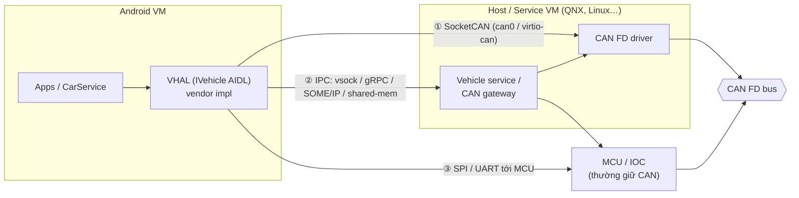
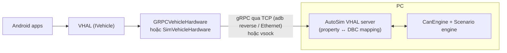
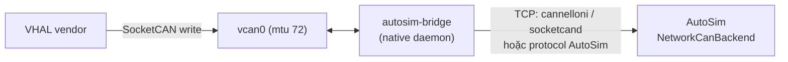
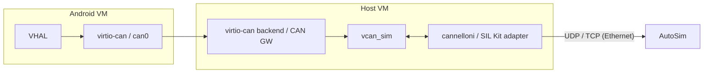
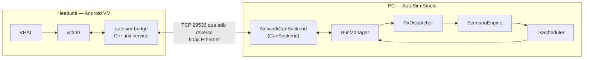

# Virtual CAN FD channel cho Android trong Headunit — các proposal

> **Trạng thái:** đã chọn và implement **Proposal B (vcan + bridge)** kèm tính năng **Auto response** — xem
> [ANDROID_BRIDGE.md](ANDROID_BRIDGE.md). Protocol thực tế là ABP v1 (mục 4 của tài liệu đó), port 29536,
> AutoSim là TCP client và `autosim-bridge` là server trong Android.

> Mục tiêu: trong Headunit (SoC chạy hypervisor → VM Cluster + VM Android), dựng một **simulation server** đứng ở
> vị trí VHAL, bắt các CAN / CAN FD message mà Android gửi ra, chuyển cho **AutoSim Studio**, rồi AutoSim
> **trả lời theo kịch bản cài sẵn** — không cần xe / ECU thật.

Nội dung: [1 Bối cảnh](#1-bối-cảnh-can-thực-sự-nằm-ở-đâu) · [2 Giải pháp tham khảo](#2-các-giải-pháp-đã-có-trên-thế-giới) ·
[3 Các proposal](#3-các-proposal) · [4 So sánh](#4-so-sánh) · [5 Khuyến nghị và lộ trình](#5-khuyến-nghị-và-lộ-trình) ·
[6 Thiết kế chi tiết cho proposal khuyến nghị](#6-thiết-kế-chi-tiết-proposal-khuyến-nghị) · [7 Rủi ro](#7-rủi-ro-và-câu-hỏi-cần-chốt)

---

## 1. Bối cảnh: CAN thực sự nằm ở đâu?

Trong headunit có hypervisor, Android **thường không nói CAN trực tiếp**. Câu hỏi đầu tiên cần chốt là VHAL của
vendor gửi dữ liệu xe ra bằng đường nào, vì đó là chỗ đặt điểm chặn (interception point):



| Kiểu | Android thấy gì | Điểm chặn hợp lý |
|---|---|---|
| ① SocketCAN trong Android (pass-through hoặc virtio-can) | CAN frame thật (`struct canfd_frame`) | thay `can0` bằng `vcan0` + bridge |
| ② VHAL nói IPC với host VM (phổ biến nhất với hypervisor) | property / signal, **không phải frame** | giả lập phía server của IPC đó |
| ③ VHAL nói với MCU qua SPI/UART | message riêng của vendor | giả lập MCU, hoặc chặn ở bus thật (HIL) |

Hệ quả: nếu là ② hoặc ③ thì "CAN message" chỉ xuất hiện **sau** khi host/MCU mã hoá signal; muốn AutoSim thấy frame thì
hoặc (a) mã hoá lại ở simulation server bằng DBC, hoặc (b) chặn ở tầng host/hypervisor.

---

## 2. Các giải pháp đã có trên thế giới

### 2.1 Từ AOSP (Google)

| Giải pháp | Mô tả | Liên quan |
|---|---|---|
| **GRPC VHAL** (`hardware/interfaces/automotive/vehicle/aidl/impl/grpc/`) | `GRPCVehicleHardware` là backend của VHAL, gọi một **vehicle server ở ngoài Android** qua gRPC (TCP hoặc **vsock** `vsock:CID:PORT`). | Đúng mô hình "VHAL front-end ở Android, back-end ở VM khác" → thay back-end bằng simulator. |
| **Trout** (`device/google/trout`) | Reference AAOS cho môi trường ảo hoá: `VirtualizedVehicleService` đọc địa chỉ vsock từ property, tạo `GRPCVehicleHardware`, đăng ký `IVehicle/default`. Phía host chạy VHAL server (nó cũng điều khiển shutdown / garage mode). | Tài liệu: *AAOS virtualization architecture*. |
| **FakeVehicleHardware** (reference VHAL) | Property cấu hình bằng JSON, có `dumpsys … --set`, `--inject-event`, `--genfakedata` (linear / JSON script). | Cách nhanh nhất để giả lập ở mức property, không có CAN. |
| **Emulator VHAL + `vhal_emulator.py`** (`packages/services/Car/tools/emulator`) | VHAL của AAOS Emulator nhận/gửi protobuf qua socket; script Python trên PC set/get property. | Tiền lệ "tool trên PC trả lời VHAL". |
| **CAN bus HAL** (`hardware/interfaces/automotive/can`) | HAL chuẩn quản lý SocketCAN / slcan / **vcan**; tool `canhalctrl`, `canhaldump`, `canhalsend`. | Dùng khi VHAL của mình đọc/ghi CAN trong Android. |
| `adb shell cmd car_service inject-vhal-event` | Inject property event từ shell. | Debug nhanh, không có kịch bản. |

### 2.2 Linux / open source

| Giải pháp | Mô tả |
|---|---|
| **vcan / vxcan / cangw** (kernel) | Interface CAN ảo, hỗ trợ CAN FD (`ip link set vcan0 mtu 72`); `vxcan` là cặp tunnel giữa 2 namespace; `cangw` route frame trong kernel. |
| **can-utils** | `candump`, `cansend`, `cangen`, `cansniffer`, `isotpsend`… |
| **cannelloni** | CAN / CAN FD qua UDP hoặc SCTP giữa 2 máy (SocketCAN ↔ mạng). |
| **socketcand** | Daemon cho phép truy cập SocketCAN qua TCP (protocol text); `python-can` có interface `socketcand`. |
| **virtio-can** | Thiết bị CAN ảo chuẩn VIRTIO (OpenSynergy khởi xướng, có trong spec VIRTIO 1.4, driver `drivers/net/can/virtio_can.c` đã vào mainline Linux). AGL dùng trong `meta-egvirt`. |
| **QEMU CAN** | QEMU có controller CAN giả lập (CTU CAN FD, Kvaser PCI…) với backend SocketCAN của host. |
| **Vector SIL Kit** (open source, MIT) | Middleware co-simulation; adapter `sil-kit-adapters-vcan` nối một vcan Linux vào CAN network của SIL Kit, `sil-kit-adapters-qemu` cho VM QEMU. |
| **Eclipse Kuksa (CAN provider / dbcfeeder)** | Đọc CAN qua DBC → VSS signal và ngược lại; ví dụ tốt cho bảng mapping DBC ↔ signal ↔ property. |

### 2.3 Thương mại (để benchmark)

* **Vector CANoe / vVIRTUALtarget / CANoe4SW** — rest-bus simulation, có thể chạy với ECU ảo và SIL Kit.
* **dSPACE VEOS / SCALEXIO**, **ETAS COSYM / LABCAR** — SIL / HIL cho ECU, có virtual bus.
* **OpenSynergy COQOS Hypervisor**, **QNX Hypervisor**, **Qualcomm Gunyah** — đều có virtio device (net, vsock, và với
  COQOS là virtio-can) để chia CAN từ host cho guest.
* **Harman / Bosch / Aptiv** thường dùng mô hình ②: VHAL ↔ SOME/IP hoặc IPC riêng ↔ vehicle service trên QNX/MCU.

---

## 3. Các proposal

### Proposal A — "Sim VehicleHardware": thay back-end của VHAL (mức property)

Viết một `IVehicleHardware` mới (hoặc dùng luôn **GRPC VHAL** của AOSP) trỏ tới **AutoSim** thay vì host VM. AutoSim
nhận `setValues(prop, area, value)`, dùng bảng mapping property ↔ DBC signal để mã hoá thành CAN FD frame (cho trace /
kịch bản), rồi trả lời bằng `onPropertyChangeEvent`.



* **Ưu**: không cần đụng hypervisor/host; chạy được cả trên AAOS Emulator / Cuttlefish; gRPC + proto đã có sẵn trong AOSP.
* **Nhược**: không test được code mapping signal → CAN của vendor (vì bị bỏ qua); phải có bảng mapping property ↔ signal.
* **Phù hợp**: test app / framework, demo, CI.

### Proposal B — vcan + bridge daemon trong Android (mức frame, kiểu ①)

Nếu VHAL vendor gửi CAN qua SocketCAN: tạo `vcan0` (CAN FD), cấu hình VHAL dùng `vcan0` thay `can0`, chạy daemon
**`autosim-bridge`** (native, init service) đọc/ghi `vcan0` và đẩy frame qua TCP tới AutoSim.



* **Ưu**: test được **toàn bộ** code VHAL vendor (cả encode signal); AutoSim thấy đúng frame thật; dùng lại được tool
  chuẩn (`candump` trong Android, `socketcand`, `cannelloni`).
* **Nhược**: kernel Android phải có `CONFIG_CAN_VCAN` (GKI cần vendor module); cần SELinux policy cho socket CAN và
  socket mạng; chỉ dùng được nếu VHAL thật sự nói SocketCAN.

### Proposal C — giả lập phía server của IPC (kiểu ②)

Khi VHAL nói với host VM bằng vsock / SOME/IP / gRPC riêng, viết một **fake vehicle service** nói đúng protocol đó, chạy
trên PC (qua Ethernet) hoặc trong host VM thay service thật. Fake service chuyển message IPC ↔ CAN frame (theo DBC/ARXML)
rồi đưa cho AutoSim.

* **Ưu**: Android image giữ nguyên 100% (không sửa VHAL); test cả code IPC client của vendor.
* **Nhược**: phải có spec protocol IPC của vendor (thường là ARXML/SOME/IP service interface hoặc proto nội bộ); có thể
  phải có quyền deploy vào host VM.

### Proposal D — chặn ở tầng hypervisor / host (virtio-can hoặc CAN gateway của host)

Cấu hình hypervisor để kênh CAN ảo của Android (virtio-can, hoặc CAN gateway trong host VM) **không nối ra controller thật**
mà nối vào `vcan` trong host; từ đó `cannelloni` / `sil-kit-adapters-vcan` đưa ra PC cho AutoSim.



* **Ưu**: sát production nhất mà vẫn không cần xe; Android và VHAL không sửa gì; Cluster VM cũng có thể nhận cùng bus ảo.
* **Nhược**: phụ thuộc hypervisor vendor (QNX / Gunyah / COQOS / Xen); cần quyền build host image; khó nhất.

### Proposal E — HIL ở CAN vật lý (baseline, AutoSim đã hỗ trợ)

Nối cổng CAN FD thật của headunit vào **CANable 2.0**; AutoSim làm rest-bus simulation + kịch bản.

* **Ưu**: không sửa phần mềm HU; AutoSim đã chạy được (slcan backend); test cả MCU / gateway.
* **Nhược**: cần bench + phần cứng; chỉ thấy những gì ra được bus vật lý (sau gateway / filter).

### Proposal F — co-simulation qua Vector SIL Kit

AutoSim trở thành một participant SIL Kit (Python binding hoặc process C++ nhỏ); host/Android nối vào bằng
`sil-kit-adapters-vcan`. Kết hợp với B hoặc D.

* **Ưu**: chuẩn công nghiệp, mở rộng sang Ethernet / LIN / FlexRay, chạy CI, có thể đồng bộ thời gian ảo; tương thích CANoe.
* **Nhược**: thêm một dependency lớn; cần build adapter cho Android/host.

---

## 4. So sánh

| | A Sim VHAL | B vcan + bridge | C Fake IPC server | D Hypervisor | E HIL | F SIL Kit |
|---|---|---|---|---|---|---|
| Sửa Android image | VHAL back-end | kernel module + daemon + sepolicy | không | không | không | tuỳ B/D |
| Sửa host / hypervisor | không | không | có thể | **có** | không | tuỳ |
| AutoSim thấy CAN frame thật | không (tự encode) | **có** | tự encode | **có** | **có** | **có** |
| Test code VHAL vendor | không | **có** | **có** | **có** | **có** | **có** |
| Chạy được trên Emulator / CI | **có** | có (Cuttlefish) | có | khó | không | **có** |
| Độ khó | thấp | trung bình | trung bình–cao | cao | thấp | trung bình |
| Thời gian ước tính PoC | 1–2 tuần | 2–3 tuần | 3–6 tuần | 4–8 tuần | đã có | 2–4 tuần |

---

## 5. Khuyến nghị và lộ trình

1. **Chốt kiểu kết nối** của VHAL vendor (①/②/③ ở mục 1): `adb shell ip link`, `lsof`/`ls -l /proc/<vhal pid>/fd`
   (có socket `AF_CAN`? `AF_VSOCK`?), `zcat /proc/config.gz | grep -E "CAN|VSOCK"`, xem `vendor/etc/init/*vehicle*.rc`.
2. **Phase 1 — AutoSim nói được qua mạng** (dùng chung cho mọi proposal): thêm `NetworkCanBackend` vào AutoSim
   (implement `CanBackend`) nói protocol **socketcand** hoặc **cannelloni**, cộng **Scenario engine** (mục 6.3).
   Test ngay với `vcan0` trên một máy Linux / Cuttlefish.
3. **Phase 2 — điểm chặn trên HU**:
   * nếu ①: Proposal **B** (vcan + `autosim-bridge`);
   * nếu ②: Proposal **A** (GRPC VHAL, nhanh) rồi tiến lên **C** khi có spec IPC;
   * song song giữ **E** làm reference "ground truth" trên bench.
4. **Phase 3 — tuỳ chọn**: **D** khi có hợp tác với team hypervisor/host, **F** khi cần CI / co-sim với CANoe.

---

## 6. Thiết kế chi tiết proposal khuyến nghị

### 6.1 Thành phần



* **autosim-bridge** (Android, C++, ~500 dòng): mở `PF_CAN/SOCK_RAW` với `CAN_RAW_FD_FRAMES`, `connect()` tới
  `127.0.0.1:29536` (sau `adb reverse tcp:29536 tcp:29536`) hoặc IP của PC; hai luồng read/write; tự reconnect.
  Có thể thay bằng `socketcand` build cho Android để khỏi tự viết.
* **NetworkCanBackend** (AutoSim, Python): server TCP, map frame ↔ `CanFrame`; đăng ký như một loại channel mới
  ("NET1") trong Channels panel, giống SIM1.

### 6.2 Wire protocol (nếu tự định nghĩa)

Mỗi frame, little-endian, không cần text parsing:

| Offset | Size | Field |
|---|---|---|
| 0 | 2 | magic `0xA5C4` |
| 2 | 1 | type: 0 = frame, 1 = heartbeat, 2 = bus config, 3 = error |
| 3 | 1 | flags: bit0 EXT, bit1 FD, bit2 BRS, bit3 ESI, bit4 RTR, bit5 TX-echo |
| 4 | 4 | CAN ID |
| 8 | 8 | timestamp µs (đồng hồ của phía gửi) |
| 16 | 1 | DLC thật (0–64 byte) |
| 17 | n | data |

Nếu muốn tương thích tool sẵn có, dùng luôn protocol **socketcand** (python-can đã có client) hoặc **cannelloni**.

### 6.3 Scenario engine (phần "response theo kịch bản")

Kịch bản lưu YAML trong project, dựa trên tên message/signal của DBC:

```yaml
scenario: door_lock_basic
rules:
  - on: { message: BCM_Cmd, signal: DoorLockReq, equals: 1 }     # Android gửi lệnh khoá cửa
    delay_ms: 80
    send: { message: BCM_Status, signals: { DoorLockSts: 1 } }  # ECU giả trả lời
  - on: { message: HU_Heartbeat, timeout_ms: 500 }               # mất heartbeat
    send: { message: GW_Fault, signals: { HuLost: 1 } }
cyclic:
  - { message: ESP_Speed, cycle_ms: 20, signals: { VehSpeed: { ramp: [0, 120, 10s] } } }
```

* Trigger: frame ID, signal == / range / thay đổi, timeout (không thấy message), timer.
* Action: gửi frame / set signal, bật–tắt cyclic job (TxScheduler đã có), chờ, chuyển state (state machine đơn giản).
* Mở rộng: hook Python (`def on_frame(ctx, frame)`) cho logic phức tạp — tương tự CAPL trong CANoe.
* Tận dụng sẵn: `DatabaseRegistry`, `signal_codec`, `TxScheduler`, `generators`, `RxDispatcher` (đặt ScenarioEngine
  làm subscriber của RX).

### 6.4 Android integration checklist

* Kernel: `CONFIG_CAN`, `CONFIG_CAN_RAW`, `CONFIG_CAN_VCAN` (GKI → vendor_dlkm module `vcan.ko`).
* `init.autosim.rc`: `ip link add dev vcan0 type vcan; ip link set vcan0 mtu 72 up`, start `autosim-bridge`
  (chỉ trong build `userdebug` hoặc khi `persist.vendor.autosim.enable=1`).
* SELinux: domain `autosim_bridge` với quyền `can_socket` và `tcp_socket` (connect); VHAL cần quyền dùng `vcan0`.
* VHAL vendor: đổi tên interface qua sysprop / config (`can0` → `vcan0`) — không hard-code.

---

## 7. Rủi ro và câu hỏi cần chốt

| # | Câu hỏi / rủi ro | Ảnh hưởng |
|---|---|---|
| 1 | VHAL vendor nói ①, ② hay ③? | quyết định chọn A/B/C/D |
| 2 | Có quyền sửa image host VM / hypervisor không? | D có khả thi không |
| 3 | Có DBC / ARXML cho các bus CAN FD và bảng mapping VHAL property ↔ signal? | A, C cần bảng mapping |
| 4 | Yêu cầu timing (cycle 10 ms, timeout E2E)? | qua adb/TCP jitter ~1–5 ms: đủ cho functional, **không** đủ để test timing chặt |
| 5 | E2E protection / SecOC / alive counter trên frame? | Scenario engine phải tính CRC/counter (thêm generator `e2e_profile`) |
| 6 | Bản build user (production) | bridge chỉ bật ở userdebug / eng hoặc qua property, tránh lọt ra production |

---

### Tài liệu tham khảo

* AAOS virtualization architecture — https://source.android.com/docs/automotive/virtualization/architecture
* Trout `VirtualizedVehicleService.cpp` — https://android.googlesource.com/device/google/trout/+/be96706/hal/vehicle/aidl/VirtualizedVehicleService.cpp
* virtio-can driver (Linux) — https://lwn.net/Articles/934187/ ; history: https://kernelsources.org/source/history/linux/drivers/net/can/virtio_can.c
* AGL `meta-egvirt` virtio-can — https://git.automotivelinux.org/AGL/meta-agl-devel/log/meta-egvirt/recipes-kernel/kernel-module-virtio-can/kernel-module-virtio-can.bb
* Vector SIL Kit — https://vectorgrp.github.io/sil-kit-docs ; adapters: https://github.com/vectorgrp/sil-kit-adapters-vcan , https://github.com/vectorgrp/sil-kit-adapters-qemu
* cannelloni — https://github.com/mguentner/cannelloni ; socketcand — https://github.com/linux-can/socketcand ; can-utils — https://github.com/linux-can/can-utils
* Eclipse Kuksa CAN provider — https://github.com/eclipse-kuksa/kuksa-can-provider
