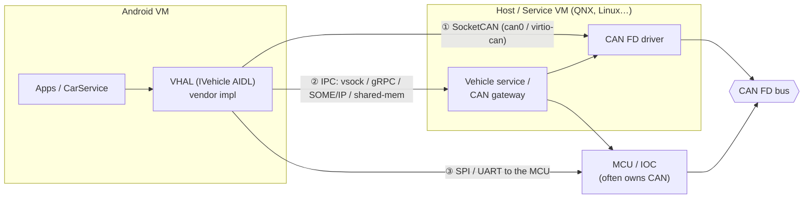
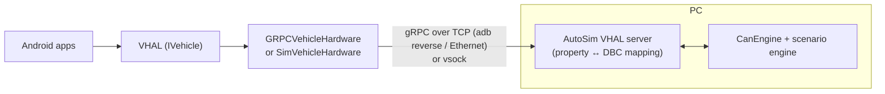
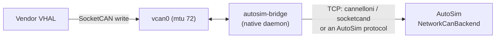
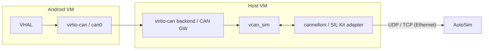
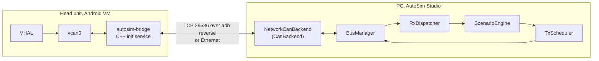

# Virtual CAN FD channel for Android in a head unit: proposals

> **Status:** **Proposal B (vcan + bridge)** was chosen and implemented, together with the **Auto response**
> feature. See [ANDROID_BRIDGE.md](ANDROID_BRIDGE.md). The protocol actually used is ABP v1 (section 4 of that
> document), on port 29536. `autosim-bridge` is the TCP server inside Android and AutoSim is the client.

> Goal: in a head unit (an SoC running a hypervisor, with a Cluster VM and an Android VM), build a **simulation
> server** in place of the VHAL's back-end. It captures the CAN / CAN FD messages that Android sends, passes them to
> **AutoSim Studio**, and AutoSim **answers according to predefined scenarios**. No vehicle or real ECU is needed.

Contents: [1 Context](#1-context-where-does-can-really-live) · [2 Existing solutions](#2-existing-solutions) ·
[3 Proposals](#3-proposals) · [4 Comparison](#4-comparison) · [5 Recommendation and roadmap](#5-recommendation-and-roadmap) ·
[6 Detailed design of the recommended proposal](#6-detailed-design-of-the-recommended-proposal) · [7 Risks](#7-risks-and-open-questions)

---

## 1. Context: where does CAN really live?

In a head unit with a hypervisor, Android **often does not speak CAN directly**. The first thing to settle is how
the vendor's VHAL sends vehicle data out, because that decides where to intercept it:



| Kind | What Android sees | Sensible interception point |
|---|---|---|
| ① SocketCAN inside Android (passthrough or virtio-can) | real CAN frames (`struct canfd_frame`) | replace `can0` with a vcan + bridge |
| ② The VHAL talks IPC to a host VM (most common with a hypervisor) | properties / signals, **not frames** | simulate the server side of that IPC |
| ③ The VHAL talks to an MCU over SPI / UART | the vendor's own messages | simulate the MCU, or intercept on the real bus (HIL) |

As a result, in cases ② and ③ "CAN messages" only exist **after** the host or MCU has encoded the signals. For
AutoSim to see frames, either (a) the simulation server re-encodes them with the DBC, or (b) the interception
happens at the host / hypervisor level.

---

## 2. Existing solutions

### 2.1 From AOSP (Google)

| Solution | Description | Relevance |
|---|---|---|
| **GRPC VHAL** (`hardware/interfaces/automotive/vehicle/aidl/impl/grpc/`) | `GRPCVehicleHardware` is a VHAL back-end that calls a **vehicle server outside Android** over gRPC (TCP or **vsock** `vsock:CID:PORT`). | Exactly the "VHAL front-end in Android, back-end in another VM" model: replace the back-end with a simulator. |
| **Trout** (`device/google/trout`) | Reference AAOS for virtualised setups: `VirtualizedVehicleService` reads the vsock address from a property, creates a `GRPCVehicleHardware` and registers `IVehicle/default`. The host runs the VHAL server (which also drives shutdown / garage mode). | Documentation: *AAOS virtualization architecture*. |
| **FakeVehicleHardware** (reference VHAL) | Properties configured in JSON, with `dumpsys … --set`, `--inject-event`, `--genfakedata` (linear / JSON script). | Fastest way to simulate at property level, without CAN. |
| **Emulator VHAL + `vhal_emulator.py`** (`packages/services/Car/tools/emulator`) | The AAOS Emulator's VHAL sends and receives protobuf over a socket; a Python script on the PC sets / gets properties. | Precedent for "a PC tool answers the VHAL". |
| **CAN bus HAL** (`hardware/interfaces/automotive/can`) | Standard HAL managing SocketCAN / slcan / **vcan**; tools `canhalctrl`, `canhaldump`, `canhalsend`. | Used when the VHAL reads / writes CAN inside Android. |
| `adb shell cmd car_service inject-vhal-event` | Injects property events from the shell. | Quick debugging, no scenarios. |

### 2.2 Linux / open source

| Solution | Description |
|---|---|
| **vcan / vxcan / cangw** (kernel) | Virtual CAN interfaces with CAN FD support (`ip link set vcan0 mtu 72`); `vxcan` is a tunnel pair between two namespaces; `cangw` routes frames in the kernel. |
| **can-utils** | `candump`, `cansend`, `cangen`, `cansniffer`, `isotpsend`… |
| **cannelloni** | CAN / CAN FD over UDP or SCTP between two machines (SocketCAN ↔ network). |
| **socketcand** | Daemon giving access to SocketCAN over TCP (text protocol); `python-can` has a `socketcand` interface. |
| **virtio-can** | Standard VIRTIO virtual CAN device (started by OpenSynergy, in the VIRTIO 1.4 spec; the driver `drivers/net/can/virtio_can.c` is in mainline Linux). AGL uses it in `meta-egvirt`. |
| **QEMU CAN** | QEMU emulates CAN controllers (CTU CAN FD, Kvaser PCI…) with a host SocketCAN back-end. |
| **Vector SIL Kit** (open source, MIT) | Co-simulation middleware; the `sil-kit-adapters-vcan` adapter connects a Linux vcan to a SIL Kit CAN network, `sil-kit-adapters-qemu` does the same for QEMU VMs. |
| **Eclipse Kuksa (CAN provider / dbcfeeder)** | Reads CAN through a DBC into VSS signals and back; a good example of a DBC ↔ signal ↔ property mapping table. |

### 2.3 Commercial (for comparison)

* **Vector CANoe / vVIRTUALtarget / CANoe4SW**: rest-bus simulation; can run with virtual ECUs and SIL Kit.
* **dSPACE VEOS / SCALEXIO**, **ETAS COSYM / LABCAR**: SIL / HIL for ECUs, with virtual buses.
* **OpenSynergy COQOS Hypervisor**, **QNX Hypervisor**, **Qualcomm Gunyah**: all provide virtio devices (net,
  vsock and, for COQOS, virtio-can) to share CAN from the host with guests.
* **Harman / Bosch / Aptiv** commonly use model ②: VHAL ↔ SOME/IP or a private IPC ↔ a vehicle service on QNX or
  the MCU.

---

## 3. Proposals

### Proposal A: "Sim VehicleHardware", replace the VHAL back-end (property level)

Write a new `IVehicleHardware` (or use AOSP's **GRPC VHAL** as is) that points at **AutoSim** instead of the host VM.
AutoSim receives `setValues(prop, area, value)`, encodes it into CAN FD frames with a property ↔ DBC signal mapping
table (for the trace and the scenarios), and answers with `onPropertyChangeEvent`.



* **Pros**: no change to the hypervisor or host; also runs on the AAOS Emulator / Cuttlefish; gRPC and the protos
  already exist in AOSP.
* **Cons**: the vendor's signal → CAN mapping code is not tested (it is bypassed); a property ↔ signal mapping table
  is needed.
* **Fits**: testing apps and the framework, demos, CI.

### Proposal B: vcan + bridge daemon in Android (frame level, kind ①)

If the vendor VHAL sends CAN through SocketCAN: create a CAN FD vcan, make the VHAL use it instead of the real
`can0`, and run an **`autosim-bridge`** daemon (native, init service) that reads / writes the vcan and forwards frames
over TCP to AutoSim.



* **Pros**: tests **all** of the vendor's VHAL code (including signal encoding); AutoSim sees the real frames;
  standard tools can be reused (`candump` in Android, `socketcand`, `cannelloni`).
* **Cons**: the Android kernel needs `CONFIG_CAN_VCAN` (with GKI, as a vendor module); SELinux policy is needed for
  the CAN socket and the network socket; only works if the VHAL really speaks SocketCAN.

### Proposal C: simulate the server side of the IPC (kind ②)

When the VHAL talks to a host VM over vsock / SOME/IP / a private gRPC, write a **fake vehicle service** that speaks
exactly that protocol, running on the PC (over Ethernet) or in the host VM in place of the real service. The fake
service converts IPC messages ↔ CAN frames (from the DBC / ARXML) and hands them to AutoSim.

* **Pros**: the Android image stays 100 % unchanged (the VHAL is not modified); the vendor's IPC client code is
  tested too.
* **Cons**: needs the specification of the vendor's IPC protocol (often an ARXML / SOME/IP service interface or
  internal protos); may need the right to deploy into the host VM.

### Proposal D: intercept at the hypervisor / host (virtio-can or the host's CAN gateway)

Configure the hypervisor so that Android's virtual CAN channel (virtio-can, or the CAN gateway in the host VM)
**is not connected to the real controller** but to a vcan in the host; from there `cannelloni` /
`sil-kit-adapters-vcan` take it out to the PC for AutoSim.



* **Pros**: closest to production while still needing no vehicle; nothing changes in Android or the VHAL; the
  Cluster VM can receive the same virtual bus.
* **Cons**: depends on the hypervisor vendor (QNX / Gunyah / COQOS / Xen); needs the right to build the host image;
  the hardest option.

### Proposal E: HIL on the physical CAN bus (baseline, already supported by AutoSim)

Connect the head unit's real CAN FD port to a **CANable 2.0** (or the ESP32 node); AutoSim does rest-bus simulation
and the scenarios.

* **Pros**: no change to the head unit's software; AutoSim already does it (slcan back-end); the MCU / gateway is
  tested too.
* **Cons**: needs a bench and hardware; only sees what reaches the physical bus (after gateways / filters).

### Proposal F: co-simulation through Vector SIL Kit

AutoSim becomes a SIL Kit participant (Python binding or a small C++ process); the host / Android connects through
`sil-kit-adapters-vcan`. Combined with B or D.

* **Pros**: industry standard, extends to Ethernet / LIN / FlexRay, runs in CI, can synchronise virtual time;
  compatible with CANoe.
* **Cons**: one more large dependency; adapters must be built for Android / the host.

---

## 4. Comparison

| | A Sim VHAL | B vcan + bridge | C Fake IPC server | D Hypervisor | E HIL | F SIL Kit |
|---|---|---|---|---|---|---|
| Android image changes | VHAL back-end | kernel module + daemon + sepolicy | none | none | none | as B / D |
| Host / hypervisor changes | none | none | maybe | **yes** | none | depends |
| AutoSim sees real CAN frames | no (encodes itself) | **yes** | encodes itself | **yes** | **yes** | **yes** |
| Tests the vendor's VHAL code | no | **yes** | **yes** | **yes** | **yes** | **yes** |
| Runs on Emulator / CI | **yes** | yes (Cuttlefish) | yes | hard | no | **yes** |
| Difficulty | low | medium | medium–high | high | low | medium |
| Estimated PoC time | 1–2 weeks | 2–3 weeks | 3–6 weeks | 4–8 weeks | done | 2–4 weeks |

---

## 5. Recommendation and roadmap

1. **Find out how the vendor VHAL connects** (①/②/③ in section 1): `adb shell ip link`, `lsof` /
   `ls -l /proc/<vhal pid>/fd` (an `AF_CAN` socket? `AF_VSOCK`?), `zcat /proc/config.gz | grep -E "CAN|VSOCK"`,
   and `vendor/etc/init/*vehicle*.rc`. [ANDROID_ENV_CHECKLIST.md](ANDROID_ENV_CHECKLIST.md) automates this.
2. **Phase 1: AutoSim talks over the network** (shared by every proposal): add a `NetworkCanBackend` to AutoSim
   (implementing `CanBackend`) speaking **socketcand**, **cannelloni** or an own protocol, plus a **scenario engine**
   (section 6.3). Test it right away with a vcan on a Linux machine / Cuttlefish.
3. **Phase 2: interception point on the head unit**:
   * case ①: Proposal **B** (vcan + `autosim-bridge`);
   * case ②: Proposal **A** (GRPC VHAL, quick), then **C** once the IPC specification is available;
   * keep **E** in parallel as the "ground truth" reference on the bench.
4. **Phase 3, optional**: **D** with the cooperation of the hypervisor / host team, **F** when CI or co-simulation
   with CANoe is needed.

---

## 6. Detailed design of the recommended proposal

This is the design as proposed. The implementation differs in a few points: the bridge is the TCP server and AutoSim
the client (`adb forward`), the protocol is ABP v1, and the scenarios are the Auto response rules. See
[ANDROID_BRIDGE.md](ANDROID_BRIDGE.md).

### 6.1 Components



* **autosim-bridge** (Android, C++, about 500 lines): opens `PF_CAN/SOCK_RAW` with `CAN_RAW_FD_FRAMES`,
  `connect()`s to `127.0.0.1:29536` (after `adb reverse tcp:29536 tcp:29536`) or to the PC's IP; separate read and
  write threads; reconnects by itself. `socketcand` built for Android could replace it.
* **NetworkCanBackend** (AutoSim, Python): TCP server, maps frames ↔ `CanFrame`; registered as a new kind of
  channel ("NET1") in the Channels window, like SIM1.

### 6.2 Wire protocol (if defined in-house)

One frame per packet, little-endian, no text parsing:

| Offset | Size | Field |
|---|---|---|
| 0 | 2 | magic `0xA5C4` |
| 2 | 1 | type: 0 = frame, 1 = heartbeat, 2 = bus config, 3 = error |
| 3 | 1 | flags: bit0 EXT, bit1 FD, bit2 BRS, bit3 ESI, bit4 RTR, bit5 TX echo |
| 4 | 4 | CAN ID |
| 8 | 8 | timestamp in µs (sender's clock) |
| 16 | 1 | real length (0–64 bytes) |
| 17 | n | data |

For compatibility with existing tools, use **socketcand** (python-can already has a client) or **cannelloni**
instead.

### 6.3 Scenario engine (the "answer according to scenarios" part)

Scenarios are stored as YAML in the project, using the DBC's message and signal names:

```yaml
scenario: door_lock_basic
rules:
  - on: { message: BCM_Cmd, signal: DoorLockReq, equals: 1 }     # Android sends a door-lock command
    delay_ms: 80
    send: { message: BCM_Status, signals: { DoorLockSts: 1 } }  # the simulated ECU answers
  - on: { message: HU_Heartbeat, timeout_ms: 500 }               # heartbeat lost
    send: { message: GW_Fault, signals: { HuLost: 1 } }
cyclic:
  - { message: ESP_Speed, cycle_ms: 20, signals: { VehSpeed: { ramp: [0, 120, 10s] } } }
```

* Triggers: frame ID, signal == / range / change, timeout (a message not seen), timer.
* Actions: send a frame / set a signal, start / stop a cyclic job (TxScheduler already exists), wait, change state
  (a simple state machine).
* Extension: Python hooks (`def on_frame(ctx, frame)`) for complex logic, similar to CAPL in CANoe.
* Reuses: `DatabaseRegistry`, `signal_codec`, `TxScheduler`, `generators`, `RxDispatcher` (the ScenarioEngine
  subscribes to RX).

### 6.4 Android integration checklist

* Kernel: `CONFIG_CAN`, `CONFIG_CAN_RAW`, `CONFIG_CAN_VCAN` (GKI → `vcan.ko` as a vendor_dlkm module).
* `init.autosim.rc`: `ip link add dev vcan0 type vcan; ip link set vcan0 mtu 72 up`, start `autosim-bridge`
  (only in `userdebug` builds or when `persist.vendor.autosim.enable=1`).
* SELinux: an `autosim_bridge` domain allowed `can_socket` and `tcp_socket` (connect); the VHAL must be allowed to
  use the vcan.
* Vendor VHAL: the interface name comes from a sysprop / configuration (`can0` → `vcan0`), not hard-coded.
  (The implementation avoids this by renaming: the vcan takes the name `can0`.)

---

## 7. Risks and open questions

| # | Question / risk | Impact |
|---|---|---|
| 1 | Does the vendor VHAL use ①, ② or ③? | decides between A / B / C / D |
| 2 | Can the host VM / hypervisor image be modified? | whether D is feasible |
| 3 | Are there DBC / ARXML files for the CAN FD buses, and a VHAL property ↔ signal mapping table? | A and C need the mapping table |
| 4 | Timing requirements (10 ms cycles, E2E timeouts)? | over adb / TCP the jitter is about 1–5 ms: enough for functional tests, **not** for strict timing tests |
| 5 | E2E protection / SecOC / alive counters on the frames? | the scenario engine must compute CRCs / counters (an `e2e_profile` generator) |
| 6 | `user` (production) builds | the bridge is only enabled in userdebug / eng builds or through a property, so it cannot leak into production |

---

### References

* AAOS virtualization architecture: https://source.android.com/docs/automotive/virtualization/architecture
* Trout `VirtualizedVehicleService.cpp`: https://android.googlesource.com/device/google/trout/+/be96706/hal/vehicle/aidl/VirtualizedVehicleService.cpp
* virtio-can driver (Linux): https://lwn.net/Articles/934187/ ; history: https://kernelsources.org/source/history/linux/drivers/net/can/virtio_can.c
* AGL `meta-egvirt` virtio-can: https://git.automotivelinux.org/AGL/meta-agl-devel/log/meta-egvirt/recipes-kernel/kernel-module-virtio-can/kernel-module-virtio-can.bb
* Vector SIL Kit: https://vectorgrp.github.io/sil-kit-docs ; adapters: https://github.com/vectorgrp/sil-kit-adapters-vcan , https://github.com/vectorgrp/sil-kit-adapters-qemu
* cannelloni: https://github.com/mguentner/cannelloni ; socketcand: https://github.com/linux-can/socketcand ; can-utils: https://github.com/linux-can/can-utils
* Eclipse Kuksa CAN provider: https://github.com/eclipse-kuksa/kuksa-can-provider
