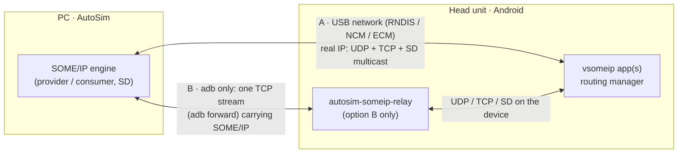
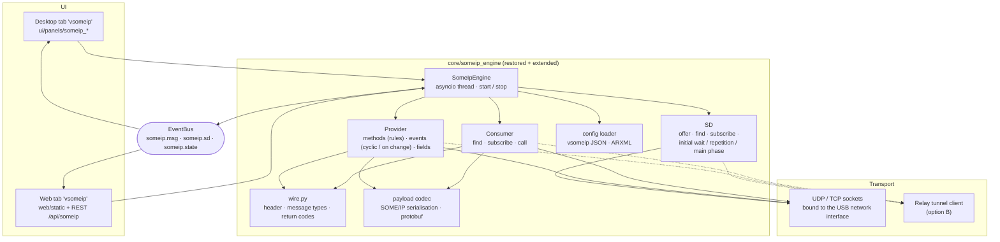

# Plan – "vsomeip" tab: simulate SOME/IP over USB

| | |
|---|---|
| **Status** | Plan, for review (branch `vsomeip`) – nothing implemented yet |
| **Goal** | A new **vsomeip** tab that simulates SOME/IP ECUs (services, methods, events, fields, Service Discovery) for a device connected to the PC **over USB** (typically an Android head unit running vsomeip), and shows every SOME/IP message in a trace |
| **Reuse** | A custom SOME/IP stack existed in this project (wire format, SD, UDP + TCP provider / consumer, vsomeip JSON loader, payload codec, protobuf, 9 tests). It was removed on 2026-10-18 and is in git history: commit `fc1f393`, folder `archive/someip_removed_2026-10-18/` (≈ 1 400 lines core + 835 lines UI) |

---

## 1. What "SOME/IP over USB" can mean

SOME/IP runs on **UDP / TCP over IP** (port 30490 + multicast `224.244.224.245` for Service Discovery). USB itself
does not carry IP, so the first decision is which path the device offers. Three options, from simplest to most work:



| Option | When | SOME/IP on the link | Work |
|---|---|---|---|
| **A · USB network** | the head unit exposes a USB network interface (USB tethering / RNDIS / NCM, or a USB-Ethernet adapter on the bench) | native: UDP, TCP, SD multicast – AutoSim binds to that interface | small: pick the USB network interface, bind and join multicast on it |
| **B · adb only** | only `adb` is available (no IP over USB) | `adb forward` carries **TCP only** – no UDP, no multicast – so a small **relay on the device** joins SD / UDP there and tunnels the messages to AutoSim over one TCP stream (like `autosim-bridge` does for CAN) | medium: relay daemon (C / NDK) + tunnel framing + deploy script, root / SELinux as for the CAN bridge |
| **C · local** | development without a device: vsomeip sample apps on the same PC / WSL / Linux VM | loopback / host network | none extra – also used for automated interop tests |

**Recommendation:** build A first (it is real SOME/IP, and C comes with it), check on the target head unit whether
a USB network exists (M0), and add B only if it does not.

## 2. What the tab does

**Roles**

| AutoSim as … | It does | Typical use |
|---|---|---|
| **Provider** (simulated ECU) | offers services via SD, answers method calls (rules: request → response, like Auto response), sends events cyclically or on change, serves fields (get / set / notify) | the head unit's vsomeip app talks to "the car" while no ECU is there |
| **Consumer** (simulated client) | finds services, subscribes to event groups, calls methods, shows events | test the head unit's own services |
| **Monitor** | traces every SOME/IP / SD message on the interface | debug |

**Layout (same style as the other desktops)**

```
┌ vsomeip ────────────────────────────────────────────────────────────────────────────┐
│ Link: [USB network ▾ usb0 192.168.42.129]  [Start]  ● SD running                    │
├──────────────────────┬──────────────────────────────────────────────────────────────┤
│ Services (config)    │ Service 0x1234 · instance 0x0001 · Provider ▣ offered        │
│ ▾ VehicleInfo 0x1234 │  Methods   GetSpeed 0x0001  → response rule / fixed payload   │
│    ▸ methods         │  Events    Speed 0x8001  every 100 ms  payload [editor]       │
│    ▸ events          │  Fields    Gear  get / set / notify  value [D ▾]              │
│    ▸ fields          │  Consumer  [Call method]  [Subscribe eventgroup 0x0001]       │
├──────────────────────┴──────────────────────────────────────────────────────────────┤
│ SOME/IP trace  filters: service · method · type · peer   (click a row: header + payload decoded) │
│ time  peer  UDP/TCP  service.method  client/session  type  rc  len  payload / decoded            │
│ SD log: OfferService · FindService · SubscribeEventgroup · Ack / Nack                            │
└───────────────────────────────────────────────────────────────────────────────────────┘
```

**Configuration input**

- **vsomeip JSON** (services, instances, unreliable / reliable ports, event groups) – the archived loader reads it.
- **ARXML** SOME/IP service interfaces – best effort (IDs, event groups), as before.
- **Payloads:** a SOME/IP serialisation editor (uint8 … uint64, int, float, bool, strings, arrays, structs with
  length fields) and **protobuf** (`.proto`) – both exist in the archive (`payload.py`, `proto_loader.py`).
- Everything saved with the project / signal board; export / import as JSON.

---

## 3. Architecture

Same rules as CAN: the engine is pure Python (no Qt), runs on its own asyncio thread, publishes on the EventBus; the
desktop tab and the web tab are two views of it.



| Package | Content | From the archive |
|---|---|---|
| `core/someip_engine/wire.py` | header, message types, return codes, TP flag | yes |
| `core/someip_engine/sd.py` | SD entries / options, offer / find / subscribe | yes – add the SD phases (initial wait, repetitions, cyclic offer, TTL) |
| `core/someip_engine/server.py`, `client.py`, `tcp.py` | provider / consumer over UDP + TCP | yes |
| `core/someip_engine/payload.py`, `proto_loader.py` | serialisation, protobuf | yes |
| `core/someip_engine/config_loader.py` | vsomeip JSON, ARXML | yes |
| `core/someip_engine/rules.py` | method → response rules, cyclic events, fields | **new** (pattern of `auto_response.py`) |
| `core/someip_engine/trace.py` | decoded message rows, filters, export (pcap?) | **new** |
| `hardware/usb_net.py` | list network interfaces, mark USB ones (RNDIS / NCM / ECM), IP, multicast join | partly (`eth_interface/nic.py`) |
| `bridge/autosim-someip-relay/` | device relay + framing (option B) | **new** |
| `ui/panels/someip_*.py` | desktop tab | archived `someip_panel.py` (835 lines) as a start, rebuilt in the current UI style |
| `web/someip.py` + `static` | web tab, REST, WebSocket messages | **new** |

---

## 4. Milestones

| # | Milestone | Content | Estimate |
|---|---|---|---|
| **M0** | Spike on the target | Check the head unit: `adb shell ip addr` (usb0 / rndis0 / ncm?), USB tethering, vsomeip version and config (`/vendor/etc/vsomeip*.json`), unicast address, SD multicast, services it offers / needs. Decide A or B. Small Windows test: bind + multicast join on the USB network adapter | 1–2 d |
| **M1** | Engine back | Restore `someip_engine` from `fc1f393` into the current structure, current Python / lint, EventBus topics, the 9 archived tests green + new tests (SD phases, TTL, TCP framing) | 2–3 d |
| **M2** | Transport over USB | **A:** interface picker (USB networks first), bind + multicast on it, reconnect when USB is replugged. **B (only if needed):** relay daemon (C / NDK), tunnel framing, Python transport, deploy script `scripts/someip_relay.cmd`, docs | A: 1–2 d · B: 4–5 d |
| **M3** | Provider simulation | offer / stop offer, method response rules (match on payload, like Auto response), cyclic and on-change events, fields get / set / notify, return codes and errors | 3 d |
| **M4** | Consumer + trace | find / subscribe, method caller with payload editor, event view; SOME/IP trace with filters (service, method, type, peer), click a row for header + decoded payload, SD log, export | 3 d |
| **M5** | Desktop tab "vsomeip" | rail button, layout above, persistence in project / signal board files, light / dark | 3–4 d |
| **M6** | Web tab "vsomeip" | REST `/api/someip/…`, WebSocket `someip` messages, the same tab in the browser; **Test API**: expose SOME/IP fields / events as `/api/v1/someip/<name>` (GET value, PUT sends) | 3 d |
| **M7** | Interop, docs, release | automated interop test against the **real vsomeip sample apps** (hello_world, request / response, notify) in a Linux container; user guide section, design doc, release notes; installer | 2–3 d |

**Total:** about 3–4 weeks with option A, plus about 1 week for option B.
Each milestone ends with a commit on `vsomeip`, green tests and screenshots; merge to `main` when you say so.

---

## 5. Testing

| Level | How |
|---|---|
| Unit | wire format, SD entries / options, payload codec (all types, endianness, length fields), rules, config loader |
| Integration (no device) | provider ↔ consumer of AutoSim over loopback UDP / TCP / multicast; SD phases and TTL expiry |
| **Interop** | real **vsomeip 3.x** sample apps built in a Linux container (CI): AutoSim provider ↔ vsomeip client and vsomeip service ↔ AutoSim consumer |
| GUI / web | headless desktop tests, browser end to end (Playwright) like the Test API tab |
| On the bench | head unit over USB: SD visible, a service offered by AutoSim found by the head unit's vsomeip app, method calls answered, events received |

## 6. Risks

| Risk | Mitigation |
|---|---|
| The head unit has **no IP over USB** (adb only) | option B (relay on the device), decided in M0 |
| Windows: binding and **multicast join on a USB network adapter** (several NICs, firewall) | bind to the adapter's IP explicitly; firewall rule hint in the UI; spike in M0 |
| vsomeip on the device expects a fixed unicast IP / subnet / SD multicast group | read the device's vsomeip JSON in M0; make IP, port, multicast and SD timing configurable |
| Large payloads over UDP (> 1 400 bytes) need **SOME/IP-TP** | not in the archive; add in M3 if the target uses it |
| E2E protection (profile 4 / 5 / 6 CRC + counter) on signals | out of scope for v1; can be added like DBC checksums later |
| Root / SELinux for the relay (option B) | same approach as `autosim-bridge` (`adb root`, permissive or policy) |
| Licence | AutoSim implements the protocol itself; vsomeip (MPL-2.0) is not linked, only used in interop tests |

## 7. Questions to decide before M1

1. **Target device and link:** is it the Android head unit used for the CAN bridge? Does it offer USB tethering /
   an RNDIS / NCM network, or only adb? (If unsure, M0 checks it.)
2. **Role first:** simulate the **ECU side** (AutoSim = provider, the head unit = client) – or the head unit side?
3. **Where:** desktop app, web mode, or both? (Recommendation: shared engine; desktop tab first, web tab in M6.)
4. **Configuration available:** a vsomeip JSON, ARXML, FIBEX or `.proto` files of the services? A sample helps a lot.
5. **Payload format:** plain SOME/IP serialisation, protobuf, or both?
6. Needed in v1: **SOME/IP-TP**, **E2E**, TCP (reliable) services, IPv6?
