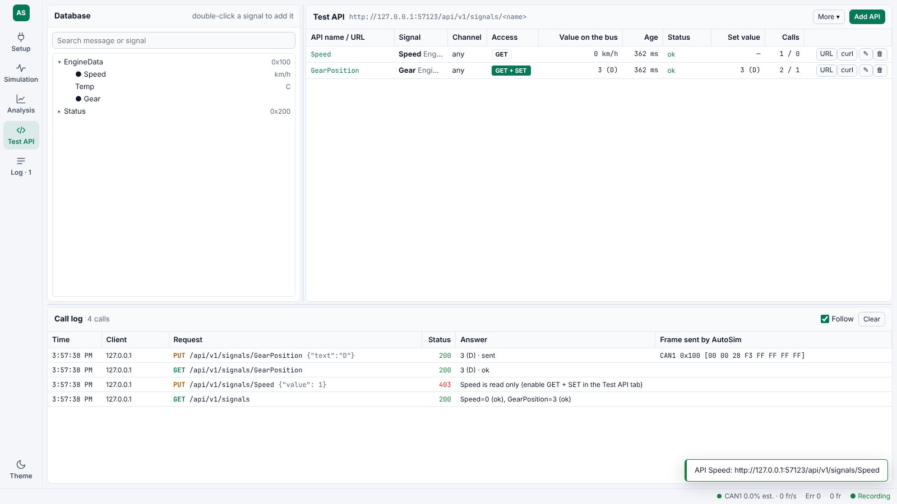

# AutoSim Studio Web – web mode

The simulator in a browser. The PC with the CAN adapters runs a small server; any browser (on the same PC or on
another PC of the network) shows the same desktops as the app: **Setup** (Channels | Database), **Simulation**
(Interactive generator, Auto response, Trace) and **Analysis** (Bus trace). The Signal plot is not part of web mode.

Everything the browser does goes through an HTTP / JSON API and one WebSocket (below), so scripts and test benches
can drive the simulator the same way.

## 1. Start it

| How | Command |
|---|---|
| Installed (Windows) | Start menu → **AutoSim Studio Web** (this PC only) or **AutoSim Studio Web (network access)** |
| From source | `uv run --extra web autosim-web` or `uv run --extra web python -m autosim.web` |

A console window shows the address and the browser opens on it (`--no-browser` to skip). Close the window or press
`Ctrl+C` to stop.

| Option | Default | Meaning |
|---|---|---|
| `--host` | `127.0.0.1` | Address to listen on. `0.0.0.0`: every network interface (other PCs can connect) |
| `--port` | `8765` | TCP port |
| `--data-dir` | `~/.autosim-web` | Settings (`settings.json`) and uploaded databases (`databases/`) |
| `--token` | random when the host is not loopback | Access token |
| `--no-token` | off | No token even on a network address (trusted lab network only) |
| `--dbc FILE` | – | Database to add at start (repeatable) |
| `--no-browser` | off | Do not open the browser |

**Security.** On `127.0.0.1` only this PC can connect. With `--host 0.0.0.0` anyone who can reach the port could
send frames on the real bus, so a token is required: the printed address contains `?token=…`, opening it once stores
a cookie in that browser. API clients send the header `X-AutoSim-Token: <token>`. Allow the port in the Windows
firewall when other PCs must connect.

## 2. What it can do

Same behaviour as the desktop windows, on the same engine:

- **Channels**: Scan, ESP32 / CANable / PCAN / simulated nodes / **VIRTUAL CAN** (Android bridge), rates limited
  to what the adapter supports, Connect, Connect all, Disconnect, rename (ESP32), live state and counters.
- **Database**: upload `.dbc` / `.arxml` / `.kcd` / `.sym` (button or drag and drop) or add a file by its path on the
  server, tree (nodes, Tx messages, messages, signals), search, properties, Channel choice per database (All
  channels / one channel / Not used), reload, remove.
- **Interactive generator**: Add signals dialog, channel, cycle, FD / BRS, Cyclic, Send, raw / physical / symbolic
  values, generators (sine, ramp, square, toggle) with their parameters, live values 5 times per second.
- **Auto response**: the full rule editor, on / off, hits, duplicate, delete, import / export JSON.
- **Trace**: fixed view (one row per message, expandable to decoded signals, highlight on change) and chronological
  view (last 100 000 frames in the browser, virtual scrolling), filters (the name filter works as in the app: `Speed|Gear`, `ADRV_*`, `!CHECKSUM`; the 5 recent filters are kept in the browser), pause, clear, export CSV / ASC / BLF of the
  last 200 000 frames kept by the server.
- **Test API** (`Ctrl+4`): publish CAN signals for test systems, see [Test API](#test-api-for-test-systems).
- Log, status bar (bus load, frames/s, errors), light / dark theme, `Ctrl+1…4`, `Ctrl+J`, `Ctrl+L`, `Space`.

Settings (databases, rules, generator messages, last form) are saved in `--data-dir` and restored at the next start.
Channels are not reopened automatically.

## 3. API

JSON in, JSON out. A problem for the user answers **400** `{"error": "text"}`; a missing token **401**.

### State and channels

| Method | Path | Body / query | Answer |
|---|---|---|---|
| GET | `/api/state` | – | `ports`, `channels`, `form`, `databases`, `cards`, `auto_response`, `version`, … |
| POST | `/api/scan` | – | state, with the ports scanned again |
| GET | `/api/rates` | `?port=SIM1&nominal=500000` | `{"rates": [data rates the adapter accepts]}` |
| POST | `/api/connect` | `{"port", "channel"?, "nominal", "data", "fd", "brs", "iso", "loop"}` | `{"channel": "CAN1"}` |
| POST | `/api/connect_all` | rates / mode as above | `{"opened": [...], "failed": [...]}` |
| POST | `/api/disconnect` | `{"channel"}` | `{"ok": true}` |
| POST | `/api/disconnect_all` | – | `{"closed": n}` |
| POST | `/api/rename` | `{"channel", "name"}` | ESP32 nodes only |

### Databases

| Method | Path | Body | Notes |
|---|---|---|---|
| GET | `/api/databases` | – | every database with nodes, messages, signals (start bit, factor, range, unit, value table, …) |
| POST | `/api/databases/upload` | multipart, field `file` (repeatable) | saved in `<data-dir>/databases/` and used on all channels |
| POST | `/api/databases/add` | `{"path"}` | a file on the server PC |
| POST | `/api/databases/use` | `{"path", "channel"}` | `"*"` all channels, `"CAN1"`, or `null` = not used |
| POST | `/api/databases/reload` · `/remove` | `{"path"}` | |
| POST | `/api/decode` | `{"channel", "id", "data": "hex"}` | `{"message", "signals": [{name, value, unit, text}]}` |

### Interactive generator

| Method | Path | Body |
|---|---|---|
| POST | `/api/tx/add` | `{"message"}` or `{"messages": [...]}`, optional `"channel"` → `{"ids": [...]}` |
| POST | `/api/tx/update` | `{"id", "channel"?, "cycle"?, "fd"?, "brs"?, "enabled"?}` (`enabled` = cyclic on / off) |
| POST | `/api/tx/send` | `{"id"}` – send once |
| POST | `/api/tx/signal` | `{"id", "name", "value"}` (physical) or `{"id", "name", "raw"}` → `{"value"}` (clamped) |
| POST | `/api/tx/generator` | `{"id", "name", "kind": "sine"\|"ramp"\|"square"\|"toggle"\|null, "params"?: [p1, p2, p3]}` |
| POST | `/api/tx/remove` | `{"id"}` |
| POST | `/api/tx/stop_all` | – |

### Auto response and trace

| Method | Path | Body |
|---|---|---|
| GET | `/api/rules` | – → `{"enabled", "rules": [rule + when / condition / response text, hits, errors]}` |
| PUT | `/api/rules` | `{"rules": [...], "enabled"?}` → `{"problems": [...]}` (same fields as the desktop rule editor and the JSON export) |
| POST | `/api/rules/enabled` | `{"enabled"}` |
| POST | `/api/rules/reset` | – reset hit counters |
| POST | `/api/trace/pause` | `{"paused"}` |
| POST | `/api/trace/clear` | – |
| GET | `/api/trace/export?format=csv\|asc\|blf` | file download |

### WebSocket `/ws`

Server → client messages (JSON):

| `type` | When | Content |
|---|---|---|
| `hello` | on connect | `rows` (last 2 000 frames), `logs`, `status`, `version` |
| `update` | up to 25 times per second | `rows` (new frames), `dropped`, `logs`, `nodes` (channel states), `version` (changed → GET `/api/state`) |
| `values` | 5 times per second while a message is cyclic | `cards`: `{id: {count, values}}` |
| `status` | every second | per channel `load` (%), `fps`, `state`, `errors`; `hits` of the rules; `trace` size |
| `clear` | trace cleared | – |

A frame row is `[time s, channel, rx (1) / tx (0), id, extended, name, fd, brs, "hex data", cycle ms, changed]`.

### Example (Python)

```python
import requests
B = "http://127.0.0.1:8765"
requests.post(f"{B}/api/connect", json={"port": "SIM1"})
requests.post(f"{B}/api/databases/add", json={"path": r"C:\dbc\vehicle.dbc"})
cid = requests.post(f"{B}/api/tx/add", json={"message": "EngineData"}).json()["ids"][0]
requests.post(f"{B}/api/tx/signal", json={"id": cid, "name": "Speed", "value": 88})
requests.post(f"{B}/api/tx/update", json={"id": cid, "cycle": 10, "enabled": True})
```

## Test API for test systems

The **Test API** tab publishes chosen CAN signals as simple HTTP endpoints, so a test system (pytest, Robot
Framework, Jenkins, LabVIEW, Postman …) can read the value on the bus and make AutoSim send a frame.
Step-by-step guide with examples (read the speed, set the gear, read the JSON): **[TEST_API_GUIDE.md](TEST_API_GUIDE.md)**.



**Publish a signal**

- **Double-click a signal** in the database tree (left): an API named after the signal is added with the defaults
  (read only, any channel, value = the signal's DBC initial value). Double-click it again: nothing is duplicated.
- Or **Add API** (right-click a signal → *Add API…*): message, signal, **API name** (part of the URL; letters,
  digits, `_ . -`), **Channel**, **Access** (*GET* = read only, *GET + SET* = PUT allowed), **Value to send**
  (starts at the DBC initial value; signals with a value table offer their names), **Stale after** (ms).
- The table shows, live: the value on the bus (with its value-table name and unit), its age, the status, the value a
  PUT sends, and the number of GET / PUT calls. **URL** and **curl** copy the address or a ready command;
  ✎ edits, 🗑 removes. *More* exports / imports the list as JSON. The list is saved in `--data-dir`.
- **Call log** (bottom): every call of a test system - time, client address, request and body, HTTP status, the
  answer, and the frame AutoSim sent for a PUT. **Click a call** to see the whole request and JSON response (and
  the frame), with *Copy as curl* / *Copy response*.

**How it works.** The Test API is independent of the Interactive generator:

- **GET** answers the newest value of the signal **on the bus**: the last frame of its message received or sent on
  the API's channel (any channel when it has none), whoever sent it. It works while the trace is paused.
- **PUT** sets the value and sends **one frame** of the message now, on the API's channel (or the channel its
  database is used on). The frame holds the DBC initial values, plus the current value of every API of the same
  message. Nothing is sent cyclically and no generator message is created.

**Calls**

| Method | Path | Answer |
|---|---|---|
| GET | `/api/v1/signals/<name>` | one signal (below) |
| GET | `/api/v1/signals` or `?names=A,B` | `{"signals": {name: …}}`, every (or the named) API in one call |
| PUT / POST | `/api/v1/signals/<name>` | body `{"value": 3}` (physical), `{"text": "D"}` (value table name) or `{"raw": 30}` |

```json
GET /api/v1/signals/GearPosition
{"name": "GearPosition", "signal": "Gear", "message": "EngineData", "id": "0x100", "channel": "CAN1",
 "value": 3, "raw": 3, "text": "D", "unit": "", "timestamp": 12.345, "age_ms": 8.1, "direction": "rx",
 "status": "ok", "default": 0, "set_value": 3, "access": "getset"}

PUT /api/v1/signals/GearPosition   {"text": "D"}
{"name": "GearPosition", "value": 3, "text": "D", "status": "sent",
 "sent": {"channel": "CAN1", "id": "0x100", "data": "00 00 28 F3 FF FF FF FF", "fd": false}, …}
```

`status`: `ok`; `stale` (no frame for longer than *Stale after*); `no_data` (never seen on the bus); `inactive`
(multiplexed signal not in the last frame); `undecodable`; `error` (message no longer in the databases).

| HTTP status | Meaning |
|---|---|
| 200 | done |
| 400 | bad body: not JSON, not a number, outside the DBC range, unknown value name, raw not an integer |
| 401 | token missing (server started on a network address) - send `X-AutoSim-Token: <token>` |
| 403 | PUT on a read-only API (enable *GET + SET*) |
| 404 | no API with this name, or its signal is no longer in the databases |
| 409 | the channel is not open, or the adapter refused the frame |

```python
import requests
B = "http://127.0.0.1:8765/api/v1/signals"
H = {}                                        # {"X-AutoSim-Token": "…"} when the server prints a token
requests.put(f"{B}/GearPosition", json={"text": "D"}, headers=H).raise_for_status()
v = requests.get(f"{B}/VehicleSpeed", headers=H).json()
assert v["status"] == "ok" and v["value"] > 0, v
```

Configuration calls used by the tab: `GET /api/testapi` (APIs with live values, call log), `POST /api/testapi/add`
`{message, signal, name?, channel?, access?, stale_ms?, value?}`, `/update` `{name, new_name?, channel?, access?,
stale_ms?, value?}`, `/remove` `{name}`, `/log/clear`, `/import` `{data, replace?}`, `GET /api/testapi/export`.
The WebSocket also pushes `{"type": "api", "live": [...], "log": [new calls]}` 5 times per second.

## 4. Build and install

`scripts\build.cmd` (Windows) builds both programs with PyInstaller and one installer with Inno Setup:
`dist\installer\AutoSimStudio-Setup-<version>.exe`. The installer offers **Desktop app and web mode** (default),
**Desktop app only** or **Web mode only**; web mode goes to `<install dir>\web\AutoSimWeb.exe` (about 36 MB, no Qt).

The GitHub Actions workflow `.github/workflows/build-windows.yml` does the same on a Windows runner for every push
to `main` / `web-mode` (and on demand): download the installer from the run's **Artifacts**; a `v*` tag also
publishes it as a release.
