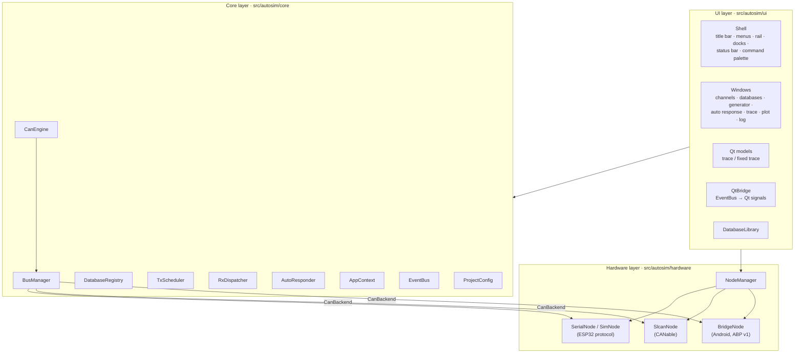
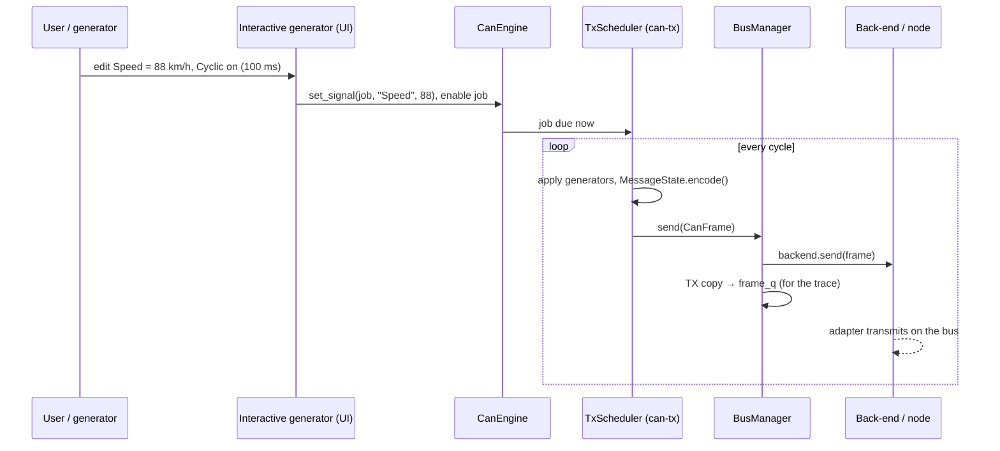
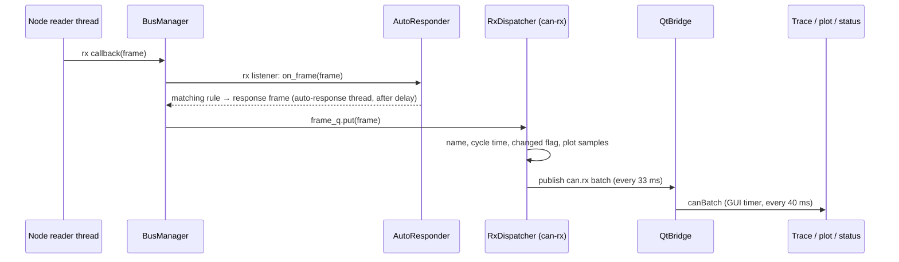
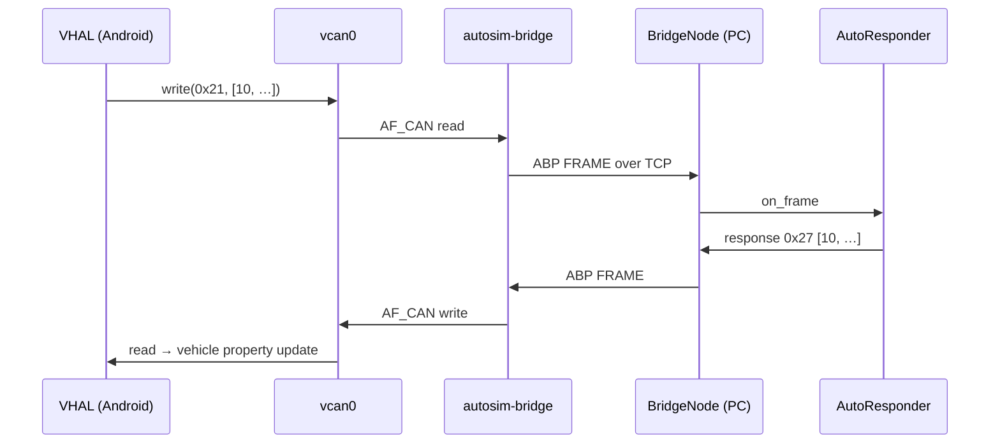
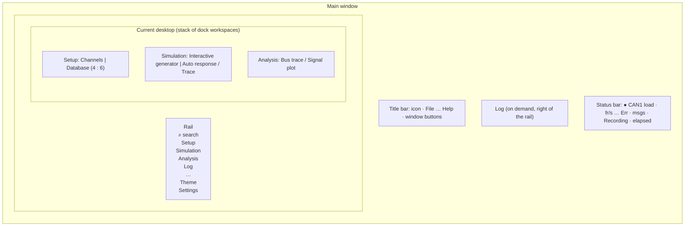

# AutoSim Studio – High-Level Design (HLD)

| | |
|---|---|
| **Scope** | Architecture of the desktop application and how it talks to adapters |
| **Prerequisite** | [System design](SYSTEM_DESIGN.md) |
| **Details** | [Low-level design](LLD.md) |

## 1. Architecture at a glance

AutoSim Studio is one process with three layers. Dependencies point downwards only: the core never imports Qt, and
hardware back-ends never import the UI.



| Layer | Package | Responsibility |
|---|---|---|
| UI | `autosim.ui` | Windows, interaction, presentation, persistence of UI state |
| Core | `autosim.core` | CAN engine: databases, channels, transmission, reception, rules, events, project files |
| Hardware | `autosim.hardware` | Adapter back-ends and their wire protocols; port discovery |

## 2. Components

### 2.1 Core

| Component | Module | Role |
|---|---|---|
| `AppContext` | `context.py` | Composition root: creates the `EventBus`, `CanEngine` and `NodeManager`; starts and stops them |
| `CanEngine` | `core/can_engine/engine.py` | Facade for the UI: databases, channels, TX jobs, signals, generators, rules |
| `DatabaseRegistry` | `core/can_engine/database.py` | Loaded cantools databases per channel (`*` = all channels); ID → message lookup; decode |
| `BusManager` | `core/can_engine/bus_manager.py` | Channel name → `CanBackend`; routes sends; puts RX **and** TX frames on one queue for the trace; RX listeners |
| `TxScheduler` | `core/can_engine/tx_scheduler.py` | One thread, heap of due times; cyclic and single-shot jobs; generators update signals before encoding |
| `RxDispatcher` | `core/can_engine/rx_dispatcher.py` | Drains the frame queue; adds name, cycle time and payload-changed flag; publishes batches; samples watched signals for plots |
| `AutoResponder` | `core/can_engine/auto_response.py` | Rules engine: matches received frames, builds responses, sends them (with delay) on its own thread |
| `MessageState` | `core/can_engine/signal_codec.py` | Current physical values of one message; encode / decode |
| Generators | `core/can_engine/generators.py` | Constant, sine, ramp (saw / triangle), square, toggle |
| `logger_io` | `core/can_engine/logger_io.py` | Export of the trace to CSV, ASC, BLF |
| `EventBus` | `core/common/events.py` | Thread-safe publish / subscribe between engine threads and the UI |
| `ProjectConfig` | `core/common/config.py` | Project file (JSON): channels, databases, auto response rules |

### 2.2 Hardware

| Component | Module | Wire protocol | Role |
|---|---|---|---|
| `NodeManager` | `hardware/esp32_gateway/manager.py` | – | Scans ports (USB VID/PID → adapter kind), creates the right node and back-end for a port string, publishes node state and errors |
| `SerialNode` + `Esp32Backend` | `hardware/esp32_gateway/` | AutoSim serial protocol v1 (COBS + CRC16) | ESP32-S3 + MCP2518FD board: handshake, config, start / stop, TX with ack, RX, status, heartbeat |
| `SimNode` | `hardware/esp32_gateway/sim_node.py` | same, over an in-memory pipe | Software model of the ESP32 firmware (`SIM1`, `SIM2`, …): loops frames back |
| `SlcanNode` + `SlcanBackend` | `hardware/slcan/` | slcan (ASCII) | CANable 2.0 adapters |
| `BridgeNode` + `BridgeBackend` | `hardware/bridge/` | ABP v1 over TCP | Android head unit via `autosim-bridge`; reconnects by itself |

All nodes expose the same attributes and callbacks (state, info, counters; `on_rx`, `on_state`, `on_status`,
`on_error`), so the rest of the application treats every adapter the same way.

### 2.3 UI

| Component | Module | Role |
|---|---|---|
| `MainWindow` | `ui/main_window.py` | Builds the shell and the desktops; commands; layout persistence; status updates |
| `TitleBar` / `EdgeResizer` | `ui/shell/title_bar.py` | Frameless title row with the menus; native move, snap and resize |
| `AppMenuBar` | `ui/shell/menu_bar.py` | File · Edit · View · Hardware · Database · Analysis · Simulation · Help, built from commands |
| `CommandRegistry` / `CommandPalette` | `ui/shell/commands.py` | One registry for menus, shortcuts and the palette (Ctrl+K) |
| `DesktopRail`, `AppBar` | `ui/shell/app_bar.py` | Left rail: search, desktops, Log, Theme, Settings |
| `Panel` | `ui/shell/panels.py` | Dock window with a themed header, detach / attach |
| `AppStatusBar`, `BusLoadMeter` | `ui/shell/status_bar.py`, `bus_load.py` | Per-channel state dot, load and frame rate, errors, trace size, recording |
| `QtBridge` | `ui/bridge.py` | EventBus → Qt signals; CAN batches drained by a 40 ms GUI timer |
| `DatabaseLibrary` | `ui/db_library.py` | Databases of the configuration: used or not, channel assignment, persistence |
| Windows | `ui/panels/*.py` | Channels, Database (explorer with use / channel per database), Interactive generator (signals), signal selection dialog, Auto response, Bus trace, Signal plot, Log |
| Theme | `ui/theme.py`, `ui/styles/` | Design tokens (light / dark), Qt stylesheet, palette, icons |

## 3. Interfaces

### 3.1 Back-end interface (core ↔ hardware)

```python
class CanBackend(ABC):
    def open(self, cfg: CanChannelConfig) -> None: ...      # bit rates, FD, BRS, ISO, listen-only, loopback
    def close(self) -> None: ...
    def send(self, frame: CanFrame) -> None: ...             # non-blocking; may queue
    def set_rx_callback(self, cb: Callable[[CanFrame], None]) -> None: ...   # called on the adapter's thread
```

`CanFrame` (id, data, extended, FD, BRS, timestamp, channel, direction) and `CanChannelConfig` are plain dataclasses
in `core/common/frame.py`.

### 3.2 Events (core → UI)

| Topic | Payload | Published by | Consumed by |
|---|---|---|---|
| `can.rx` | `list[TraceRow]` (both directions) | RxDispatcher (`can-rx` thread) | QtBridge → trace, plot, bus load |
| `can.db_loaded` / `can.db_unloaded` | file path | CanEngine | Library, explorer, generator, plot, trace names |
| `hw.node_state` | `{channel, port, state, rx, tx, errors, info}` | NodeManager | Channels table, status pill and dots |
| `log` | text | engine, nodes, rules | Log window |

### 3.3 External protocols

| Link | Protocol | Reference |
|---|---|---|
| PC ↔ ESP32 node | AutoSim serial protocol v1: COBS framing, CRC-16/CCITT, typed packets (HELLO, CONFIG, START, TX_FRAME, RX_FRAME, STATUS, …) | [ESP32_PROTOCOL](../ESP32_PROTOCOL.md) |
| PC ↔ CANable | slcan (Lawicel ASCII + FD extensions) | [CANABLE_FIRMWARE](../CANABLE_FIRMWARE.md) |
| PC ↔ Android | ABP v1 over TCP port 29536 (`0xAB · type · u16 len · payload`) | [ANDROID_BRIDGE](../ANDROID_BRIDGE.md) |
| Bridge ↔ VHAL | SocketCAN `AF_CAN` raw sockets on `vcan0` | [ANDROID_CAN_LAYERS](../ANDROID_CAN_LAYERS.md) |

## 4. Data flows

### 4.1 Transmit



### 4.2 Receive, trace and rules



### 4.3 Android head unit



## 5. Threading model

| Thread | Owner | Work |
|---|---|---|
| GUI (main) | Qt | All widgets and models; drains CAN batches every 40 ms; 1 s status tick |
| `can-tx` | TxScheduler | Wakes at the next due job, encodes, sends |
| `can-rx` | RxDispatcher | Reads `frame_q`, annotates, publishes batches every 33 ms |
| `auto-response` | AutoResponder | Sends responses in order, honouring delays |
| `node-rx-*`, `node-hb-*` | SerialNode | Reads and decodes packets; heartbeat / PING and timeouts |
| `slcan-rx-*`, `slcan-status-*` | SlcanNode | Reads slcan lines; error-register polling |
| `bridge-rx-*`, `bridge-status-*` | BridgeNode | Reads ABP; PING, half-open detection, reconnect |
| `sim-node`, `sim-node-status` | SimNode | Simulated firmware |

Rules:

- Engine and adapter threads never touch Qt objects. They publish to the `EventBus`. CAN batches are appended to a
  lock-protected buffer that the GUI drains on its own timer, so a slow GUI never builds up a backlog.
- Shared engine state (registry, jobs, rule set) is protected by locks; frames are immutable once created.

## 6. Persistence

| Data | Store | Key / file |
|---|---|---|
| Theme, window geometry, dock layout per desktop, current desktop | QSettings (Windows registry `HKCU\Software\AutoSim\AutoSimStudio`, INI elsewhere) | `theme`, `layout/*` (versioned by `LAYOUT_VERSION`) |
| Database library (path, used, channel) | QSettings | `dblib/entries` (JSON); `last/dbc` for older versions |
| Last port | QSettings | `last/port` |
| Auto response rules | QSettings and project file | `auto_response/config` (JSON); `ProjectConfig.auto_response` |
| Project | JSON file chosen by the user | channels, databases, rules |
| Trace export | CSV / ASC / BLF | chosen by the user |

A layout saved by another `LAYOUT_VERSION` is discarded and the default layout is used.

## 7. UI organisation



- Each window is a dock (`Panel`) on one desktop. Any window can be **detached** into its own top-level window,
  which stays visible on every desktop; closing it docks it back.
- Menus, shortcuts and the command palette share one `CommandRegistry`.

## 8. Error handling

| Situation | Behaviour |
|---|---|
| Adapter does not answer | Connect fails with a message naming the likely cause (wrong USB port, firmware, baud) |
| Node heartbeat lost / bridge link down | Node state → ERROR (red dot, status pill); the bridge reconnects every second |
| Bus errors reported by the ESP32 (BDIAG) | Logged with a decoded description and a hint (bit rate mismatch, transceiver) |
| Database parse error | Dialog; a reload keeps the version already loaded |
| Rule invalid | Shown in red in the rule table with the reason; the rule is inactive |
| Response storm | Loop guard: a rule firing more than 1 000 times per second is switched off and logged |

## 9. Build and test (overview)

- `uv sync`, `uv run pytest`, `uv run autosim`. Windows installer: PyInstaller + Inno Setup (`scripts/build.ps1`).
- Firmware: PlatformIO or Arduino IDE (ESP32); `scripts/build_firmware.ps1` and `scripts/flash_canable.ps1`
  (CANable); NDK or AOSP build for `autosim-bridge`.
- See [Deployment](../DEPLOYMENT.md) and [Setup](../SETUP.md).
