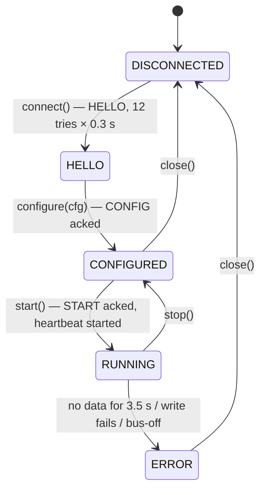
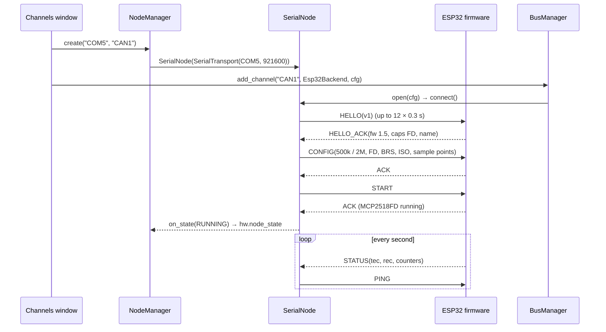
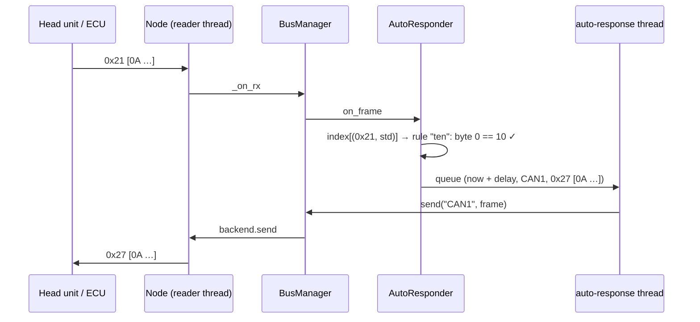

# AutoSim Studio – Low-Level Design (LLD)

| | |
|---|---|
| **Scope** | Module-level design: classes, data structures, protocols, algorithms, sequences |
| **Prerequisite** | [High-level design](HLD.md) |
| **Source** | `src/autosim/` (Python), `firmware/` (C++ / C), `bridge/autosim-bridge/` (C) |

Contents: [1 Source layout](#1-source-layout) · [2 Core data types](#2-core-data-types) ·
[3 CAN engine](#3-can-engine) · [4 Hardware back-ends](#4-hardware-back-ends) · [5 UI](#5-ui) ·
[6 Firmware and bridge](#6-firmware-and-bridge) · [7 Key sequences](#7-key-sequences) · [8 Testing](#8-testing) ·
[9 Extending](#9-extending)

## 1. Source layout

```
src/autosim/
  app.py, __main__.py        bootstrap: QApplication, theme, MainWindow
  context.py                 AppContext: EventBus + CanEngine + NodeManager
  core/common/               frame.py (CanFrame, CanChannelConfig), events.py (EventBus), config.py (ProjectConfig),
                             clock.py (monotonic time base)
  core/can_engine/           engine.py, database.py, bus_manager.py, tx_scheduler.py, rx_dispatcher.py,
                             auto_response.py, signal_codec.py, generators.py, logger_io.py
  hardware/esp32_gateway/    protocol.py, transport.py, serial_node.py, sim_node.py, bus_adapter.py, manager.py
  hardware/slcan/            protocol.py, node.py
  hardware/bridge/           protocol.py (ABP v1), node.py, sim_bridge.py (Python reference bridge)
  ui/                        main_window.py, bridge.py (QtBridge), db_library.py, theme.py, widgets.py, icons.py
  ui/shell/                  title_bar, menu_bar, app_bar (rail), panels (dock windows), commands, status_bar, bus_load
  ui/panels/                 connection_panel, dbc_explorer, signal_panel, signal_select,
                             auto_response_panel, trace_panel, plot_panel, log_panel
  ui/models/                 trace_model (chronological), fixed_trace_model (one row per message)
  ui/styles/                 tokens.py (design tokens), themes.py (stylesheet template)
firmware/esp32_can_node/     PlatformIO project + Arduino library AutoSimCanNode (ESP32 + MCP2518FD)
firmware/canable2_stm32/     CANable 2.0 slcan firmware (patched bit timing) + flash scripts
bridge/autosim-bridge/       Android daemon (C), Android.bp, init rc, sepolicy, vcan / adb scripts
```

## 2. Core data types

```python
@dataclass(slots=True)
class CanFrame:                        # core/common/frame.py
    arbitration_id: int
    data: bytes
    is_extended: bool = False
    is_fd: bool = False
    bitrate_switch: bool = False
    timestamp: float = 0.0             # seconds, host monotonic time base (clock.now())
    channel: str = ""                  # logical channel name, e.g. "CAN1"
    is_rx: bool = True                 # False for frames this app transmitted

@dataclass(slots=True)
class CanChannelConfig:
    nominal_bitrate: int = 500_000
    data_bitrate: int = 2_000_000
    fd_enabled: bool = True
    brs: bool = True
    iso_mode: bool = True              # ISO 11898-1:2015 CRC vs Bosch non-ISO
    listen_only: bool = False
    sample_point_nominal: float = 0.8
    sample_point_data: float = 0.75
    extras: dict                       # e.g. {"loopback": True, "tx_confirm": True}

@dataclass(slots=True)
class TraceRow:                        # core/can_engine/rx_dispatcher.py
    frame: CanFrame
    name: str = ""                     # message name from the databases
    cycle_ms: float | None = None      # time since the previous frame of (channel, id, direction)
    changed: bool = True               # payload differs from that previous frame
```

`EventBus` (`core/common/events.py`): `subscribe(topic, handler)` and `publish(topic, payload)`. Handlers are copied
under a lock and called on the publisher's thread. The UI wraps them in `QtBridge` (see §5.2).

## 3. CAN engine

### 3.1 CanEngine (facade)

Owns one each of `DatabaseRegistry`, `BusManager`, `TxScheduler`, `RxDispatcher` and `AutoResponder`, wired at
construction:

- `TxScheduler(send=bus.send)`; `RxDispatcher(registry, bus, eventbus)`;
  `AutoResponder(registry, bus.send, log=…)`, registered with `bus.add_rx_listener(responder.on_frame)`.
- `load_database(path, channel="*")`: `registry.load` → log warnings → publish `can.db_loaded`.
- `unload_database(path)`: `registry.unload` → remove TX jobs whose message came from that file → drop plot
  watches whose message no longer exists → publish `can.db_unloaded`.
- `open_channel(name, backend, cfg)` / `close_channel(name)` → `BusManager`.
- `add_tx_message`, `set_signal`, `bind_generator` → `TxScheduler`.

### 3.2 DatabaseRegistry

```
_dbs:   {channel: [cantools.Database, …]}      "*" = applies to every channel
_paths: {channel: [path, …]}                   parallel to _dbs
_by_id: {channel: {frame_id: Message}}         rebuilt on unload; later files win on conflicts
```

- `load(path, channel)`: `cantools.database.load_file(strict=False)`. Real-world DBCs sometimes declare IDs above
  0x7FF without the extended flag; `_fix_oversized_standard_ids` rewrites them as 29-bit (as Vector tools do), skips
  IDs that do not fit 29 bits, and reports both in `warnings`. Loading a file that is already loaded on that
  channel replaces it only after the new copy parsed, so a broken edit keeps the old version.
- `message_by_id(channel, id)`: the channel's own databases first, then `*`.
- `decode(frame)` → `(message, {signal: value})` or `None`.

### 3.3 BusManager

- `channels`: open channel names; `add_channel(name, backend, cfg)` sets
  `backend.set_rx_callback(lambda f: self._on_rx(name, f))` and opens it.
- `send(channel, frame)`: `backend.send(frame)`, then a TX copy (`is_rx=False`, timestamp now) goes to `frame_q`.
- `_on_rx(channel, frame)` (adapter thread): sets `channel`, `is_rx=True` and the timestamp, calls every RX listener
  (exceptions are swallowed so a listener bug cannot stop a reader), then `frame_q.put_nowait`. The queue holds
  200 000 frames; when it is full, frames are dropped rather than blocking the adapter.

### 3.4 TxScheduler

```python
@dataclass(eq=False)
class TxJob:
    channel: str; message: Message; state: MessageState
    cycle_ms: int | None               # None: send on demand only
    fd: bool; brs: bool; enabled: bool; count: int
    bindings: dict[str, Generator]     # signal -> generator
```

Algorithm (single thread `can-tx`):

1. A heap holds `(due_time, seq, job, generation)`. Enabling or changing a job pushes a new entry with an
   incremented generation. Older entries are discarded when popped (lazy deletion).
2. The thread waits on a condition variable until about 1.5 ms before the earliest due time, then spins for the
   rest. This gives sub-millisecond precision without burning a core.
3. On fire: each bound generator writes `value(t - job._t0)` into the `MessageState`; the state is encoded
   (cantools, scaling, padding); `send(channel, CanFrame)`; `count += 1`.
4. The next due time is `due + cycle` (not `now + cycle`), so there is no cumulative drift. If the thread is more
   than one cycle late, it re-bases on `now` instead of sending a burst.

`trigger(job)` sends once immediately (the *Send* button).

### 3.5 MessageState and generators

- `MessageState(message)`: holds the physical value of every signal, initialised from the DBC initial values
  (or 0). `set_signal` clamps to the signal range. `encode()` → bytes (`padding=True` fills unused bits with 1).
  `decode(data)` accepts truncated or excess data.
- Generators (`value(t)`):

| Generator | Parameters | Formula |
|---|---|---|
| `Constant` | value | v |
| `Sine` | amplitude, freq_hz, offset, phase | offset + A·sin(2π·f·t + phase) |
| `Ramp` | lo, hi, period_s, saw | saw: lo → hi then jump back; triangle otherwise |
| `Square` | lo, hi, freq_hz, duty | hi for `duty` of each period, lo otherwise |
| `Toggle` | values, interval_s | cycles through the values |

### 3.6 RxDispatcher

Thread `can-rx`:

```
batch = []
deadline = now + flush_s                       # flush_s = 0.033
loop:
    frame = frame_q.get(timeout=flush_s)       # if any
    batch.append(annotate(frame))
    if batch and now >= deadline:
        eventbus.publish("can.rx", batch); batch = []
        deadline = now + flush_s
```

`annotate(f)`:

- key = `(channel, id, is_rx)`; `cycle_ms` = time since the last frame of that key; `changed` = payload differs
  from the last payload of that key.
- `registry.decode(f)` gives the message name. For signals watched by the plot, `(timestamp, value)` is appended
  to a `deque(maxlen=20 000)` per `(message, signal)`, read by `snapshot()` under a lock.

### 3.7 AutoResponder

```python
@dataclass
class ResponseRule:
    name: str; enabled: bool
    rx_id: int; rx_extended: bool; rx_channel: str           # "" = any channel
    match: "any" | "signal" | "raw"
    signal: str; op: str; value: str                          # e.g. signal ReqValue == 10
    raw_offset: int; raw_size: int; raw_order: "little" | "big"
    tx_channel: str                                           # "" = channel of the trigger
    tx_id: int; tx_extended: bool; tx_fd: bool; tx_brs: bool
    tx_mode: "raw" | "signal"
    tx_dlc: int; tx_data: str (hex base payload)              # raw mode
    tx_value: str; tx_offset: int; tx_size: int; tx_order: str  # raw mode: value / expression written into it
    tx_signals: {signal: expression}                          # signal mode
    delay_ms: int
```

- `compile(rule)` validates (ID widths, signal present in a loaded database, FD needed for more than 8 bytes,
  expressions) and returns `_Compiled` with pre-parsed value functions. Expressions are a safe AST subset: numbers,
  `rx`, `+ - * / // %` and parentheses (`compile_value`).
- `set_rules` builds `_index: {(id, extended): [compiled, …]}` for O(1) trigger lookup.
- `on_frame(frame)` runs on the adapter's reader thread: ignored for TX frames or when disabled. For each candidate
  rule it checks the channel and evaluates the condition. The signal match decodes once per frame (lazily); the
  raw match reads an integer of `raw_size` bytes. A match calls `build()` and queues `(due, channel, frame)`.
- `build()`: in raw mode, the hex base payload (`tx_data`, padded to `tx_dlc`) plus an optional value written at
  `tx_offset`; in signal mode, a `MessageState`
  of the response message with the expressions evaluated against the trigger value (the other signals keep
  their initial values).
- Thread `auto-response` sends queued responses at their due time, in order. **Loop guard**: when a rule fires
  more than `max_rate` (1 000) times per second, it is disabled and logged. `RuleStats` counts hits and errors per
  rule, shown in the *Hits* column.

### 3.8 Export (logger_io)

`export_by_extension(rows, path)` → CSV (own format), ASC or BLF (python-can writers, with channel numbers mapped
from channel names).

## 4. Hardware back-ends

### 4.1 Port strings and NodeManager

| Port string | Node | Back-end |
|---|---|---|
| `COMx` / `/dev/tty…` with an ESP32 or USB-UART VID | `SerialNode(SerialTransport)` | `Esp32Backend` |
| `COMx` with VID:PID `16D0:117E` (CANable 2.0) | `SlcanNode` | `SlcanBackend` |
| `SIM1`, `SIM2`, … | `SerialNode` + `SimNode` (in-memory pipe) | `Esp32Backend` |
| `bridge://HOST:PORT` | `BridgeNode` (TCP) | `BridgeBackend` |

`NodeManager.scan()` lists serial ports with a *kind* (`esp32`, `slcan`) from the USB IDs, plus the simulated ports.
`create(port, channel)` builds the node and back-end and hooks the callbacks (`on_state`, `on_status` → publish
`hw.node_state`; `on_error` → log line with a hint from `bus_error_hint`).

### 4.2 AutoSim serial protocol (ESP32, simulated nodes)

Packet before COBS: `type u8 · seq u8 · len u16 LE · payload · crc16 LE` (CRC-16/CCITT-FALSE over header and
payload). Each packet is COBS-encoded and terminated by `0x00`. Full table: [ESP32_PROTOCOL](../ESP32_PROTOCOL.md).

`SerialNode` state machine:



- `request(type, payload, timeout=0.1, retries=3)`: registers a pending entry under its `seq`, writes, and waits
  for the ACK / NACK with that `seq`. A NACK raises `NodeError(code, text)`.
- Thread `node-rx`: reads bytes, splits on `0x00`, COBS-decodes, checks the CRC (bad packets are counted in
  `crc_errors`), and dispatches: RX_FRAME → `on_rx`, STATUS → counters + `on_status`, ERROR → `on_error`,
  ACK / NACK → wakes the pending request.
- Thread `node-hb`: PING every 1 s; no packet for 3.5 s → ERROR.
- `send_frame`: TX_FRAME packet (no ACK per frame, for throughput). Drops are visible in the node's STATUS.

### 4.3 slcan (CANable)

- Open sequence: `C` (close), `S<n>` nominal (`S6` = 500 k), `Y<n>` data (`Y2` = 2 M, `Y5` = 5 M), mode
  (`M0` normal / `M1` silent), `A1` (automatic retransmission), `O` (open). Frames: `t`/`T` classic, `d`/`D` FD, `b`/`B` FD+BRS, `r`/`R` remote;
  FD lengths map through `FD_LENGTHS`.
- Thread `slcan-rx` parses lines; thread `slcan-status` reads the error register (`E`) and reports set bits by name.
- The adapter supports only fixed data rates (2 and 5 Mbit/s); the Channels window limits the choice and forces ISO
  CRC.

### 4.4 Android bridge (ABP v1)

Packet: `0xAB · type u8 · len u16 LE · payload`. FRAME payload: `u32 id · u8 flags (EXT, FD, BRS, ESI, RTR) · u8 len ·
u16 reserved · u64 timestamp µs · data`. Types: HELLO 1, FRAME 2, PING 3, PONG 4, STATUS 5, ERROR 6. Default port 29536.

`BridgeNode`:

- `connect()`: for a local host, runs `adb forward tcp:P tcp:P` first. Then TCP connect, HELLO exchange (version,
  capabilities: FD, interface name).
- Thread `bridge-rx`: parses ABP; FRAME → `on_rx`. Thread `bridge-status`: PING every second; no data for 5 s →
  ERROR (half-open link); then reconnects every second and returns to RUNNING by itself.

## 5. UI

### 5.1 Composition (MainWindow)

1. `QtBridge(ctx.events)`, `CommandRegistry`, `DatabaseLibrary(ctx, bridge)`.
2. Windows: `CanConnectionPanel`, `DbcExplorer`, `SignalPanel`, `AutoResponsePanel`, `TracePanel`
   (+ a mini view of its fixed model for the Simulation desktop), `PlotPanel`, `LogPanel`.
3. `_build_desktops()`: one `DockWorkspace` (a nested `QMainWindow`) per entry of `DESKTOPS`, a `QStackedWidget` of
   them as the central widget, and the `DesktopRail` as a fixed left dock that owns the left corners (so the Log
   dock sits right of it).
4. Menus (`AppMenuBar`) inside the `TitleBar` (`setMenuWidget`), or as a normal menu bar when
   `AUTOSIM_NATIVE_TITLEBAR=1`. Status bar. Timers: 1 s `_tick` (status, bus load).
5. `_restore()`: geometry, `restoreState` of the main window and of every desktop if `LAYOUT_VERSION` matches,
   current desktop, then (deferred) the database library.

```python
DESKTOPS = (("Setup", ("Channels", "Database")),       # Channels 4 : Database 6 (SETUP_SPLIT)
            ("Simulation", ("Signals", "Auto response", "Trace")),
            ("Analysis", ("Bus trace", "Signal plot")))
```

### 5.2 QtBridge (engine → GUI)

- `bus.subscribe("can.rx", self._on_can)`: called on `can-rx`. It only extends a list under a lock.
- A `QTimer(40 ms)` in the GUI thread swaps the list out and emits `canBatch(list)` once. Whatever arrived since the
  last tick becomes one batch, so the GUI's work per tick is bounded and no queue of Qt events can build up.
- `log`, `nodeState`, `dbLoaded`, `dbUnloaded` are Qt signals emitted by the publisher (queued across threads).

### 5.3 Trace models

| Model | Rows | Update |
|---|---|---|
| `TraceModel` (chronological) | ring buffer of 200 000 rows, filtered view | `beginInsertRows` per batch; oldest rows evicted |
| `FixedTraceModel` | one row per (channel, direction, id) with signal child rows | entries updated in place; **one** `dataChanged` per batch for the span of updated rows; `index()` checks bounds itself (no `hasIndex()` callback) |

The update highlight is computed at paint time: an accent wash fades out over 0.6 s from the time of the last
payload change (`TraceRow.changed`). A 120 ms timer repaints only the background role.

### 5.4 Interactive generator (SignalPanel)

`QTreeWidget` with one header: Signal · Raw · Physical · Unit · Generator · Symbolic. Message rows (`MessageItem`)
span all columns and carry the controls (channel, cycle, FD, BRS, Cyclic, Send, count). Signal rows (`SignalItem`)
are edited in place by `SignalDelegate`. Raw and physical values are converted through the cantools signal
(scale / offset, range clamp); the Symbolic column is a combo box from the value table.

### 5.5 DatabaseLibrary

```python
@dataclass
class DbEntry: path: str; active: bool = True; channel: str = "*"
```

- `add(path, active, channel)`: when active, `ctx.can.load_database(path, channel)`. A file that fails to parse is
  never listed. `set_active(path, on)` loads or unloads; `set_channel(path, ch)` reloads on the new channel.
- `database(path)` returns the engine's copy when in use, else parses on demand (cached) for browsing.
- Files loaded by other paths (project, drop) join the library through the `dbLoaded` / `dbUnloaded` signals; a
  `_busy` flag ignores the echo of the library's own changes.
- Persisted as JSON in `dblib/entries`.

### 5.6 Shell details

- **Desktop switch** → `_focus_desktop`: focus goes to the first visible table or tree of the new desktop, never to
  a header button (Qt would otherwise move the focus to the next focusable widget, which then shows the focus
  ring).
- **Detach** (`Panel.detach`): `setFloating(True)` plus window flags of a normal top-level window. Close or *attach*
  docks it back.
- **Columns**: all interactive. `fill_column(view, col)` gives the free width to one column (Data / Value, Signal,
  rule name) until the user resizes that column.
- **Copy**: `install_copy(view)` adds a Ctrl+C action (current cell, or the selected rows as tab-separated text) and
  *Copy* / *Copy row* to the context menu.
- **Frameless window**: `TitleBar` calls `QWindow.startSystemMove()` on a press on its empty area (native snap), and
  toggles maximise on a double-click. `EdgeResizer` (an application event filter) shows resize cursors in the
  outer 6 px and calls `startSystemResize(edges)`.
- **Status**: `AppStatusBar.set_channels(loads, channels, states)` shows a dot per channel (green running, amber
  connecting, red error), the estimated load and frames/s. `BusLoadMeter` sums `frame_seconds(len, fd, brs, ext,
  nominal, data)` per channel; frame times are cached per frame shape in each batch.

### 5.7 Theme

`styles/tokens.py` defines colour tokens per theme (surfaces, borders, text, accent `#047857` emerald, semantic
colours, Rx / Tx), spacing, radii and the type scale (13 / 14 / 18 px, Segoe UI with the system fallback).
`styles/themes.py` renders one stylesheet template per theme; `ThemeManager` applies it (clearing the old sheet
first, about 4× faster) and emits `changed`. WCAG AA contrast is enforced by `tests/test_theme_contrast.py`.

## 6. Firmware and bridge

### 6.1 ESP32 node (`firmware/esp32_can_node`)

- Library `AutoSimCanNode` (Arduino format, also built by PlatformIO). The ACAN2517FD driver is bundled.
- Two FreeRTOS tasks: **link task** (serial ↔ queues: parses packets, answers HELLO / PING / SET_NAME, sends ACK /
  NACK, STATUS, RX frames) and **CAN task** (queues ↔ MCP2518FD: start / stop, `tryToSend`, `receive`, 1 Hz STATUS,
  BDIAG1 bus-error decoding).
- Robustness: the crystal is measured at start (`oscMHz = 0`: counts the MCP2518FD time-base counter against the
  ESP32 clock for 2 ms → 20 or 40 MHz); retransmissions are limited to 3; the driver is woken every millisecond as
  a safety net for a missed INT edge, with an "INT never fired" warning; XSTBY drives the transceiver's standby
  pin.
- Configuration in `setup()` through `BoardConfig` (pins, crystal, LED, UART baud, XSTBY, node name).

### 6.2 CANable firmware (`firmware/canable2_stm32`)

Upstream canable2-fw with changed bit timing: 34 time quanta at nominal rates, SJW = phase segment 2, and transmitter
delay compensation at 5 Mbit/s. This keeps it in sync with crystal-clocked nodes even though the board itself runs
from the internal oscillator. See [CANABLE_FIRMWARE](../CANABLE_FIRMWARE.md).

### 6.3 autosim-bridge (`bridge/autosim-bridge`)

C daemon on the head unit: opens `vcan0` (raw `AF_CAN`, CAN FD enabled, `CAN_RAW_RECV_OWN_MSGS` off), listens on TCP
29536, and accepts up to 4 clients (every client receives every frame). It has a TX queue of 4 096 frames for
`EAGAIN` / `ENOBUFS`, a per-client send buffer (frames are dropped and counted when a client is slow, the CAN side
never blocks), and retries the interface every second. Built with `Android.bp` (AOSP) or `build_ndk.sh`; started by
`autosim-bridge.rc`; SELinux policy in `sepolicy/`. Reference implementation in Python:
`hardware/bridge/sim_bridge.py` (`--demo`).

## 7. Key sequences

### 7.1 Connecting an ESP32 node



### 7.2 Auto response round trip



### 7.3 Adding signals (selection dialog)

1. *Add signals…* → `SignalSelectDialog(library, already=messages in the generator)`: tree database → message →
   signal with check boxes; search by message, signal or hex ID.
2. `selected_messages()` → for each, `SignalPanel.add_message(name)` → `CanEngine.add_tx_message` (TxJob on the
   first open channel or the database's channel).

## 8. Testing

| Test module | Covers |
|---|---|
| `test_protocol.py`, `test_bridge.py`, `test_slcan.py` | Codecs, nodes against simulated peers (fake CANable, Python bridge) |
| `test_bridge_c.py` | The C bridge built for the host (`autosim-bridge-fake`) |
| `test_can_engine.py`, `test_auto_response.py`, `test_db_unload.py` | Engine, scheduler, decoding, rules, database library |
| `test_firmware.py`, `test_arduino_library.py` | Firmware logic on the PC (`pio test -e native`), library packaging |
| `test_gui.py`, `test_shell.py`, `test_gui_auto_response.py` | UI behaviour headless (pytest-qt, `QT_QPA_PLATFORM=offscreen`): layout, desktops, menus, copy, columns, status |
| `test_theme_contrast.py` | WCAG AA contrast of every text / surface pair in both themes |
| `test_hw_canable*.py` | Real adapters, opt-in with `AUTOSIM_HW=1` |

## 9. Extending

| Goal | Steps |
|---|---|
| New adapter type | Implement a node with the common attributes and callbacks plus a `CanBackend`; teach `NodeManager.scan()` its USB IDs and `create()` its port string; add tests with a simulated peer |
| New generator | Subclass `Generator` (`value(t)`), add it to `GEN_ITEMS` in `signal_panel.py` and to the generator dialog |
| New window | Create the widget, add it to `widgets` and to a `DESKTOPS` entry in `main_window.py`, add a menu entry in `menu_bar.py`; bump `LAYOUT_VERSION` |
| New export format | Extend `export_by_extension` in `logger_io.py` and the file filter of the trace's *Export* |
| New event | Add a topic in `events.py`, publish from the engine, and add a signal in `QtBridge` if the UI needs it |
