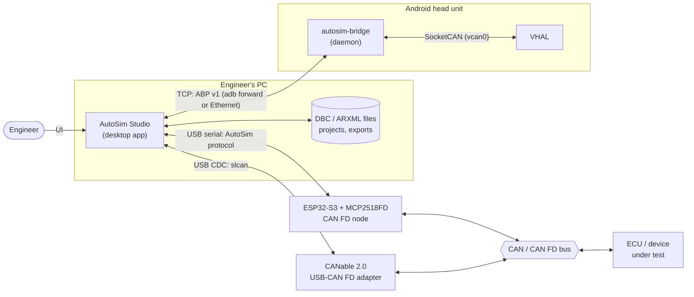
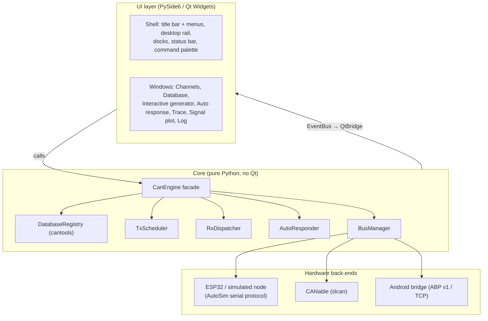

# AutoSim Studio – System Design

| | |
|---|---|
| **Scope** | The whole AutoSim system: desktop application, adapter firmware, Android bridge |
| **Audience** | Engineers who build, extend or integrate AutoSim |
| **Related** | [HLD](HLD.md) · [LLD](LLD.md) · [Deployment](../DEPLOYMENT.md) · [Setup](../SETUP.md) |

## 1. Purpose

AutoSim Studio simulates and analyses CAN / CAN FD networks on an engineer's PC. It plays the part of the vehicle
(or of individual ECUs) for:

- **ECU bench work**: send the messages a device under test expects, watch what it sends, plot its signals.
- **Android head-unit (IVI) development**: the head unit's Vehicle HAL (VHAL) reads and writes CAN through SocketCAN.
  AutoSim replaces the car behind that socket and answers requests by rules.
- **Learning and demos**: built-in simulated nodes, so the complete workflow runs without any hardware.

## 2. System context

| External element | Interaction |
|---|---|
| Engineer | Uses the desktop UI: databases, channels, signals, rules, trace, plots |
| ESP32-S3 + MCP2518FD | One CAN FD channel per board; firmware in `firmware/esp32_can_node` speaks the AutoSim serial protocol |
| CANable 2.0 | One CAN FD channel per adapter; slcan firmware (patched build in `firmware/canable2_stm32`) |
| Android head unit | The `autosim-bridge` daemon exposes the VHAL's CAN interface over TCP |
| CAN bus / ECU | The real network the adapters are attached to |
| Files | Databases (DBC, ARXML, KCD, SYM), project files (JSON), trace exports (CSV, ASC, BLF) |

## 3. Goals and non-goals

**Goals**

1. Make the everyday rest-bus simulation workflow (databases → signals → transmit → observe) fast and familiar to
   CANoe users.
2. Run on low-cost, open hardware, and with no hardware at all.
3. Support CAN FD (64-byte frames, BRS) and several channels at once.
4. Let the PC answer an Android head unit's CAN requests without changing the head unit's VHAL.
5. Stay responsive under heavy traffic (thousands of frames per second).

**Non-goals**

- Replacing a full certified toolchain (no CAPL scripting, no diagnostics stack, no AUTOSAR network management).
- Hard real-time guarantees: transmission timing is soft real-time on a desktop OS. Adapters timestamp received
  frames in hardware where they can.
- LIN, FlexRay or automotive Ethernet.

## 4. Requirements

### 4.1 Functional

| ID | Requirement |
|---|---|
| F1 | Load DBC, ARXML, KCD and SYM databases; browse nodes, messages and signals; keep a library of databases with an on/off switch and a channel assignment each |
| F2 | Open several CAN / CAN FD channels on ESP32, CANable, Android-bridge or simulated adapters, with nominal and data bit rates, FD / BRS / ISO, listen-only and loopback modes |
| F3 | Transmit messages cyclically or once; edit signals as raw or physical values; drive signals with generators |
| F4 | Show every frame in a trace (fixed and chronological views), with filters and export |
| F5 | Plot decoded signals over time |
| F6 | Answer received frames by rules (auto response), configured in the UI and persisted |
| F7 | Bridge the Android VHAL's SocketCAN to the PC |
| F8 | Persist the layout, theme, database library and rules; save and open project files |

### 4.2 Quality attributes

| Attribute | Target and how it is met |
|---|---|
| Responsiveness | The GUI never falls behind the bus. Engine threads batch frames and the GUI drains them on a 40 ms timer (no unbounded queue of Qt events). See [HLD §5](HLD.md#5-threading-model). |
| Throughput | Measured above 10 000 frames/s into the GUI with simulated nodes; real adapters are limited by their link (UART at 921 600 Bd carries roughly 1 000 64-byte FD frames/s). |
| Robustness | Adapters are supervised: heartbeat / PING, automatic reconnect for the Android bridge, error states shown in the UI. A database that fails to parse keeps the previous version. |
| Portability | Python 3.11 + Qt 6 (PySide6) on Windows (primary), Linux and macOS. The firmware builds with PlatformIO or the Arduino IDE. |
| Testability | About 300 automated tests: protocol codecs, engine, back-ends with simulated peers, and headless UI tests (pytest-qt, offscreen). |
| Usability | CANoe-like structure, light and dark themes meeting WCAG AA contrast, keyboard shortcuts, detachable windows. |

## 5. Solution overview

AutoSim is a single desktop process with three layers. Adapters are reached through interchangeable back-ends.

- **Core**: the CAN engine is Qt-free. It owns the databases, the channels, transmission, reception and the rules.
  It reports to the UI through a thread-safe `EventBus`.
- **Hardware back-ends**: each implements the same `CanBackend` interface (open, close, send, receive callback).
- **UI**: a CANoe-like shell. Each feature is a window on a desktop; windows can be detached.

Details: [HLD](HLD.md).

## 6. Key design decisions

| # | Decision | Rationale | Alternatives considered |
|---|---|---|---|
| D1 | **Python + PySide6** for the application | Fast iteration, cantools / python-can ecosystem, native-looking desktop UI, one code base for all OSes | C++/Qt (slower to evolve); Electron + Python backend (adds an IPC hop per frame, two runtimes) |
| D2 | **Qt-free engine** behind an EventBus | Engine and protocols are testable without a display; the UI can be replaced | Engine using Qt signals directly |
| D3 | **Batching between engine and GUI** (33 ms on the RX thread, 40 ms GUI drain) | Bounded GUI work per tick at any bus load, no backlog | One Qt signal per frame (measured: GUI falls seconds behind at about 8 000 frames/s) |
| D4 | **One TX scheduler thread** with a heap of due times | Many cyclic messages with a single thread; precise enough for soft real-time | One timer or thread per message |
| D5 | **Own binary serial protocol** for the ESP32 node (COBS + CRC16) | Robust framing over UART, FD payloads, status and acknowledgements | slcan (no FD status / acks, ASCII overhead) |
| D6 | **slcan** for CANable | Adapters work with their standard firmware; a patched build fixes bit timing | gs_usb (needs a different driver per OS) |
| D7 | **TCP bridge (ABP v1) + vcan** for Android | The VHAL keeps its `AF_CAN` socket unchanged; works through `adb forward` or Ethernet | Modifying the VHAL; virtio-can; GRPC VHAL. See [VIRTUAL_CAN_PROPOSAL](../VIRTUAL_CAN_PROPOSAL.md). |
| D8 | **Database library** separate from the engine's loaded set | Keep databases configured but unused; assign per channel, as CANoe does | Load / unload only |
| D9 | **Desktops of detachable dock windows** | CANoe-like organisation by task; a second monitor for the trace | One dense main view (rejected in usability review) |
| D10 | **Custom frameless title bar** (opt-out with `AUTOSIM_NATIVE_TITLEBAR=1`) | Menus in the title row, themed in light and dark | Native title bar plus a menu row |

## 7. Constraints and assumptions

- Windows 10 / 11 is the primary platform (installer, COM ports). Linux and macOS run from source.
- Adapters show up as serial ports (USB CDC or a USB-UART bridge). One adapter is one logical channel.
- An Android head unit must allow running the bridge daemon (adb root or a system image with the service) and
  creating a `vcan` interface (kernel `CONFIG_CAN_VCAN`). See [ANDROID_ENV_CHECKLIST](../ANDROID_ENV_CHECKLIST.md).
- Bus load in the status bar is an estimate from frame lengths and bit rates; adapters do not report it.

## 8. Risks and mitigations

| Risk | Mitigation |
|---|---|
| Wrong bit timing between nodes (e.g. a 20 MHz crystal configured as 40 MHz) | The ESP32 firmware measures its crystal; bus errors are decoded and shown in the Log with hints |
| UART link slower than the bus | Drop counters in node STATUS, shown in the UI; use native USB on ESP32-S3 |
| GUI overload at high traffic | Batching (D3); fixed trace view updates in place; plots draw only the visible time window |
| Frameless window behaviour differs by OS | Platform move / resize APIs (`startSystemMove` / `startSystemResize`); native title bar opt-out |
