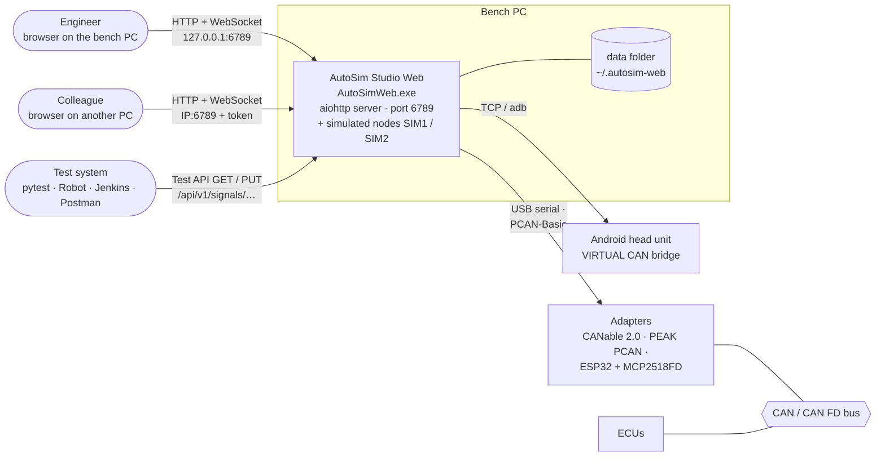
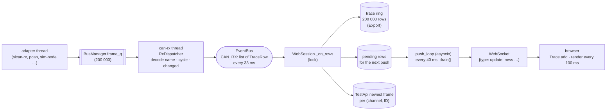
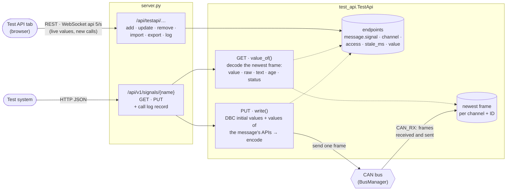
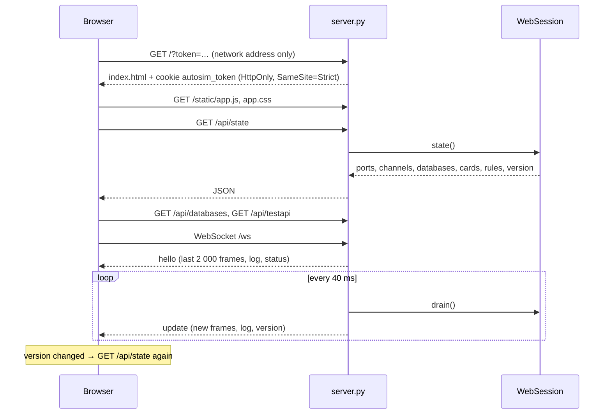
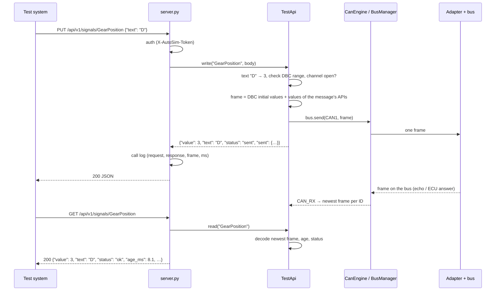
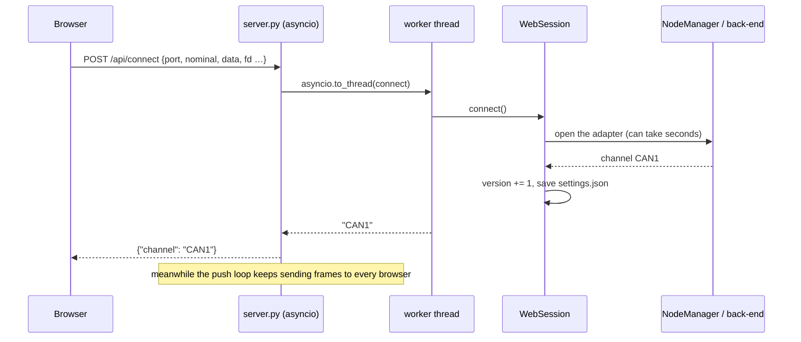
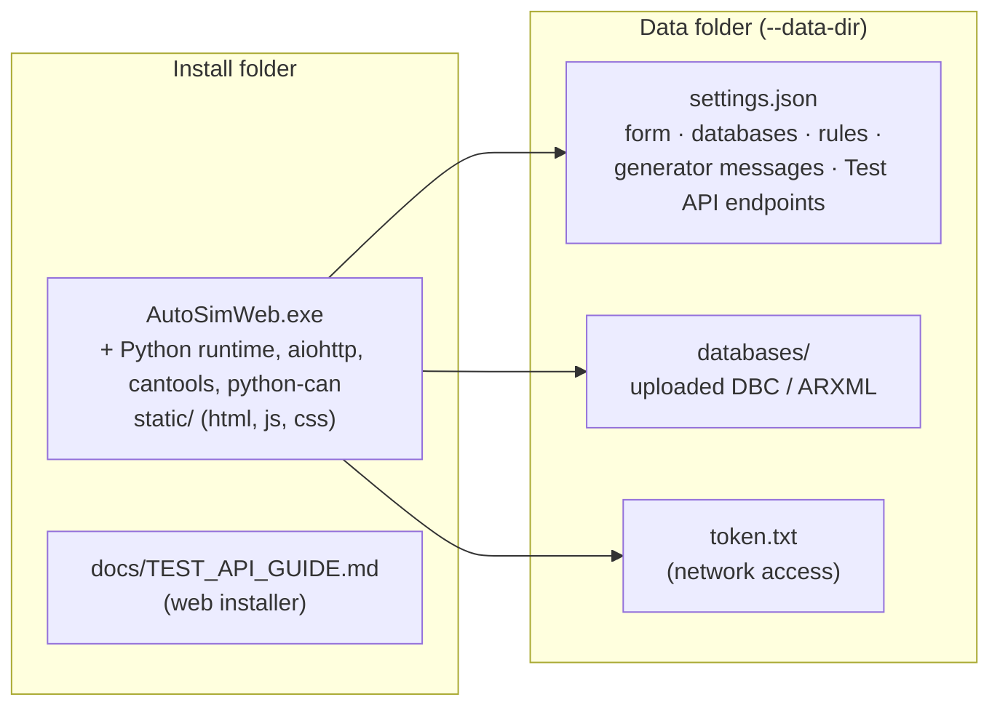

# AutoSim Studio – Web mode architecture

| | |
|---|---|
| **Scope** | AutoSim Studio Web (`autosim-web`, `AutoSimWeb.exe`): browser UI, HTTP / WebSocket server, Test API |
| **Prerequisite** | [HLD](HLD.md) (the CAN engine and hardware layers are shared with the desktop app) |
| **Usage** | [WEB_MODE.md](../WEB_MODE.md) (start, options, API reference) · [TEST_API_GUIDE.md](../TEST_API_GUIDE.md) |

Web mode runs the same CAN engine as the desktop app, without Qt, behind a small **aiohttp** server. Browsers get
the UI as static files and talk to the server with **REST (JSON)** for actions and **one WebSocket** for live data.
Test systems call the **Test API** (`/api/v1/signals/…`) with plain HTTP.

Contents: [1 Context](#1-system-context) · [2 Layers](#2-layers-and-components) · [3 Live data](#3-live-data-path) ·
[4 Test API](#4-test-api) · [5 Sequences](#5-sequences) · [6 Threads](#6-threads-and-concurrency) ·
[7 Security](#7-security) · [8 Persistence and deployment](#8-persistence-and-deployment) ·
[9 Choices](#9-design-choices)

Diagrams are [Mermaid](https://mermaid.js.org/) – GitHub and VS Code render them.

---

## 1. System context

| Actor | Talks to | How |
|---|---|---|
| Engineer | the whole UI (Setup, Simulation, Analysis, Test API) | browser on the bench PC, no token on `127.0.0.1` |
| Colleague | the same UI from another PC | browser on `http://<IP>:6789/?token=…` (token kept as a cookie) |
| Test system | published signals only | `GET` / `PUT` `/api/v1/signals/<name>`, header `X-AutoSim-Token` on a network address |

---

## 2. Layers and components

```mermaid
flowchart TB
    subgraph B["1 · Browser"]
        direction LR
        html["index.html<br/>rail · 4 desktops"]
        js["app.js<br/>Channels · Database · Generator ·<br/>Rules · Trace · TestApi · WS client"]
        css["app.css<br/>light / dark"]
    end
    subgraph S["2 · Server · aiohttp"]
        direction LR
        mw["middlewares<br/>auth · JSON errors"]
        rest["REST<br/>/api/state · connect · databases ·<br/>tx · rules · trace · testapi"]
        v1["Test API<br/>/api/v1/signals"]
        ws["/ws + push_loop<br/>update · values · api · status"]
    end
    subgraph W["3 · Session"]
        direction LR
        sess["WebSession<br/>channels · library · cards ·<br/>trace ring · logs · nodes"]
        tapi["TestApi<br/>endpoints · newest frames ·<br/>call log"]
    end
    subgraph C["4 · Core · shared"]
        direction LR
        ctx["AppContext"]
        evb["EventBus"]
        cen["CanEngine<br/>DatabaseRegistry · BusManager · TxScheduler ·<br/>RxDispatcher · AutoResponder"]
    end
    subgraph H["5 · Hardware · shared"]
        direction LR
        nm["NodeManager"]
        be["back-ends<br/>SimNode · SerialNode · SlcanNode ·<br/>PcanNode · BridgeNode"]
    end
    B -- "REST (JSON) + one WebSocket" --> S
    S -- "method calls · drain() / live() for the push" --> W
    W -- "engine calls · EventBus subscriptions" --> C
    C -- "CanBackend" --> H
```

Calls go down; results come back up as return values, and live data comes up through the **EventBus** (`CAN_RX`,
`LOG`, `NODE_STATE`, delivered on engine threads to `WebSession`) and the server's **push loop** (`drain()` every
40 ms → WebSocket).

| Component | File | Responsibility |
|---|---|---|
| Static UI | `web/static/index.html`, `app.js`, `app.css` | All windows of the web UI; renders state, sends actions, applies pushed updates; virtual scrolling for the trace |
| HTTP server | `web/server.py` | Routes, token check, JSON errors (400 / 401 / 403 / 404 / 409), WebSocket push loop, stored token, CLI (`main`) |
| `WebSession` | `web/session.py` | The simulator state behind the browser: channels and their settings, database library, Interactive generator messages, auto response rules, trace ring, log, node states; saves `settings.json` |
| `TestApi` | `web/test_api.py` | Published signals (endpoints), newest frame per (channel, ID), GET decode, PUT encode + send one frame, call log |
| `AppContext` / `CanEngine` | `context.py`, `core/can_engine/*` | Same engine as the desktop app: databases, channels, cyclic TX, RX dispatch, auto response |
| `NodeManager` + back-ends | `hardware/*` | Adapter discovery and drivers (same as the desktop app) |
| `BusLoadMeter` | `ui/shell/bus_load.py` | Bus load estimate (pure Python, reused without Qt) |

**Rules**

* **No Qt in web mode.** The server imports the core, the hardware and `web/*` only (the PyInstaller spec excludes
  PySide6): a much smaller program (about 25 MB).
* **One `WebSession` per server**, shared by every browser: two browsers see and change the same simulator.
* **The browser holds no truth.** It re-reads `/api/state` when the pushed `version` changes; everything it shows
  comes from the server.

---

## 3. Live data path

Frames go from the adapter threads to every browser in batches; nothing waits on a browser.

| WebSocket message | Rate | Content |
|---|---|---|
| `hello` | on connect | last 2 000 frames, log, status, state version |
| `update` | up to 25 / s | new frames (at most 5 000 per push, the rest counted as `dropped`), log lines, node states, state version |
| `values` | 5 / s while a message is cyclic | live signal values of the Interactive generator |
| `api` | 5 / s while APIs exist | live values of the published signals, new Test API calls |
| `status` | 1 / s | bus load and frames/s per channel, errors, rule hits, trace size |
| `clear` | on Clear | trace cleared |

A slow browser cannot slow the others: each send has a 2 s timeout, after which that client is dropped (it
reconnects and gets a fresh `hello`).

---

## 4. Test API

* **Independent of the Interactive generator.** A PUT creates no TX job; it builds the frame from the DBC initial
  values plus the value of every API of the same message, and sends it once on the API's channel (or the channel the
  message's database is used on).
* **GET reads the bus**, not what AutoSim last wrote: the newest frame of the message received *or* sent, whoever
  sent it, also while the trace is paused. `status` says how fresh it is (`ok` / `stale` / `no_data` …).
* **Call log**: 500 calls, each with the full request body and JSON response (8 000 characters), headers (the token
  is never logged), duration and the frame sent. Pushed to the tab with the `api` WebSocket message.
* **Persistence**: the endpoints are part of `settings.json`; values written by PUTs are saved at most once per
  second (a test loop may PUT many times per second).

---

## 5. Sequences

### 5.1 A browser opens the UI

### 5.2 Test system: set the gear, then read it back

### 5.3 Connecting an adapter (slow work off the event loop)

---

## 6. Threads and concurrency

| Thread / task | Owner | Work |
|---|---|---|
| asyncio event loop (main) | aiohttp | HTTP requests, WebSocket clients, `push_loop` (40 ms) |
| worker threads | `asyncio.to_thread` | scan, connect, disconnect, database parsing and upload, export |
| `can-tx` | `TxScheduler` | cyclic transmission of the Interactive generator |
| `can-rx` | `RxDispatcher` | frame queue → `TraceRow` batches on the EventBus (33 ms) |
| adapter threads | back-ends | reading the adapters (slcan, PCAN, ESP32, simulated nodes, bridge) |
| auto response | `AutoResponder` | rules and delayed responses |

`WebSession._lock` guards the trace ring, the pending rows, logs and node states (written by engine threads, read by
`drain()` on the event loop); `TestApi._lock` guards the endpoints, the newest frames and the call log. Test API GET
and PUT are short (decode / encode one frame) and run on the event loop.

---

## 7. Security

| Start | Listens on | Token |
|---|---|---|
| `autosim-web` (Start menu *AutoSim Studio Web*) | `127.0.0.1` | none: only this PC can connect |
| `--host 0.0.0.0` (*network access*) | every interface | **required** for `/api/*` and `/ws`; made once and kept in `<data-dir>/token.txt` (the same at every start), `--new-token` renews it |
| `--token X` | – | uses X |
| `--no-token` | – | no check (closed, trusted lab network only) |

* Browsers: `?token=…` once, then an HttpOnly `SameSite=Strict` cookie. Test systems: header `X-AutoSim-Token`.
* The token is compared in constant time (`secrets.compare_digest`) and never written to the call log.
* Why a token at all: the API can **send frames on a real bus** (PUT, generator, connect).

---

## 8. Persistence and deployment

| Installer | Contents |
|---|---|
| `AutoSimStudio-Setup-<v>.exe` | desktop app and / or web mode (`<install>\web\AutoSimWeb.exe`) |
| `AutoSimStudioWeb-Setup-<v>.exe` | web mode only, shortcuts *this PC* / *network access*, Test API guide |

Channels are not reopened automatically after a restart (an adapter may be gone); databases, rules, generator
messages and Test API endpoints come back.

---

## 9. Design choices

| Choice | Why |
|---|---|
| **aiohttp** (not FastAPI / Flask) | one dependency with HTTP and WebSocket in the same asyncio loop; small, easy to freeze with PyInstaller; FastAPI would add Starlette, Pydantic and uvicorn mainly for an auto-generated OpenAPI page |
| **Plain JS, no framework, no build** | the static files are served as they are; nothing to compile in the installer |
| **REST for actions, one WebSocket for live data** | actions get a status code and a clear error; frames are pushed in batches instead of polled |
| **Server-side state, version number** | every browser shows the same simulator; a changed version makes clients re-read `/api/state` |
| **Batched push (40 ms, ≤ 5 000 rows)** | thousands of frames per second reach the browser without one message per frame; the full trace stays on the server for Export |
| **Test API apart from the generator** | a test system's PUT never starts cyclic sending or changes the generator; GET reports the bus, not AutoSim's intent |
| **Stored token** | test systems are configured once; the token survives restarts and installer updates (it lives in the data folder) |
